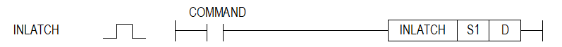

# INLATCH

Manual section(s): 4.24.21. Original Korean notes below may cover the other variants on the same page; apply the widths and execution form of `INLATCH`.

## Editing route

Use `insert_ladder_instruction` after calling `describe_operation` for its current schema.
The writer mnemonic is `INLATCH`; the catalog records opcode `1574` and `2` operands in order.
Inspect the CPU/project and target cells first. Use the inspected revision and positions, preserve expected values, dry-run when useful, then save and inspect the result. See the [editing skill](../../SKILL.md) and [ladder workflow](../ladder.md).

## Operands

| Order | Operand | Description (Korean manual) | Reviewed types | Device areas | Constant |
| --- | --- | --- | --- | --- | --- |
| 1 | S1 | 입력 모듈이 장착되어 있는 베이스&슬롯번호 | WORD | None | Allowed |
| 2 | D | 입력 래치 데이터를 저장할 디바이스 번호 | WORD | PMK, T, Z, U, N, D, R | Not allowed |

These are the current library's reviewed operand rules. A shared type union is not a per-variant type choice; use the manual behavior to select the required width. Missing permissions stay unknown.

## CPU and acceptance

Reviewed XGK model table: XGK-CPUUN, XGK-CPUHN, XGK-CPUSN (`42421inlatch.htm`).
Check the applicable model, firmware, modules and memory spans stated in the manual notes. Local parsing, writer validation and IL conversion do not prove native compilation or PLC behavior. Native acceptance requires XG5000 Open → Check Program → Save As → comparison.

## Manual behavior notes (Korean)

- INLATCH (Input Latch)
- 이 명령은 S1으로 지정한 위치에 있는 16점 디지털 입력 모듈의 래치 영역 값을 D로 지정한 위치로 읽어오는 명령어입니다.
- (신호가 입력 모듈에 입력되면 INLATCH 명령이 실행될 때까지 1로 래치됩니다.)
- 명령이 실행되면 입력 모듈의 래치 영역은 0으로 클리어 됩니다
- 지정한 모듈위치에 16점 디지털 입력 모듈이 없거나 다른 모듈이 장착되어 있을 경우에는 무처리 합니다
- 이 명령은 PLC 동작 중 PLC 스캔 타임보다 짧은 입력 신호를 검출할 때 사용합니다.
- 단, 입력 모듈에 설정된 입력 필터 값을 초과하는 신호만 감지할 수 있습니다.
- (스캔 동기 일괄 처리 방식은 스캔 프로그램 종료 후 입력 데이터 읽기 및 출력 데이터를 일괄 적으로 처리하므로 1 스캔 동안 외부에서 입력 된 데이터를 업데이트 할 수 없습니다.)
- INLATCH 명령은 프로그램 실행 중 해당 입력 모듈 래치 값을 업데이트 합니다.
- 이 명령어는 고성능 XGK(XGK-CPUUN, XGK-CPUHN, XGK-CPUSN)에서만 지원되며, XGI-D22A/B모듈(16점 디지털 입력 모듈) 전용입니다.

## Manual applicability and restrictions

- 적용 기종 : XGK

## Manual flag and step matrix

The shared usage table marks affected flags with `O`, and `-` where it lists no effect. Native steps are the manual's instruction size, not the number of operand arguments. Conditions for setting/clearing flags are in the behavior notes.

| Manual instruction group | Native steps | 에러 (F110) | 제로 (F111) | 캐리 (F112) |
| --- | --- | --- | --- | --- |
| INLATCH | 4~7 | - | - | - |

## Referenced manual figures

These figures belong to the shared source topic. Read the source corrections above before using variant-specific layouts or example values.

## Provenance

Source: `XGK(B)InstructionHelp_Kr_V3.5.chm`, SHA-256 `b866d589d800addcb039f9f09b182592464d6367faa55abf6dde9ac34a1580e0`.

- `42421inlatch.htm` — §4.24.21; source SHA-256 `16ecfa1dfeccf0807d07cab2dd67d02aa3725bd321bd8f94d4aface0d43feffe`.
- Additional behavior/operand evidence: `42421inlatch.htm`.
