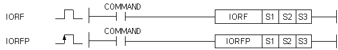

# IORFP

Manual section(s): 4.24.9. Original Korean notes below may cover the other variants on the same page; apply the widths and execution form of `IORFP`.

Execution form: the source explicitly pairs this command as `(P)`; `IORFP` is the pulse-type P form. Manual §2.4.2 defines `P` as pulse-type notation. Select the paired forms deliberately and retain the instruction's actual execution conditions; unrelated mnemonics ending in P are not classified by suffix alone.

## Editing route

Use `insert_ladder_instruction` after calling `describe_operation` for its current schema.
The writer mnemonic is `IORFP`; the catalog records opcode `632` and `3` operands in order.
Inspect the CPU/project and target cells first. Use the inspected revision and positions, preserve expected values, dry-run when useful, then save and inspect the result. See the [editing skill](../../SKILL.md) and [ladder workflow](../ladder.md).

## Operands

| Order | Operand | Description (Korean manual) | Reviewed types | Device areas | Constant |
| --- | --- | --- | --- | --- | --- |
| 1 | S1 | 즉시 처리하고자 하는 I/O 모듈의 위치 ( 베이스 + 슬롯 ) | WORD | None | Allowed |
| 2 | S2 | 마스크 시킬 데이터 상위32비트값 또는 디바이스 번호 | DWORD | PMK, F, L, T, C, Z, U, N, D, R | Allowed |
| 3 | S3 | 마스크 시킬 데이터 하위32비트값 또는 디바이스 번호 | DWORD | PMK, F, L, T, C, Z, U, N, D, R | Allowed |

These are the current library's reviewed operand rules. A shared type union is not a per-variant type choice; use the manual behavior to select the required width. Missing permissions stay unknown.

## CPU and acceptance

No separately reviewed CPU-model restriction is available in the current catalog; this means unknown, not universal compatibility.
Check the applicable model, firmware, modules and memory spans stated in the manual notes. Local parsing, writer validation and IL conversion do not prove native compilation or PLC behavior. Native acceptance requires XG5000 Open → Check Program → Save As → comparison.

## Manual flags

- IORF (I/O Refresh)
- S1으로 지정한 위치에 있는 I/O 모듈의 값을 S2와 S3로 입력한 마스크 값과 AND처리하여 즉시 데이터 처리를 수행합니다.
- S1으로 지정된 위치의 I/O 점수만큼 마스크 처리합니다. 즉, I/O 리프레시를 하고자하는 모듈이 16점일 경우에는 마스크 데이터를 하위 16비트만 입력하면 됩니다.
- PLC의 연산과정에서 최신의 입력 정보를 필요로 할 때나 연산결과를 바로 출력해야 할 때 IORF를 사용합니다.
- 지정한 모듈위치에 I/O모듈이 없거나 다른 모듈이 장착되어 있을 경우에는 무처리 합니다.

| 플래그 | 내 용 | 디바이스 번호 |
| --- | --- | --- |
| 에러 | N의 값이 지정 영역을 벗어날 때 셋(Set)됩니다. | F110 |

## Manual applicability and restrictions

- 적용 기종 : XGK, XGB

## Manual flag and step matrix

The shared usage table marks affected flags with `O`, and `-` where it lists no effect. Native steps are the manual's instruction size, not the number of operand arguments. Conditions for setting/clearing flags are in the behavior notes.

| Manual instruction group | Native steps | 에러 (F110) | 제로 (F111) | 캐리 (F112) |
| --- | --- | --- | --- | --- |
| IORF(P) | 4~6 | - | - | - |

## Additional source notes after examples

The manual places some execution restrictions and timing conditions after its example heading. Retain those checks below. Example addresses and circuit assumptions describe the source example and are not defaults for a new program.

- 입출력 혼합 모듈을 사용했을 경우, S2의 값이 출력 마스크 데이터가 되고, S3의 값이 입력 마스크 데이터가 됩니다.
- 입력16점 출력16점 혼합 모듈을 리프레시할 경우, S3의 16비트 데이터가 입력 부분 마스크 데이터가 되고, S2의 16비트 데이터가 출력 부분 마스크 데이터가 됩니다.

## Referenced manual figures

These figures belong to the shared source topic. Read the source corrections above before using variant-specific layouts or example values.

## Provenance

Source: `XGK(B)InstructionHelp_Kr_V3.5.chm`, SHA-256 `b866d589d800addcb039f9f09b182592464d6367faa55abf6dde9ac34a1580e0`.

- `4249iorfiorfp.htm` — §4.24.9; source SHA-256 `30c1bd2a57b3abdc837354fba4625286a2481cfcf4eb8b4722862d6a2d1c5ade`.
- Additional behavior/operand evidence: `4249iorfiorfp.htm`, `245.htm`.
