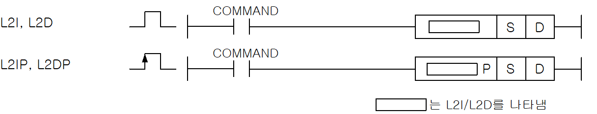
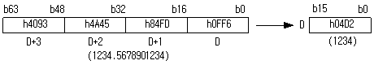
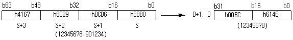

# L2IP

Manual section(s): 4.13.4. Original Korean notes below may cover the other variants on the same page; apply the widths and execution form of `L2IP`.

Execution form: the source explicitly pairs this command as `(P)`; `L2IP` is the pulse-type P form. Manual §2.4.2 defines `P` as pulse-type notation. Select the paired forms deliberately and retain the instruction's actual execution conditions; unrelated mnemonics ending in P are not classified by suffix alone.

## Editing route

Use `get_ir` → `apply_patch` for this instruction edit. `insert_ladder_instruction` is the internal writer route, not a separate MCP tool. Preserve the exported revision and native constraints.
The writer mnemonic is `L2IP`; the catalog records opcode `448` and `2` operands in order.
Inspect the CPU/project and target cells first. Use the inspected revision and positions, preserve expected values, dry-run when useful, then save and inspect the result. See the [editing skill](../../SKILL.md) and [ladder workflow](../ladder.md).

## Operands

| Order | Operand | Description (Korean manual) | Reviewed types | Device areas | Constant |
| --- | --- | --- | --- | --- | --- |
| 1 | S | 배장 실수형 데이터가 저장되어진 영역번호 또는 배장 실수형 데이터 | LREAL | PMK, F, L, T, C, U, N, D, R | Allowed |
| 2 | D | 정수형 데이터 형태로 변환된 데이터를 저장할 디바이스 번호 | INT/DINT | PMK, L, T, C, U, N, D, R | Not allowed |

These are the current library's reviewed operand rules. A shared type union is not a per-variant type choice; use the manual behavior to select the required width. Missing permissions stay unknown.

## CPU and acceptance

No separately reviewed CPU-model restriction is available in the current catalog; this means unknown, not universal compatibility.
Check the applicable model, firmware, modules and memory spans stated in the manual notes. Local parsing, writer validation and IL conversion do not prove native compilation or PLC behavior. Native acceptance requires XG5000 Open → Check Program → Save As → comparison.

## Manual flags

- L2I(Long to Integer)
- L2I(P)은 S+3,S+2,S+1,S로 지정된 배장형 실수를 정수형(16비트)으로 변환하여 D에 저장합니다.
- S+3,S+2,S+1,S로 지정된 배장형 실수의 값이 -32,768 ~ 32,767 범위를 벗어날 경우 연산에러가발생합니다.
- 결과값은 입력값이 32,767보다 클 경우는 32,767이 저장되고, 입력값이-32,768보다 작을 경우는 -32,768이 저장됩니다.
- 소수점 이하의 값은 반올림한 후에 버려집니다.
- L2D(Long Real to Double Integer)
- L2D(P)은 S+3,S+2,S+1,S로 지정된 배장형 실수를 배장 정수형(32비트)로 변환하여D+1,D에 저장합니다.
- S+3,S+2,S+1,S로 지정된 배장형 실수의 값이 -2,147,483,648 ~ 2,147,483,647 범위를 벗어날 경우 연산에러가 발생합니다.
- 결과값은 배장형 실수의 값이 2,147,483,647보다 클 경우는2,147,483,647이 저장되고, 배장형 실수의 값이 -2,147,483,648보다 작을 경우는 -2,147,483,648이 저장됩니다.

| 플래그 | 내 용 | 디바이스 번호 |
| --- | --- | --- |
| 에러 | L2I명령 사용시, S로 지정된 배장형 실수값이 -32,768~32,767 범위를 벗어날 때. L2D명령 사용시, S로 지정된 배장형 실수값이 -2,147,483,648~2,147,483,647 범위를 벗어날 때. | F110 |

## Manual applicability and restrictions

- 적용 기종 : XGK, XGB

## Manual flag and step matrix

The shared usage table marks affected flags with `O`, and `-` where it lists no effect. Native steps are the manual's instruction size, not the number of operand arguments. Conditions for setting/clearing flags are in the behavior notes.

| Manual instruction group | Native steps | 에러 (F110) | 제로 (F111) | 캐리 (F112) |
| --- | --- | --- | --- | --- |
| L2I(P) L2D(P) | 2~4 | O | - | - |

## Referenced manual figures

These figures belong to the shared source topic. Read the source corrections above before using variant-specific layouts or example values.

## Provenance

Source: `XGK(B)InstructionHelp_Kr_V3.5.chm`, SHA-256 `b866d589d800addcb039f9f09b182592464d6367faa55abf6dde9ac34a1580e0`.

- `4134l2il2ipl2dl2dp.htm` — §4.13.4; source SHA-256 `8670f232229e15d0aa30898550c3a08686efa8e6f1c7e96a69d6019426439e17`.
- Additional behavior/operand evidence: `4134l2il2ipl2dl2dp.htm`, `245.htm`.
