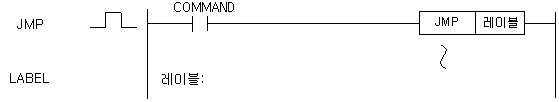
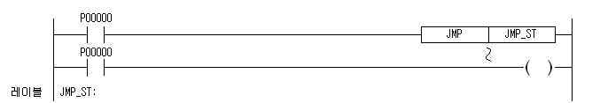

# LABEL

Mark a unique named JMP destination.

Manual section(s): 4.30.1. Original Korean notes below may cover the other variants on the same page; apply the widths and execution form of `LABEL`.

## Editing route

No matching public writer route is exposed for this exact instruction form. Use this file to interpret existing code; preserve its records when editing other parts of a project. Manual documentation alone does not enable insertion.

## Instruction constraints

- The label is a string up to 16 English characters or 8 Korean characters; duplicate labels are prohibited.

## Operands

| 오퍼랜드 | 설명 | 데이터 타입 |
| --- | --- | --- |
| 레이블 | 점프할 위치의 레이블 ( 영문 : 16자, 한글 : 8자 사용가능 ) | STRING |

This source table is not a separately reviewed writer rule. Retain shared variant distinctions and let the current writer reject unsupported operands.

## CPU and acceptance

No separately reviewed CPU-model restriction is available in the current catalog; this means unknown, not universal compatibility.
Check the applicable model, firmware, modules and memory spans stated in the manual notes. Local parsing, writer validation and IL conversion do not prove native compilation or PLC behavior. Native acceptance requires XG5000 Open → Check Program → Save As → comparison.

## Manual behavior notes (Korean)

- JMP
- JMP (레이블) 명령의 입력접점이 On되면 지정 레이블(LABEL) 이후로 Jump하며 JMP와 레이블 사이의 모든 명령은 처리되지 않습니다.
- 레이블은 중복되게 사용할 수 없습니다. JMP는 중복사용 가능합니다.
- 비상사태 발생시 처리해서는 안되는 프로그램을 JMP와 레이블 사이에 넣으면 좋습니다.

## Manual applicability and restrictions

- 적용 기종 : XGK, XGB

## Manual flag and step matrix

The shared usage table marks affected flags with `O`, and `-` where it lists no effect. Native steps are the manual's instruction size, not the number of operand arguments. Conditions for setting/clearing flags are in the behavior notes.

| Manual instruction group | Native steps | 에러 (F110) | 제로 (F111) | 캐리 (F112) |
| --- | --- | --- | --- | --- |
| JMP | 1 | - | - | - |
| LABEL | 5 | - | - | - |

## Referenced manual figures

These figures belong to the shared source topic. Read the source corrections above before using variant-specific layouts or example values.

## Provenance

Source: `XGK(B)InstructionHelp_Kr_V3.5.chm`, SHA-256 `b866d589d800addcb039f9f09b182592464d6367faa55abf6dde9ac34a1580e0`.

- `4301jmplabel1.htm` — §4.30.1; source SHA-256 `bcaeed98793a12626113732589125db5e7f05f3d0a5bc0e41f9b9d2019632552`.
