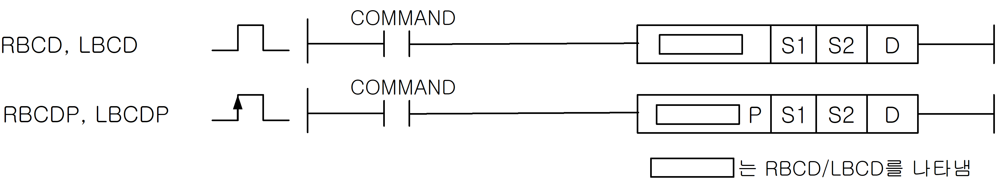
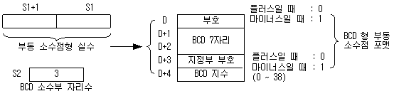
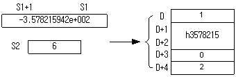

# LBCDP

Manual section(s): 4.26.18. Original Korean notes below may cover the other variants on the same page; apply the widths and execution form of `LBCDP`.

Execution form: the source explicitly pairs this command as `(P)`; `LBCDP` is the pulse-type P form. Manual §2.4.2 defines `P` as pulse-type notation. Select the paired forms deliberately and retain the instruction's actual execution conditions; unrelated mnemonics ending in P are not classified by suffix alone.

## Editing route

Use `insert_ladder_instruction` after calling `describe_operation` for its current schema.
The writer mnemonic is `LBCDP`; the catalog records opcode `730` and `3` operands in order.
Inspect the CPU/project and target cells first. Use the inspected revision and positions, preserve expected values, dry-run when useful, then save and inspect the result. See the [editing skill](../../SKILL.md) and [ladder workflow](../ladder.md).

## Operands

| Order | Operand | Description (Korean manual) | Reviewed types | Device areas | Constant |
| --- | --- | --- | --- | --- | --- |
| 1 | S1 | 부동 소수점 데이터 | REAL/LREAL | PMK, L, Z, U, N, D, R | Not allowed |
| 2 | S2 | 소수부 자리 수(0~7) | WORD | PMK, F, L, T, C, Z, U, N, D, R | Not allowed |
| 3 | D | BCD로 분해한 데이터 저장 위치 | WORD | PMK, L, Z, U, N, D, R | Not allowed |

These are the current library's reviewed operand rules. A shared type union is not a per-variant type choice; use the manual behavior to select the required width. Missing permissions stay unknown.

## CPU and acceptance

No separately reviewed CPU-model restriction is available in the current catalog; this means unknown, not universal compatibility.
Check the applicable model, firmware, modules and memory spans stated in the manual notes. Local parsing, writer validation and IL conversion do not prove native compilation or PLC behavior. Native acceptance requires XG5000 Open → Check Program → Save As → comparison.

## Manual flags

- RBCD (Real to BCD)
- S1으로 지정된 디바이스에 저장되어 있는 부동 소수점형 단장형 실수 데이터를 BCD형 부동소수점 포맷으로 분해하여, D로 지정된 디바이스 번호 이후에 저장합니다.
- BCD 포맷의 소수부 자리수는 0 ~ 7 범위이며 이 영역을 벗어나면 에러처리되며, D는 변화하지 않습니다.
- RBCD의 연산 범위는 -3.402823466e+038 ~ -1.175494351e-038 또는 0 또는 1.175494351e-038 ~ 3.402823466e+038 까지 입니다. 이 영역을 벗어난 경우 에러 처리됩니다.
- LBCD (Long Real to BCD)
- S1으로 지정된 디바이스에 저장되어 있는 부동 소수점형 배장형 실수 데이터를 BCD형 부동 소수점 포맷으로 분해하여, D로 지정된 디바이스 번호 이후에 저장합니다.
- BCD 포맷은 RBCD 와 동일합니다.
- LBCD 의 연산 범위는 -1.7976931348623157e+308 ~ -2.2250738585072014e-308 또는 0 또는 2.2250738585072014e-308 ~ 1.7976931348623157e+308 까지 입니다.
- 연산 범위를 넘은 값을 입력할 경우 에러를 출력합니다.

| 플래그 | 내 용 | 디바이스 번호 |
| --- | --- | --- |
| 에러 | 1.변환된 BCD데이터가 D로 지정된 영역을 초과할 경우. 2.소수부 자리수가 0~7 범위를 벗어날 때 3.S1 의 값이 연산 범위를 초과한 경우 | F110 |

## Manual applicability and restrictions

- 적용 기종 : XGK, XGB(XBC-U, XBM-H/H2/HP)

## Manual flag and step matrix

The shared usage table marks affected flags with `O`, and `-` where it lists no effect. Native steps are the manual's instruction size, not the number of operand arguments. Conditions for setting/clearing flags are in the behavior notes.

| Manual instruction group | Native steps | 에러 (F110) | 제로 (F111) | 캐리 (F112) |
| --- | --- | --- | --- | --- |
| RBCD(P) LBCD(P) | 4~6 | O | - | - |

## Referenced manual figures

These figures belong to the shared source topic. Read the source corrections above before using variant-specific layouts or example values.

## Provenance

Source: `XGK(B)InstructionHelp_Kr_V3.5.chm`, SHA-256 `b866d589d800addcb039f9f09b182592464d6367faa55abf6dde9ac34a1580e0`.

- `42618rbcdrbcdplbcdlbcdp.htm` — §4.26.18; source SHA-256 `110605a81c3e882d209a2aaf63bd71240e1eced386c94d4f708fbae5c0532497`.
- Additional behavior/operand evidence: `42618rbcdrbcdplbcdlbcdp.htm`, `245.htm`.
