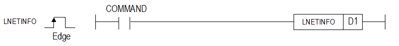

# LNETINFO

Manual section(s): 4.40.14. Original Korean notes below may cover the other variants on the same page; apply the widths and execution form of `LNETINFO`.

## Editing route

Use `insert_ladder_instruction` after calling `describe_operation` for its current schema.
The writer mnemonic is `LNETINFO`; the catalog records opcode `1640` and `1` operands in order.
Inspect the CPU/project and target cells first. Use the inspected revision and positions, preserve expected values, dry-run when useful, then save and inspect the result. See the [editing skill](../../SKILL.md) and [ladder workflow](../ladder.md).

## Operands

| Order | Operand | Description (Korean manual) | Reviewed types | Device areas | Constant |
| --- | --- | --- | --- | --- | --- |
| 1 | D1 | IP, Subnet, Gateway, MAC Address를 저장할 디바이스 번호 | WORD | PMK, L, Z, D, R | Not allowed |

These are the current library's reviewed operand rules. A shared type union is not a per-variant type choice; use the manual behavior to select the required width. Missing permissions stay unknown.

## CPU and acceptance

Reviewed XGK model table: XGK-CPUUN, XGK-CPUHN, XGK-CPUSN (`44014lnetinfo.htm`).
Check the applicable model, firmware, modules and memory spans stated in the manual notes. Local parsing, writer validation and IL conversion do not prove native compilation or PLC behavior. Native acceptance requires XG5000 Open → Check Program → Save As → comparison.

## Manual behavior notes (Korean)

- 로컬 IP 주소, 서브넷마스크, 게이트웨이, MAC설정 값을 읽을 수 있는 명령어입니다.
- 읽은 설정값은 아래와 같이 표현됩니다.
- EX. IP주소 : 192.168.0.100
- Subnet : 255.255.255.0
- Gateway : 192.168.0.1
- MAC 주소 : 00-16-EA-50-AB-CD
- D1 : 192 (0x00C0) // IP Address
- D1 + 1 : 168 (0x00A8)
- D1 + 2 : 0 (0x0000)
- D1 + 3 : 100 (0x00C8)
- D1 + 4 : 255 (0x00FF) // Subnet Address
- D1 + 5 : 255 (0x00FF)
- D1 + 6 : 255 (0x00FF)
- D1 + 7 : 0 (0x0000)
- D1 + 8 : 192 (0x00C0) // GateWay Address
- D1 + 9 : 168 (0x00A8)
- D1 + 10: 0 (0x0000)
- D1 + 11: 1 (0x0001)
- D1 + 12: 0x0000 // MAC Address
- D1 + 13: 0x0016
- D1 + 14: 0x00EA
- D1 + 15: 0x0050
- D1 + 16: 0x00AB
- D1 + 17: 0x00CD

## Manual applicability and restrictions

- 적용 기종 : XG5000 V4.51, XGK V1.50

| 지원 기종 | XGK | XGK | XGK | XGK | XGK | XGK-N | XGK-N | XGK-N | XBC-U | XBC-U | XBC-U | XBC-U | XBM | XBM |
| --- | --- | --- | --- | --- | --- | --- | --- | --- | --- | --- | --- | --- | --- | --- |
| 지원 기종 | U | H | A | S | E | UN | HN | SN | U | H | SU | E | S | H(P) |
| 지원 기종 | X | X | X | X | X | O | O | O | X | X | X | X | X | X |

## Manual flag and step matrix

The shared usage table marks affected flags with `O`, and `-` where it lists no effect. Native steps are the manual's instruction size, not the number of operand arguments. Conditions for setting/clearing flags are in the behavior notes.

| Manual instruction group | Native steps | 에러 (F110) | 제로 (F111) | 캐리 (F112) |
| --- | --- | --- | --- | --- |
| LNETINFO | 2 | - | - | - |

## Referenced manual figures

These figures belong to the shared source topic. Read the source corrections above before using variant-specific layouts or example values.

## Provenance

Source: `XGK(B)InstructionHelp_Kr_V3.5.chm`, SHA-256 `b866d589d800addcb039f9f09b182592464d6367faa55abf6dde9ac34a1580e0`.

- `44014lnetinfo.htm` — §4.40.14; source SHA-256 `a49a70d56ad1150bae75fe0df5c21df42da3932f320ee6dd99cd0dfa22632fca`.
- Additional behavior/operand evidence: `44014lnetinfo.htm`.
