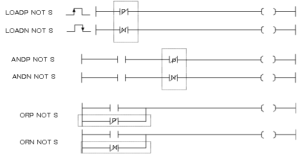
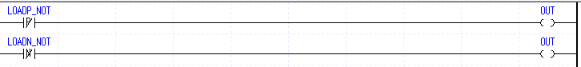
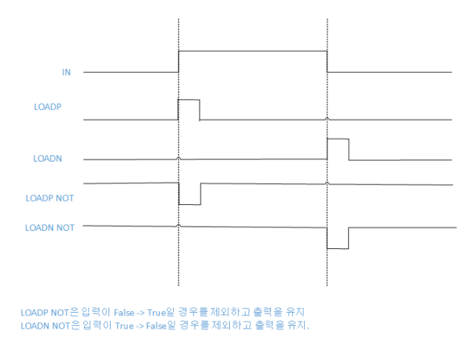
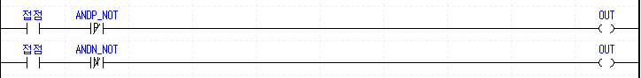
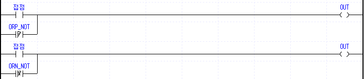

# LOADN NOT

Manual section(s): 4.1.4. Original Korean notes below may cover the other variants on the same page; apply the widths and execution form of `LOADN NOT`.

## Editing route

Use `edit_ladder_cell` after calling `describe_operation` for its current schema.
Set the replacement element kind to `AddressedFallingPulseNot`. `LOADN NOT` describes `rung_start` placement; it is represented by a physical cell rather than an application opcode.
Inspect the CPU/project and target cells first. Use the inspected revision and positions, preserve expected values, dry-run when useful, then save and inspect the result. See the [editing skill](../../SKILL.md) and [ladder workflow](../ladder.md).

## Operands

| 오퍼랜드 | 설명 | 데이터 타입 |
| --- | --- | --- |
| S | 비트 디바이스의 접점 / 워드 디바이스의 비트 접점 | BIT |

This source table is not a separately reviewed writer rule. Retain shared variant distinctions and let the current writer reject unsupported operands.

## CPU and acceptance

No separately reviewed CPU-model restriction is available in the current catalog; this means unknown, not universal compatibility.
Check the applicable model, firmware, modules and memory spans stated in the manual notes. Local parsing, writer validation and IL conversion do not prove native compilation or PLC behavior. Native acceptance requires XG5000 Open → Check Program → Save As → comparison.

## Manual behavior notes (Korean)

- LOADP NOT, LOADN NOT
- LOADP NOT은 B접점 양변환 검출 접점으로, 지정 접점이 Off에서 On으로 변할 때(상승펄스) 1스캔 Off가 되고 이 후 출력 On을 유지합니다.
- LOADN NOT은 B접점 음변환 검출 접점으로, 지정 접점이 On에서 Off으로 변할 때(하강펄스) 1스캔 Off가 되고 이 후 출력 On을 유지합니다.
- ANDP NOT, ANDN NOT
- ANDP NOT은 B접점 양변환 검출 접점 직렬 접속 명령이고, ANDN NOT은 B접점 음변환 검출 접점 직렬 명령입니다.
- ANDP NOT은 해당 접점값이 변할 때, 즉, 상승 펄스일때, ANDN NOT은 하강 펄스일때, 지정 접점 전 단계의 연산 결과와 지정 접점(S)을 AND 연산하여 그것을 연산결과로 합니다.
- ORP NOT, ORN NOT
- ORP NOT은 B접점 양변환 검출 접점 병렬 접속 명령이고, ORN NOT은 B접점 음변환 검출 접점 병렬 명령입니다.
- ORP NOT은 해당 접점값이 변할 때, 즉, 상승 펄스일때, ORN NOT은 하강 펄스일때, 지정 접점 전 단계의 연산 결과와 지정 접점(S)을 OR 연산하여 그것을 연산결과로 합니다.

## Manual applicability and restrictions

- 적용 기종 : XGK-N(V1.60)

## Manual flag and step matrix

The shared usage table marks affected flags with `O`, and `-` where it lists no effect. Native steps are the manual's instruction size, not the number of operand arguments. Conditions for setting/clearing flags are in the behavior notes.

| Manual instruction group | Native steps | 에러 (F110) | 제로 (F111) | 캐리 (F112) |
| --- | --- | --- | --- | --- |
| LOADP NOT LOADN NOT | 2 |  |  |  |
| ANDP NOT ANDN NOT | 2 |  |  |  |
| ORP NOT ORN NOT | 2 |  |  |  |

## Referenced manual figures

These figures belong to the shared source topic. Read the source corrections above before using variant-specific layouts or example values.

## Provenance

Source: `XGK(B)InstructionHelp_Kr_V3.5.chm`, SHA-256 `b866d589d800addcb039f9f09b182592464d6367faa55abf6dde9ac34a1580e0`.

- `414loadpnotloadnnotandpnotandnno.htm` — §4.1.4; source SHA-256 `2cd18e95ef0a2b9e630430b096fd32c2532bf4464a2a4bde611a7c372ea5a6a7`.
