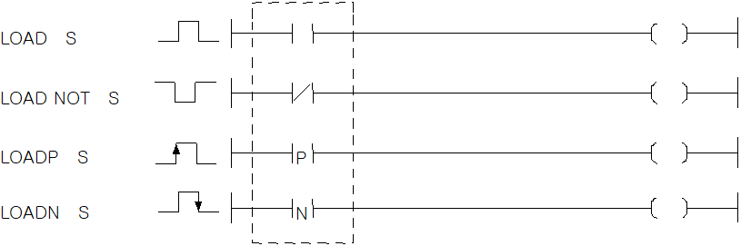

# LOADN

Begin circuit evaluation with a contact condition.

Manual section(s): 4.1.1. Original Korean notes below may cover the other variants on the same page; apply the widths and execution form of `LOADN`.

## Editing route

Use `edit_ladder_cell` after calling `describe_operation` for its current schema.
Set the replacement element kind to `AddressedFallingPulse`. `LOADN` describes `rung_start` placement; it is represented by a physical cell rather than an application opcode.
Inspect the CPU/project and target cells first. Use the inspected revision and positions, preserve expected values, dry-run when useful, then save and inspect the result. See the [editing skill](../../SKILL.md) and [ladder workflow](../ladder.md).

## Behavior

- Begin a new circuit whose result is On for one scan when S changes from On to Off.

## Instruction constraints

- S is a BIT contact, including a bit of a WORD device. D/R bit suffixes use hexadecimal 0..F.
- Index arithmetic adds to a bit-device address in bits, but to a WORD-device address in WORDs. Using indexed contact operands affects F110.

## Operands

| 오퍼랜드 | 설명 | 데이터 타입 |
| --- | --- | --- |
| S | 비트 디바이스의 접점 / 워드 디바이스의 비트 접점 | BIT |

This source table is not a separately reviewed writer rule. Retain shared variant distinctions and let the current writer reject unsupported operands.

## CPU and acceptance

No separately reviewed CPU-model restriction is available in the current catalog; this means unknown, not universal compatibility.
Check the applicable model, firmware, modules and memory spans stated in the manual notes. Local parsing, writer validation and IL conversion do not prove native compilation or PLC behavior. Native acceptance requires XG5000 Open → Check Program → Save As → comparison.

## Manual behavior notes (Korean)

- LOAD, LOAD NOT
- LOAD는 한 회로의 a접점 연산 시작을 의미하고, LOAD NOT은 b접점 연산 시작을 의미 합니다.
- 지정 접점(S)의 On/Off정보를 연산 결과로 합니다. 이때 S영역의 비트 지정의 경우 해당 비트의 값(0 또는 1)을 연산 결과로 합니다.
- LOADP, LOADN
- LOADP는 상승 펄스시 연산 시작 명령으로, 지정 접점이 Off에서 On으로 변할 때(상승펄스), S영역의 비트 지정의 경우는 해당 비트의 값이 0에서 1로 변할 때만 연산 결과가 On입니다.
- LOADN은 하강 펄스시 연산 시작 명령으로, 지정 접점이 On에서 Off로 변할 때(하강펄스), S영역의 비트 지정의 경우는 해당 비트의 값이 1에서 0으로 변할 때만 연산 결과가 On입니다.

## Manual applicability and restrictions

- 적용 기종 : XGK, XGB

## Manual flag and step matrix

The shared usage table marks affected flags with `O`, and `-` where it lists no effect. Native steps are the manual's instruction size, not the number of operand arguments. Conditions for setting/clearing flags are in the behavior notes.

| Manual instruction group | Native steps | 에러 (F110) | 제로 (F111) | 캐리 (F112) |
| --- | --- | --- | --- | --- |
| LOAD LOAD NOT | 1~2 | - | - | - |
| LOADP LOADN | 2 | - | - | - |

## Additional source notes after examples

The manual places some execution restrictions and timing conditions after its example heading. Retain those checks below. Example addresses and circuit assumptions describe the source example and are not defaults for a new program.

- D영역의 비트 지정은 16진수로 표기합니다. 즉, Dxxxxx.0 ~ Dxxxxx.F까지 가능합니다.
- EX. D00010.A라는 의미는 D10에 해당하는 워드의 열번째 비트를 의미합니다.
- LOAD/AND/OR 명령은 오퍼랜드에 대한 인덱스 수식이 가능합니다.
- LOAD P1[Z2]은 LOAD P(1+[Z2]의 값)을 나타내고, LOAD D10[Z1].5은 LOAD D(10+[Z1]의 값).5를 나타냅니다.
- 차이점은 P디바이스는 비트디바이스이기 때문에 인덱스 수식이 비트값에 더해졌고, D디바이스는 워드 디바이스이기 때문에 인덱스 수식이 워드값에 더해집니다.
- LOAD/LOAD NOT 명령어는 인덱스 수식을 사용하게 되면 스텝수가 1증가되어 2스텝이 됩니다.
- 접점 명령에 인덱스 수식을 사용하면 에러 플래그(F110)에 영향을 주게 됩니다.

## Referenced manual figures

These figures belong to the shared source topic. Read the source corrections above before using variant-specific layouts or example values.

## Provenance

Source: `XGK(B)InstructionHelp_Kr_V3.5.chm`, SHA-256 `b866d589d800addcb039f9f09b182592464d6367faa55abf6dde9ac34a1580e0`.

- `411loadloadnotloadploadn.htm` — §4.1.1; source SHA-256 `37cabdfb950d346048071dae632ebd838f7f1059bcc615e54274c2159cd69109`.
