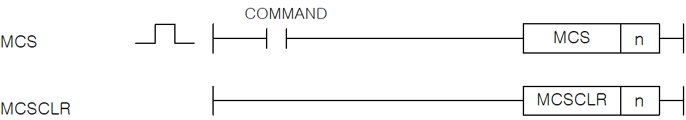

# MCS

Enable or disable a master-control region.

Manual section(s): 4.4.1. Original Korean notes below may cover the other variants on the same page; apply the widths and execution form of `MCS`.

## Editing route

No matching public writer route is exposed for this exact instruction form. Use this file to interpret existing code; preserve its records when editing other parts of a project. Manual documentation alone does not enable insertion.

No matching public instruction insertion or basic element route is exposed; preserve existing control-flow/terminal records.

## Behavior

- Input On enables instructions up to the matching MCSCLR.
- With input Off: timers and OUT behave as though their input were Off; counters retain their current value; SET and RST retain their results.

## Instruction constraints

- n is the nesting priority: XGK 0..15, XGB 0..7. Begin controls from higher priority (lower number), and release in reverse order.

## Operands

| 오퍼랜드 | 설명 | 데이터 타입 |
| --- | --- | --- |
| n | 정수. n(Nesting) 설정은 XGK는 0~15, XGB는 0~7까지 사용가능. | WORD(0~15) |

This source table is not a separately reviewed writer rule. Retain shared variant distinctions and let the current writer reject unsupported operands.

## CPU and acceptance

No separately reviewed CPU-model restriction is available in the current catalog; this means unknown, not universal compatibility.
Check the applicable model, firmware, modules and memory spans stated in the manual notes. Local parsing, writer validation and IL conversion do not prove native compilation or PLC behavior. Native acceptance requires XG5000 Open → Check Program → Save As → comparison.

## Manual behavior notes (Korean)

- MCS의 입력조건이 On이면 MCS번호와 동일한 MCSCLR까지를 실행하고 입력조건이 Off가 되면 실행하지 않습니다.
- 우선 순위는 MCS번호 0이 가장 높고 15(XGK)/7(XGB)가 가장 낮으므로 우선 순위가 높은 순으로 사용하고 해제는 그 역순으로 합니다.
- MCSCLR시 우선 순위가 높은 것을 해제하면 낮은 순위의 MCS 블록도 함께 해제됩니다.
- MCS 혹은 MCSCLR는 우선 순위에 따라 순차적으로 사용하여야 합니다.

## Manual applicability and restrictions

- 적용 기종 : XGK, XGB

## Manual flag and step matrix

The shared usage table marks affected flags with `O`, and `-` where it lists no effect. Native steps are the manual's instruction size, not the number of operand arguments. Conditions for setting/clearing flags are in the behavior notes.

| Manual instruction group | Native steps | 에러 (F110) | 제로 (F111) | 캐리 (F112) |
| --- | --- | --- | --- | --- |
| MCS MCSCLR | 1 | - | - | - |

## Additional source notes after examples

The manual places some execution restrictions and timing conditions after its example heading. Retain those checks below. Example addresses and circuit assumptions describe the source example and are not defaults for a new program.

- MCS의 On/Off 명령이 Off인 경우 MCS ~ MCSCLR의 연산결과는 다음과 같으므로 MCS(MCSCLR) 명령 사용 시 주의하여 주십시오.
- 타이머 명령 : 처리하지 않음. 접점 Off와 같은 처리.
- 카운터 명령 : 처리하지 않음. (현재값은 유지)
- OUT 명령 : 처리하지 않음. 접점 Off와 같은 처리.
- 셋(SET), RST 명령 : 결과유지.

## Referenced manual figures

These figures belong to the shared source topic. Read the source corrections above before using variant-specific layouts or example values.

## Provenance

Source: `XGK(B)InstructionHelp_Kr_V3.5.chm`, SHA-256 `b866d589d800addcb039f9f09b182592464d6367faa55abf6dde9ac34a1580e0`.

- `441mcsmcsclr.htm` — §4.4.1; source SHA-256 `9c112b9196dba369a56e1564839eac2906864df7a0ad2ded6245eb9d5aca4457`.
