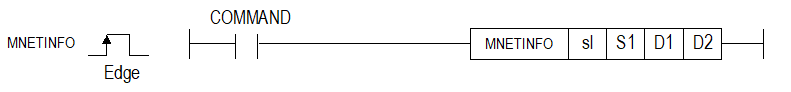

# MNETINFO

Manual section(s): 4.40.12. Original Korean notes below may cover the other variants on the same page; apply the widths and execution form of `MNETINFO`.

## Editing route

Use `get_ir` → `apply_patch` for this instruction edit. `insert_ladder_instruction` is the internal writer route, not a separate MCP tool. Preserve the exported revision and native constraints.
The writer mnemonic is `MNETINFO`; the catalog records opcode `1638` and `4` operands in order.
Inspect the CPU/project and target cells first. Use the inspected revision and positions, preserve expected values, dry-run when useful, then save and inspect the result. See the [editing skill](../../SKILL.md) and [ladder workflow](../ladder.md).

## Operands

| Order | Operand | Description (Korean manual) | Reviewed types | Device areas | Constant |
| --- | --- | --- | --- | --- | --- |
| 1 | sl | FENET모듈이 장착된 베이스 및 슬롯번호 | WORD | Unknown | Unknown |
| 2 | S1 | 진단 정보의 버전 (버전 정보 : 1 입력) | WORD | PMK, L, Z, D, R | Allowed |
| 3 | D1 | IP, Subnet, Gateway, MAC Address를 저장할 디바이스 번호 | WORD | PMK, L, Z, D, R | Not allowed |
| 4 | D2 | 명령어 내부에서 사용될 임시 디바이스 번호 | WORD | PMK, L, Z, D, R | Not allowed |

These are the current library's reviewed operand rules. A shared type union is not a per-variant type choice; use the manual behavior to select the required width. Missing permissions stay unknown.

## CPU and acceptance

Reviewed XGK model table: XGK-CPUUN, XGK-CPUHN, XGK-CPUSN (`44012mnetinfo.htm`).
Check the applicable model, firmware, modules and memory spans stated in the manual notes. Local parsing, writer validation and IL conversion do not prove native compilation or PLC behavior. Native acceptance requires XG5000 Open → Check Program → Save As → comparison.

## Manual behavior notes (Korean)

- FENET모듈의 IP 주소, 서브넷마스크, 게이트웨이, MAC설정 값을 읽을 수 있는 명령어입니다.
- sl은 현재 FENET모듈이 장착된 베이스와 슬롯 번호를 입력합니다
- S1은 읽고자 하는 정보의 버전을 입력합니다.
- 진단 정보의 버전의 경우 추후 버전이 추가될 예정이나, 현재는 버전 1만 입력하여 사용 가능합니다.
- 읽은 설정값은 아래와 같이 표현됩니다.
- EX. IP주소: 192.168.0.100
- Subnet : 255.255.255.0
- Gateway: 192.168.0.1
- MAC 주소: 00-16-EA-50-AB-CD
- D1 : 192 (0x00C0) // IP Address
- D1 + 1 : 168 (0x00A8)
- D1 + 2 : 0 (0x0000)
- D1 + 3 : 100 (0x00C8)
- D1 + 4 : 255 (0x00FF) // Subnet Address
- D1 + 5 : 255 (0x00FF)
- D1 + 6 : 255 (0x00FF)
- D1 + 7 : 0 (0x0000)
- D1 + 8 : 192 (0x00C0) // GateWay Address
- D1 + 9 : 168 (0x00A8)
- D1 + 10: 0 (0x0000)
- D1 + 11: 1 (0x0001)
- D1 + 12: 0x0000 // MAC Address
- D1 + 13: 0x0016
- D1 + 14: 0x00EA
- D1 + 15: 0x0050
- D1 + 16: 0x00AB
- D1 + 17: 0x00CD
- D2는 명령어 정보를 저장하는 임시 영역으로, 저장되는 값은 아래와 같습니다. 초기값은 모두 0 이며,사용자가 의로 데이터 값을 조작할 경우 명령어가 오동작 할 수 있습니다.
- 상태 정보

| CPU영역 | 데이터 크기 | 상태종류 |
| --- | --- | --- |
| D2 | WORD | 에러 코드 |
| D2+1 | WORD | 내부 상태(WAIT or DONE) |
| D2+2 | WORD | RETRY COUNT |

| 상태코드 | 상태 정보 | 의미 |
| --- | --- | --- |
| 00 | 초기 상태 | 명령어 수행 전 |
| 01 | 완료 | 명령어가 정상적으로 수행된 경우 |
| 02 | 모듈설정 에러 | sl값이 FENET 모듈이 장착되지 않은 베이스 또는 슬롯으로 설정된 경우 |
| 03 | 버전 호환 오류 | FEnet버전이 V8.1미만으로 해당 명령어를 지원하지 않는 경우 (CPU 버전이 V1.4 미만 인 경우는 프로그램 다운로드가 되지 않습니다.) |
| 04 | 사용자 설정 값 오류 | 버전 정보가 0일 경우 |
| 05 | 타임아웃 에러 | FENET모듈 이상으로 명령어에 대한 응답이 없는 경우 |
| 06 | 이전 명령 수행 중 | 같은 슬롯에 대해서 이전 명령의 수행이 완료되기 전에 기동 조건을 만났을 때 |
| 08 | IO 스킵 설정 오류 | 사용자가 해당모듈에 스킵을 걸어둔 상태 |
| 09 | 모듈 탈락 오류 | 해당 모듈이 수행 중 탈락되는 상태 |

## Manual flags

| 플래그 | 내 용 | 디바이스 번호 |
| --- | --- | --- |
| 에러 | sl 값이 FENET 모듈이 장착된 베이스 및 슬롯번호와 일치하지 않을 경우 | F110 |

## Manual applicability and restrictions

- 적용 기종 : XG5000 V4.51, XGK V1.50

| 지원 기종 | XGK | XGK | XGK | XGK | XGK | XGK-N | XGK-N | XGK-N | XBC-U | XBC-U | XBC-U | XBC-U | XBM | XBM |
| --- | --- | --- | --- | --- | --- | --- | --- | --- | --- | --- | --- | --- | --- | --- |
| 지원 기종 | U | H | A | S | E | UN | HN | SN | U | H | SU | E | S | H(P) |
| 지원 기종 | X | X | X | X | X | O | O | O | X | X | X | X | X | X |

## Manual flag and step matrix

The shared usage table marks affected flags with `O`, and `-` where it lists no effect. Native steps are the manual's instruction size, not the number of operand arguments. Conditions for setting/clearing flags are in the behavior notes.

| Manual instruction group | Native steps | 에러 (F110) | 제로 (F111) | 캐리 (F112) |
| --- | --- | --- | --- | --- |
| MNETINFO | 4~7 | O | - | - |

## Referenced manual figures

These figures belong to the shared source topic. Read the source corrections above before using variant-specific layouts or example values.

## Provenance

Source: `XGK(B)InstructionHelp_Kr_V3.5.chm`, SHA-256 `b866d589d800addcb039f9f09b182592464d6367faa55abf6dde9ac34a1580e0`.

- `44012mnetinfo.htm` — §4.40.12; source SHA-256 `a900aa54c0c9cc4e8424c77260944dc7f8168e9f7ec6f0deadfe138c09b7f22e`.
- Additional behavior/operand evidence: `44012mnetinfo.htm`.
