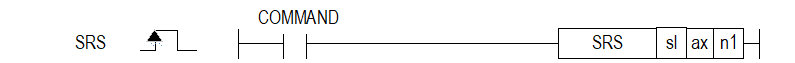

# MOF

Manual section(s): 4.41.22. Original Korean notes below may cover the other variants on the same page; apply the widths and execution form of `MOF`.

## Editing route

Use `insert_ladder_instruction` after calling `describe_operation` for its current schema.
The writer mnemonic is `MOF`; the catalog records opcode `990` and `2` operands in order.
Inspect the CPU/project and target cells first. Use the inspected revision and positions, preserve expected values, dry-run when useful, then save and inspect the result. See the [editing skill](../../SKILL.md) and [ladder workflow](../ladder.md).

## Operands

| Order | Operand | Description (Korean manual) | Reviewed types | Device areas | Constant |
| --- | --- | --- | --- | --- | --- |
| 1 | sl | 위치 모듈이 장착된 베이스(x)와 슬롯(y) 번호:h00xy | WORD | Unknown | Unknown |
| 2 | ax | 지령을 내릴 축 (0:X 축, 1:Y 축, 2:Z 축) | WORD | PMK, L, Z, N, D, R | Allowed |

These are the current library's reviewed operand rules. A shared type union is not a per-variant type choice; use the manual behavior to select the required width. Missing permissions stay unknown.

## CPU and acceptance

No separately reviewed CPU-model restriction is available in the current catalog; this means unknown, not universal compatibility.
Check the applicable model, firmware, modules and memory spans stated in the manual notes. Local parsing, writer validation and IL conversion do not prove native compilation or PLC behavior. Native acceptance requires XG5000 Open → Check Program → Save As → comparison.

## Manual behavior notes (Korean)

- ※ 오퍼랜드 설정 범위는 XGF-PxxA를 기준으로 합니다. 축에 대한 오퍼랜드(ax)의 설정 범위는 제품에서 지원하는 제어 축 수에 따라 다르니, 제품 사용설명서를 참조하여 주십시오.
- 반복 스텝을 스텝 번호(n1)에 설정한 스텝값으로 변경 합니다.
- 운전 데이터의 운전방식(단독,반복)이 반복으로 설정된 스텝을 운전한 후 다음 스텝으로 지정될 스텝을 설정합니다.
- 반복 운전 스텝 번호 변경을 실행하지 않은 상태에서 종료, 계속, 연속 운전의 반복 운전 모드로 설정하면 위치결정 운전을 완료한 후에 1번 스텝을 운전하도록 현재 운전 스텝 번호가 변경 됩니다.
- 만약 반복 운전 스텝 번호 변경 명령을 실행 한다면 1번 스텝이 아닌 지정된 스텝으로 변경 됩니다.
- 해당 지령은 운전 중에도 실행할 수 있습니다.

## Manual flags

| 플래그 | 내 용 | 디바이스 번호 |
| --- | --- | --- |
| 에러 | ax 값이 범위를 벗어날 경우 | F110 |

## Manual applicability and restrictions

- 적용 기종 : XGK, XBF
- ax의 설정값이 제품에서 지원하는 설정 범위와 다른 값을 입력하면 에러가 발생(F110이 Set)됩니다.

## Manual flag and step matrix

The shared usage table marks affected flags with `O`, and `-` where it lists no effect. Native steps are the manual's instruction size, not the number of operand arguments. Conditions for setting/clearing flags are in the behavior notes.

| Manual instruction group | Native steps | 에러 (F110) | 제로 (F111) | 캐리 (F112) |
| --- | --- | --- | --- | --- |
| MOF | 4~7 | O | - | - |

## Additional source notes after examples

The manual places some execution restrictions and timing conditions after its example heading. Retain those checks below. Example addresses and circuit assumptions describe the source example and are not defaults for a new program.

- 계속 운전 모드에서는 M 코드 번호와 M 코드 ON 신호가 발생하면 다음 스텝에 대한 운전 대기 상태가 되고, M 코드 On 신호가 Off 되기 전까지 기다립니다.
- M 코드 해제 명령을 실행하면 자동적으로 다음 스텝에 대한 계속 운전을 실행합니다.

## Referenced manual figures

These figures belong to the shared source topic. Read the source corrections above before using variant-specific layouts or example values.

## Provenance

Source: `XGK(B)InstructionHelp_Kr_V3.5.chm`, SHA-256 `b866d589d800addcb039f9f09b182592464d6367faa55abf6dde9ac34a1580e0`.

- `44122mof.htm` — §4.41.22; source SHA-256 `e78bb72787051b7529549d1507943d213a226108c97be352fcf0bb0079bae5dd`.
- Additional behavior/operand evidence: `44122mof.htm`.
