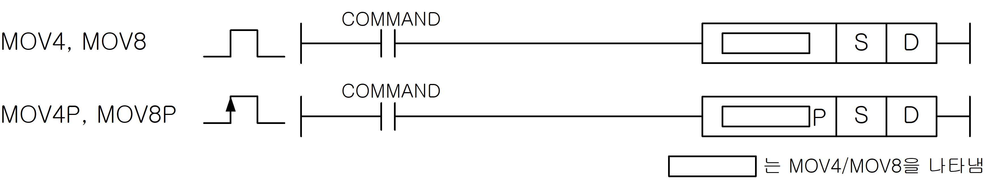
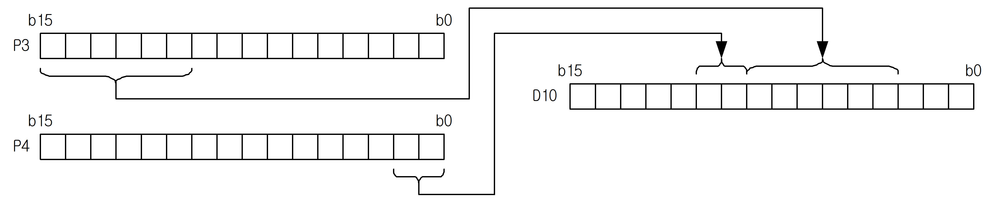
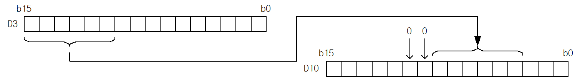

# MOV8P

Copy 8 bits starting at the specified bit positions.

Manual section(s): 4.11.2. Original Korean notes below may cover the other variants on the same page; apply the widths and execution form of `MOV8P`.

Execution form: the source explicitly pairs this command as `(P)`; `MOV8P` is the pulse-type P form. Manual §2.4.2 defines `P` as pulse-type notation. Select the paired forms deliberately and retain the instruction's actual execution conditions; unrelated mnemonics ending in P are not classified by suffix alone.

## Editing route

Use `insert_ladder_instruction` after calling `describe_operation` for its current schema.
The writer mnemonic is `MOV8P`; the catalog records opcode `845` and `2` operands in order.
Inspect the CPU/project and target cells first. Use the inspected revision and positions, preserve expected values, dry-run when useful, then save and inspect the result. See the [editing skill](../../SKILL.md) and [ladder workflow](../ladder.md).

## Behavior

- Copy 8 bits from S to D; higher bits of an integer source are ignored.
- P/M/L/K bit-device transfers may continue into the next word. D/R/U word-bit sources zero-fill beyond the selected word, and word-bit destinations discard bits beyond that word.
- This P-suffix variant executes once when the enabling input changes from Off to On.

## Instruction constraints

- Check both the selected bit position and whether each operand is a bit device or a word device.

## Operands

| Order | Operand | Description (Korean manual) | Reviewed types | Device areas | Constant |
| --- | --- | --- | --- | --- | --- |
| 1 | S | 전송하고자 하는 데이터 또는 데이터가 들어있는 디바이스 번호의 비트 위치 | BYTE | PMK, L, D.x, R.x, U | Allowed |
| 2 | D | 전송된 데이터를 저장할 디바이스 번호의 비트 위치 | BYTE | PMK, L, D.x, R.x, U | Not allowed |

These are the current library's reviewed operand rules. A shared type union is not a per-variant type choice; use the manual behavior to select the required width. Missing permissions stay unknown.

## CPU and acceptance

No separately reviewed CPU-model restriction is available in the current catalog; this means unknown, not universal compatibility.
Check the applicable model, firmware, modules and memory spans stated in the manual notes. Local parsing, writer validation and IL conversion do not prove native compilation or PLC behavior. Native acceptance requires XG5000 Open → Check Program → Save As → comparison.

## Manual behavior notes (Korean)

- MOV4(Move Nibble), MOV8(Move Byte)
- 4비트 또는 8비트데이터 S를 D로 전송합니다.
- MOV4(P)은 지정한 S비트부터 상위 4비트데이터를 D로부터 상위4비트에 해당하는 영역으로 전송합니다.
- MOV8(P)은 지정한 S비트부터 상위 8비트데이터를 D로부터 상위8비트에 해당하는 영역으로 전송합니다.
- 정수를 전송하고자 할 경우, 해당명령의 데이터 크기만큼만 전송되고 나머지는 무시됩니다.
- 비트 디바이스(P, M, L, K)와 워드 디바이스(D, R, U)에 따라 데이터 처리를 다르게 합니다.
- 비트 디바이스의 경우, Source로 지정된 S가 명령 수행시에 워드 범위를 벗어날 경우, 다음 워드에서 나머지 비트를 가져옵니다.
- Destination으로 지정된 D역시 저장할 부분이 워드를 넘어가면 다음 워드에 나머지 비트가 저장됩니다.
- 만약, 비트 디바이스의 마지막 워드를 지정했고, 다음 워드까지 포함해서 명령을 수행해야 될 경우, 아래에 설명한 워드 디바이스와 같이 처리합니다.
- 워드 디바이스의 경우, Source로 지정된 S가 명령 수행시에 워드 범위를 벗어날 경우, 벗어난 부분은 0으로 채웁니다.
- Destination으로 지정된 D가 워드를 넘어가게 되면 넘어간 데이터에 대해서는 처리하지 않습니다.
- MOV8 P0003A D10.3
- Source로 지정된 디바이스가 비트 디바이스일 경우, 전송할 데이터가 지정한 워드범위를 벗어날 경우 다음 영역의 비트 값까지 전송합니다.
- Source로 지정된 디바이스가 워드 디바이스일 경우, 전송할 데이터가 지정한 워드 범위를 벗어날 경우 그 벗어난 부분은 무시하고 Destination에 0으로 채워집니다.

## Manual applicability and restrictions

- 적용 기종 : XGK, XGB

## Manual flag and step matrix

The shared usage table marks affected flags with `O`, and `-` where it lists no effect. Native steps are the manual's instruction size, not the number of operand arguments. Conditions for setting/clearing flags are in the behavior notes.

| Manual instruction group | Native steps | 에러 (F110) | 제로 (F111) | 캐리 (F112) |
| --- | --- | --- | --- | --- |
| MOV4(P) MOV8(P) | 3~5 | - | - | - |

## Additional source notes after examples

The manual places some execution restrictions and timing conditions after its example heading. Retain those checks below. Example addresses and circuit assumptions describe the source example and are not defaults for a new program.

- Dxxxxx.x, Rxxxxx.x, Uxxx.xx.x 영역은 MOV4, MOV8 명령 결과값이 영역 초과하는 경우에 D+1 영역에 전송이 안되고 무시합니다.

## Referenced manual figures

These figures belong to the shared source topic. Read the source corrections above before using variant-specific layouts or example values.

## Provenance

Source: `XGK(B)InstructionHelp_Kr_V3.5.chm`, SHA-256 `b866d589d800addcb039f9f09b182592464d6367faa55abf6dde9ac34a1580e0`.

- `4112mov4mov4pmov8mov8p1.htm` — §4.11.2; source SHA-256 `bea17f439e687624bfe0245ce468df010ce159cdace0284a78dcc122a67a529e`.
- Additional behavior/operand evidence: `33.htm`, `4112mov4mov4pmov8mov8p1.htm`, `245.htm`.
