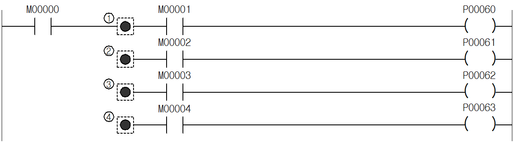

# MPUSH

Manual section(s): 4.2.3. Original Korean notes below may cover the other variants on the same page; apply the widths and execution form of `MPUSH`.

## Editing route

No matching public writer route is exposed for this exact instruction form. Use this file to interpret existing code; preserve its records when editing other parts of a project. Manual documentation alone does not enable insertion.

No matching public instruction insertion or basic element route is exposed; preserve existing control-flow/terminal records.

## Operands

No unambiguous operand table is available for this exact form; do not infer types or writable regions.

## CPU and acceptance

No separately reviewed CPU-model restriction is available in the current catalog; this means unknown, not universal compatibility.
Check the applicable model, firmware, modules and memory spans stated in the manual notes. Local parsing, writer validation and IL conversion do not prove native compilation or PLC behavior. Native acceptance requires XG5000 Open → Check Program → Save As → comparison.

## Manual behavior notes (Korean)

- Ladder의 다중 분기를 가능하게 하는 명령입니다.
- MPUSH, MPOP는 XGK는16단, XGB는 8단까지 가능합니다.
- MPUSH : 현재까지 연산결과를 저장하는 기능을 합니다.
- MLOAD : 다음연산을 위해 이전의 연산결과를 읽어 오기만 하고 저장영역의 값은 변하지 않습니다.
- MPOP : 분기점에서 저장된 이전 연산결과를 읽어온 후 저장된 이전 결과를 지웁니다.
- (1) MPUSH : M00000의 상태가 PLC의 내부 메모리에 저장됩니다. 최초의 분기로 사용합니다.
- (2) MLOAD : 저장된 M00000의 상태를 읽어 다음 연산을 합니다. 분기의 중계점으로 사용합니다.
- (3) MLOAD : 저장된 M00000의 상태를 읽어 다음 연산을 합니다.
- (4) MPOP : 저장된 M00000의 상태를 PLC의 내부 메모리에서 읽어온 다음 연산하고 리셋(Reset)합니다. 분기의 종료로 사용합니다.

## Manual applicability and restrictions

- 적용 기종 : XGK, XGB

## Manual flag and step matrix

The shared usage table marks affected flags with `O`, and `-` where it lists no effect. Native steps are the manual's instruction size, not the number of operand arguments. Conditions for setting/clearing flags are in the behavior notes.

| Manual instruction group | Native steps | 에러 (F110) | 제로 (F111) | 캐리 (F112) |
| --- | --- | --- | --- | --- |
| MPUSH MLOAD MPOP | 1 | - | - | - |

## Referenced manual figures

These figures belong to the shared source topic. Read the source corrections above before using variant-specific layouts or example values.

## Provenance

Source: `XGK(B)InstructionHelp_Kr_V3.5.chm`, SHA-256 `b866d589d800addcb039f9f09b182592464d6367faa55abf6dde9ac34a1580e0`.

- `423mpushmloadmpop1.htm` — §4.2.3; source SHA-256 `1e7de8f63c8441591a697804cc863eef5eb3135cc8849623d1f6f5664e8642ac`.
