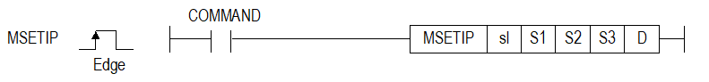
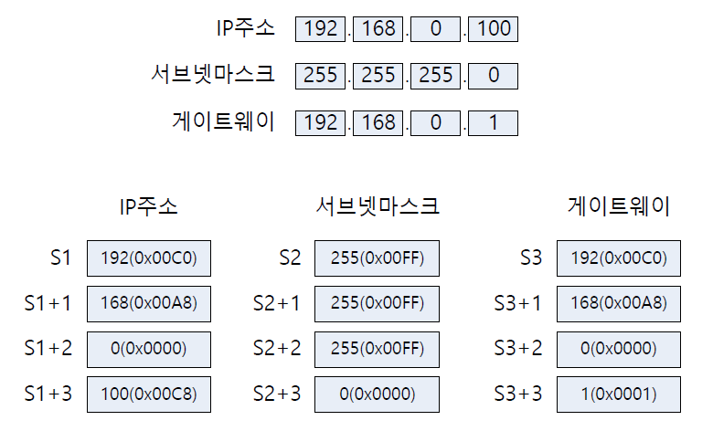

# MSETIP

Set a FEnet module IP, mask and gateway together.

Manual section(s): 4.40.13. Original Korean notes below may cover the other variants on the same page; apply the widths and execution form of `MSETIP`.

## Editing route

Use `get_ir` → `apply_patch` for this instruction edit. `insert_ladder_instruction` is the internal writer route, not a separate MCP tool. Preserve the exported revision and native constraints.
The writer mnemonic is `MSETIP`; the catalog records opcode `1636` and `5` operands in order.
Inspect the CPU/project and target cells first. Use the inspected revision and positions, preserve expected values, dry-run when useful, then save and inspect the result. See the [editing skill](../../SKILL.md) and [ladder workflow](../ladder.md).

## Behavior

- sl selects the module; S1/S2/S3 each point to four WORDs containing one IPv4 octet per WORD. Preserve mask/gateway with MNETINFO when changing only IP.
- D..D+2 holds status, internal WAIT/DONE state, and retry count; do not overwrite it.

## Instruction constraints

- DHCP prevents this IP change. The status table requires FEnet V8.1; confirm the CPU/tool versions listed in the source.

## Source corrections

- The example says decimal 100 equals 0x00C8; correct conversion is 0x0064. The ST example incorrectly calls MNETINFO_EN; do not copy it as MSETIP syntax.

## Operands

| Order | Operand | Description (Korean manual) | Reviewed types | Device areas | Constant |
| --- | --- | --- | --- | --- | --- |
| 1 | Sl | FENET모듈이 장착된 베이스 및 슬롯번호 | WORD | Unknown | Unknown |
| 2 | S1 | 설정할 IP 주소가 저장된 디바이스 번호 | WORD | PMK, L, Z, D, R | Not allowed |
| 3 | S2 | 설정할 서브넷 마스크가 저장된 디바이스 번호 | WORD | PMK, L, Z, D, R | Not allowed |
| 4 | S3 | 설정할 게이트웨이가 저장된 디바이스 번호 | WORD | PMK, L, Z, D, R | Not allowed |
| 5 | D | 명령어 내부에서 사용될 임시 디바이스 번호 | WORD | PMK, L, Z, D, R | Not allowed |

These are the current library's reviewed operand rules. A shared type union is not a per-variant type choice; use the manual behavior to select the required width. Missing permissions stay unknown.

## CPU and acceptance

Reviewed XGK model table: XGK-CPUUN, XGK-CPUHN, XGK-CPUSN (`44013msetip.htm`).
Check the applicable model, firmware, modules and memory spans stated in the manual notes. Local parsing, writer validation and IL conversion do not prove native compilation or PLC behavior. Native acceptance requires XG5000 Open → Check Program → Save As → comparison.

## Manual behavior notes (Korean)

- FENET모듈의 이더넷 정보를 설정할 수 있는 명령어로, IP 주소, 서브넷마스크, 게이트웨이 설정값을 변경할 수 있는 명령어입니다.
- sl은 현재 FENET모듈이 장착된 베이스와 슬롯 번호를 입력하면 됩니다
- S1,S2,S3에 설정한 값을 FENET모듈의 이더넷에 설정합니다.
- IP주소, 서브넷마스크, 게이트 웨이를 동시에 설정할 수 있습니다. IP 주소만 변경하기 위해서는 MNETINFO 명령어를 사용하여 현재 설정된 서브넷 마스크와 게이트웨이 설정값을 불러와서 사용해야 합니다.
- IP주소를 설정하는 경우에 아래와 같이 주소 설정에 유의해야 합니다.
- FENET 모듈이 DHCP설정이 되어 있는 경우 모듈의 IP는 변경되지 않습니다.
- D는 명령어 정보를 저장하는 임시 영역으로, 저장되는 값은 아래와 같습니다. 초기값은 모두 0이며, 사용자가 임의로 데이터 값을 조작할 경우 명령어가 오동작 할 수 있습니다.
- 상태 정보

| CPU영역 | 데이터 크기 | 상태종류 |
| --- | --- | --- |
| D | WORD | 상태 코드 |
| D+1 | WORD | 내부 상태(WAIT or DONE) |
| D+2 | WORD | RETRY COUNT |

| 상태코드 | 상태 정보 | 의미 |
| --- | --- | --- |
| 00 | 초기 상태 | 명령어 수행 전 |
| 01 | 완료 | 명령어가 정상적으로 수행된 경우 |
| 02 | 모듈설정 에러 | sl값이 FENET 모듈이 장착되지 않은 베이스 또는 슬롯으로 설정된 경우 |
| 03 | 버전 호환 오류 | FEnet버전이 V8.1미만으로 해당 명령어를 지원하지 않는 경우 (CPU 버전이 V1.4 미만 인 경우는 프로그램 다운로드가 되지 않습니다.) |
| 04 | 사용자 설정 값 오류 | 사용자가 설정한 IP, Subnet, Gateway의 값이 범위를 벗어난 경우 IP가 1~223을 벗어난 경우 SUBNET이 모두 0이거나 모두 255인 경우 GATEWAY[3]의 값이 1~254을 벗어난 경우 |
| 05 | 타임아웃 에러 | FENET모듈 이상으로 명령어에 대한 응답이 없는 경우 |
| 06 | 이전 명령 수행 중 | 같은 슬롯에 대해서 이전 명령의 수행이 완료되기 전에 기동 조건을 만났을 때 |
| 07 | 통신 설정값 이상 | 통신 파라미터 설정 이상 (통신 이더넷 파라미터가 한 번도 다운로드 되지 않은 경우) |
| 08 | IO 스킵 설정 오류 | 사용자가 해당모듈에 스킵을 걸어둔 상태 |
| 09 | 모듈 탈락 오류 | 해당 모듈이 수행 중 탈락되는 상태 |

## Manual flags

| 플래그 | 내 용 | 디바이스 번호 |
| --- | --- | --- |
| 에러 | sl 값이 FENET 모듈이 장착된 베이스 및 슬롯번호와 일치하지 않을 경우 | F110 |

## Manual applicability and restrictions

- 적용 기종 : XG5000 V4.51, XGK V1.50

| 지원 기종 | XGK | XGK | XGK | XGK | XGK | XGK-N | XGK-N | XGK-N | XBC-U | XBC-U | XBC-U | XBC-U | XBM | XBM |
| --- | --- | --- | --- | --- | --- | --- | --- | --- | --- | --- | --- | --- | --- | --- |
| 지원 기종 | U | H | A | S | E | UN | HN | SN | U | H | SU | E | S | H(P) |
| 지원 기종 | X | X | X | X | X | O | O | O | X | X | X | X | X | X |

## Manual flag and step matrix

The shared usage table marks affected flags with `O`, and `-` where it lists no effect. Native steps are the manual's instruction size, not the number of operand arguments. Conditions for setting/clearing flags are in the behavior notes.

| Manual instruction group | Native steps | 에러 (F110) | 제로 (F111) | 캐리 (F112) |
| --- | --- | --- | --- | --- |
| MSETIP | 4~7 | O | - | - |

## Referenced manual figures

These figures belong to the shared source topic. Read the source corrections above before using variant-specific layouts or example values.

## Provenance

Source: `XGK(B)InstructionHelp_Kr_V3.5.chm`, SHA-256 `b866d589d800addcb039f9f09b182592464d6367faa55abf6dde9ac34a1580e0`.

- `44013msetip.htm` — §4.40.13; source SHA-256 `be67dc92d8a2f60f80a29af81701ad288761f19ec28e13c14976d652a509a452`.
- Additional behavior/operand evidence: `44013msetip.htm`.
