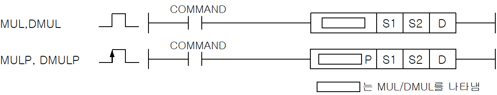
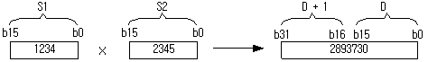

# MULP

Multiply two signed 16-bit integers.

Manual section(s): 4.20.3. Original Korean notes below may cover the other variants on the same page; apply the widths and execution form of `MULP`.

Execution form: the source explicitly pairs this command as `(P)`; `MULP` is the pulse-type P form. Manual §2.4.2 defines `P` as pulse-type notation. Select the paired forms deliberately and retain the instruction's actual execution conditions; unrelated mnemonics ending in P are not classified by suffix alone.

## Editing route

Use `insert_ladder_instruction` after calling `describe_operation` for its current schema.
The writer mnemonic is `MULP`; the catalog records opcode `532` and `3` operands in order.
Inspect the CPU/project and target cells first. Use the inspected revision and positions, preserve expected values, dry-run when useful, then save and inspect the result. See the [editing skill](../../SKILL.md) and [ladder workflow](../ladder.md).

## Behavior

- S1 and S2 are 16-bit operands. Store the full 32-bit product in consecutive WORDs beginning at D.
- This P-suffix variant executes once when the enabling input changes from Off to On.

## Instruction constraints

- Reserve 2 destination WORDs.

## Source corrections

- MKS legacy MULS maps to XGK MUL; MKS legacy DIV maps to XGK DIVU. Do not infer signedness from a legacy name.

## Operands

| Order | Operand | Description (Korean manual) | Reviewed types | Device areas | Constant |
| --- | --- | --- | --- | --- | --- |
| 1 | S1 | S2와 곱셈연산을 실행할 데이터 | INT | PMK, F, L, T, C, Z, U, N, D, R | Allowed |
| 2 | S2 | S1과 곱셈연산을 실행할 데이터 | INT | PMK, F, L, T, C, Z, U, N, D, R | Allowed |
| 3 | D | 연산결과를 저장할 주소 | DINT | PMK, L, T, C, Z, U, N, D, R | Not allowed |

These are the current library's reviewed operand rules. A shared type union is not a per-variant type choice; use the manual behavior to select the required width. Missing permissions stay unknown.

## CPU and acceptance

No separately reviewed CPU-model restriction is available in the current catalog; this means unknown, not universal compatibility.
Check the applicable model, firmware, modules and memory spans stated in the manual notes. Local parsing, writer validation and IL conversion do not prove native compilation or PLC behavior. Native acceptance requires XG5000 Open → Check Program → Save As → comparison.

## Manual behavior notes (Korean)

- MUL (Signed Binary Multiply)
- 워드데이터 S1과 S2를 곱한 후 결과를 (D+1,D)(32bit)에 저장합니다.
- 이 때 Signed 연산을 실행합니다.
- DMUL (Signed Binary Double Multiply)
- 더블 워드데이터 (S1+1,S1)과 (S2+1,S2)를 곱한 후 결과를 D+3,D+2,D+1,D(64bit)에 저장합니다.

## Manual applicability and restrictions

- 적용 기종 : XGK, XGB

## Manual flag and step matrix

The shared usage table marks affected flags with `O`, and `-` where it lists no effect. Native steps are the manual's instruction size, not the number of operand arguments. Conditions for setting/clearing flags are in the behavior notes.

| Manual instruction group | Native steps | 에러 (F110) | 제로 (F111) | 캐리 (F112) |
| --- | --- | --- | --- | --- |
| MUL(P) DMUL(P) | 4~6 | - | - | - |

## Additional source notes after examples

The manual places some execution restrictions and timing conditions after its example heading. Retain those checks below. Example addresses and circuit assumptions describe the source example and are not defaults for a new program.

- MKS 명령어중 MULS, DIV 등의 명령어는 XGK에서는 다음과 같이 명령어 이름이 바뀌었습니다.
- MULS(P) -> MUL(P) DMULS(P) -> DMUL(P) DIV(P) -> DIVU(P) DDIV(P) -> DDIVU(P)

## Referenced manual figures

These figures belong to the shared source topic. Read the source corrections above before using variant-specific layouts or example values.

## Provenance

Source: `XGK(B)InstructionHelp_Kr_V3.5.chm`, SHA-256 `b866d589d800addcb039f9f09b182592464d6367faa55abf6dde9ac34a1580e0`.

- `4203mulmulpdmuldmulp.htm` — §4.20.3; source SHA-256 `ec8e1ec576454045a420a4591b001268fcb9a2dc874b854f0520e09786ec5fe8`.
- Additional behavior/operand evidence: `33.htm`, `4203mulmulpdmuldmulp.htm`, `245.htm`.
