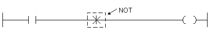

# NOT

Invert the current circuit result.

Manual section(s): 4.3.1. Original Korean notes below may cover the other variants on the same page; apply the widths and execution form of `NOT`.

## Editing route

Use `edit_ladder_cell` after calling `describe_operation` for its current schema.
Set the replacement element kind to `Inverse`. `NOT` describes `logic_cell` placement; it is represented by a physical cell rather than an application opcode.
Inspect the CPU/project and target cells first. Use the inspected revision and positions, preserve expected values, dry-run when useful, then save and inspect the result. See the [editing skill](../../SKILL.md) and [ladder workflow](../ladder.md).

## Behavior

- Negate the result produced by the circuit to the left of NOT.

## Instruction constraints

- NOT has no operand.

## Source corrections

- The initial device/support matrix incorrectly says AND LOAD; the title and behavior identify NOT.

## Operands

This catalog form is operandless.

## CPU and acceptance

No separately reviewed CPU-model restriction is available in the current catalog; this means unknown, not universal compatibility.
Check the applicable model, firmware, modules and memory spans stated in the manual notes. Local parsing, writer validation and IL conversion do not prove native compilation or PLC behavior. Native acceptance requires XG5000 Open → Check Program → Save As → comparison.

## Manual behavior notes (Korean)

- NOT명령은 이전의 결과를 반전시키는 기능을 합니다.
- 반전명령(NOT)을 사용하면 반전명령 좌측의 회로에 대하여 a접점 회로는 b접점 회로로, b접점회로는 a접점 회로로, 그리고 직렬연결 회로는 병렬연결 회로로, 병렬연결 회로는 직렬연결 회로로 반전됩니다.

## Manual applicability and restrictions

- 적용 기종 : XGK, XGB

## Referenced manual figures

These figures belong to the shared source topic. Read the source corrections above before using variant-specific layouts or example values.

## Provenance

Source: `XGK(B)InstructionHelp_Kr_V3.5.chm`, SHA-256 `b866d589d800addcb039f9f09b182592464d6367faa55abf6dde9ac34a1580e0`.

- `431not1.htm` — §4.3.1; source SHA-256 `607150324961c086ec01cf82d6356bf9eaf8f63344e0f3bb030e5ceb363bf7cd`.
