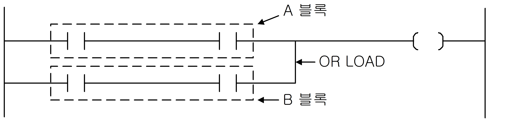

# OR LOAD

Manual section(s): 4.2.2. Original Korean notes below may cover the other variants on the same page; apply the widths and execution form of `OR LOAD`.

## Editing route

No matching public writer route is exposed for this exact instruction form. Use this file to interpret existing code; preserve its records when editing other parts of a project. Manual documentation alone does not enable insertion.

No matching public instruction insertion or basic element route is exposed; preserve existing control-flow/terminal records.

## Operands

No unambiguous operand table is available for this exact form; do not infer types or writable regions.

## CPU and acceptance

No separately reviewed CPU-model restriction is available in the current catalog; this means unknown, not universal compatibility.
Check the applicable model, firmware, modules and memory spans stated in the manual notes. Local parsing, writer validation and IL conversion do not prove native compilation or PLC behavior. Native acceptance requires XG5000 Open → Check Program → Save As → comparison.

## Manual behavior notes (Korean)

- A블록과 B블록을 AND 연산합니다. 즉, A블록과 B블록이 모두 On되어야 연산이 가능합니다.
- AND LOAD를 연속해서 사용하는 경우 최대사용 횟수를 넘으면 정상적으로 연산이 불가능합니다.
- 연속 사용의 경우 최대 15회(16블럭)까지만 가능합니다.

## Manual applicability and restrictions

- 적용 기종 : XGK, XGB

## Manual flag and step matrix

The shared usage table marks affected flags with `O`, and `-` where it lists no effect. Native steps are the manual's instruction size, not the number of operand arguments. Conditions for setting/clearing flags are in the behavior notes.

| Manual instruction group | Native steps | 에러 (F110) | 제로 (F111) | 캐리 (F112) |
| --- | --- | --- | --- | --- |
| OR LOAD | 1 | - | - | - |

## Additional source notes after examples

The manual places some execution restrictions and timing conditions after its example heading. Retain those checks below. Example addresses and circuit assumptions describe the source example and are not defaults for a new program.

- XG5000에서는 위 그림과 같은 프로그램을 래더로 작성한 후 니모닉으로 보면 OR LOAD 사용 수 제한이 없는 형식의 프로그램으로 보여 줍니다.
- 연속적으로 회로 블록을 직렬 접속하는 경우 프로그램의 입력에는 다음과 같은 2종류가 있습니다.

## Referenced manual figures

These figures belong to the shared source topic. Read the source corrections above before using variant-specific layouts or example values.

## Provenance

Source: `XGK(B)InstructionHelp_Kr_V3.5.chm`, SHA-256 `b866d589d800addcb039f9f09b182592464d6367faa55abf6dde9ac34a1580e0`.

- `422orload1.htm` — §4.2.2; source SHA-256 `8bceedbf371b62638644cc173f355fff82b7e10a0d998175c5e49adc3e9a31ca`.
