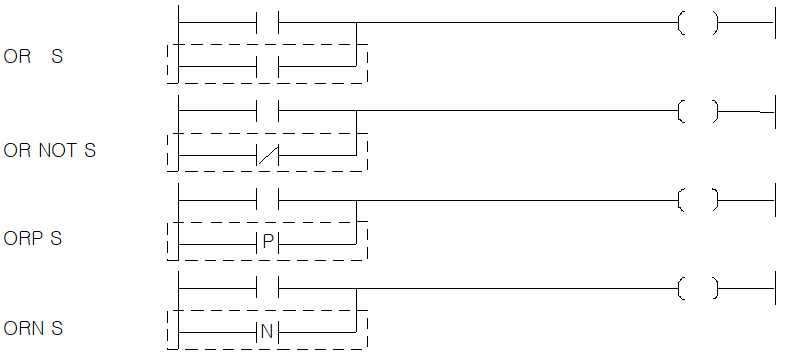

# OR NOT

Combine a parallel contact with the current circuit result.

Manual section(s): 4.1.3. Original Korean notes below may cover the other variants on the same page; apply the widths and execution form of `OR NOT`.

## Editing route

Use `edit_ladder_cell` after calling `describe_operation` for its current schema.
Set the replacement element kind to `NormallyClosed`. `OR NOT` describes `parallel` placement; it is represented by a physical cell rather than an application opcode.
OR placement requires an inspected supported parallel branch. The insertion tool does not construct the branch automatically; use `edit_ladder_branch` only where its guarded shape supports the requested circuit.
Inspect the CPU/project and target cells first. Use the inspected revision and positions, preserve expected values, dry-run when useful, then save and inspect the result. See the [editing skill](../../SKILL.md) and [ladder workflow](../ladder.md).

## Behavior

- OR the current bit result (BR) with the inverse value of S.

## Instruction constraints

- S is a BIT device contact or a specified bit of a WORD device.

## Source corrections

- The initial device/support matrix labels AND variants, copied from the preceding page; the title and body describe OR variants.

## Operands

| 오퍼랜드 | 설명 | 데이터 타입 |
| --- | --- | --- |
| S | 비트 디바이스의 접점 / 워드 디바이스의 비트 접점 | BIT |

This source table is not a separately reviewed writer rule. Retain shared variant distinctions and let the current writer reject unsupported operands.

## CPU and acceptance

No separately reviewed CPU-model restriction is available in the current catalog; this means unknown, not universal compatibility.
Check the applicable model, firmware, modules and memory spans stated in the manual notes. Local parsing, writer validation and IL conversion do not prove native compilation or PLC behavior. Native acceptance requires XG5000 Open → Check Program → Save As → comparison.

## Manual behavior notes (Korean)

- OR, OR NOT
- OR는 접점 1개의 a접점 병렬 접속 명령이고, OR NOT은 b접점 병렬 접속 명령입니다.
- 지정 접점(S) 전 단계의 연산 결과와 지정 접점(S)을 OR 또는 OR NOT연산을 하여 그것을 연산결과로 합니다.
- ORP, ORN
- ORP는 상승 펄스시 a접점 병렬 접속 명령이고, ORN은 하강 펄스시b접점 병렬 접속 명령입니다.
- 해당 접점값이 변할 때(즉, ORP는 상승 펄스, ORN은 하강 펄스시) 지정 접점(S) 전 단계의 연산 결과와 지정 접점(S)을 OR 연산하여 그것을 연산결과로 합니다.

## Manual applicability and restrictions

- 적용 기종 : XGK, XGB

## Referenced manual figures

These figures belong to the shared source topic. Read the source corrections above before using variant-specific layouts or example values.

## Provenance

Source: `XGK(B)InstructionHelp_Kr_V3.5.chm`, SHA-256 `b866d589d800addcb039f9f09b182592464d6367faa55abf6dde9ac34a1580e0`.

- `413orornotorporn.htm` — §4.1.3; source SHA-256 `2c5ba1317ed0fb61b1f55df8b594dbc81e4428c949e45fca0ba3be8c4cf42074`.
