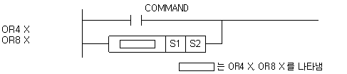

# OR8=

Combine the current circuit result with an OR comparison: OR8=.

Manual section(s): 4.15.18. Original Korean notes below may cover the other variants on the same page; apply the widths and execution form of `OR8=`.

## Editing route

Use `get_ir` → `apply_patch` for this instruction edit. `insert_ladder_comparison` is the internal writer route, not a separate MCP tool. Preserve the exported revision and native constraints.
The writer mnemonic is `8=`; the catalog records opcode `1417` and `2` operands in order.
OR placement requires an inspected supported parallel branch. The insertion tool does not construct the branch automatically; use `edit_ladder_branch` only where its guarded shape supports the requested circuit.
Inspect the CPU/project and target cells first. Use the inspected revision and positions, preserve expected values, dry-run when useful, then save and inspect the result. See the [editing skill](../../SKILL.md) and [ladder workflow](../ladder.md).

## Behavior

- Compare S1 = S2 as 8-bit unsigned bit field; the comparison is On when the relation holds and Off otherwise.
- Combine the comparison result with the current bit result (BR) using OR.

## Source corrections

- The detailed body incorrectly says AND for both OR4/OR8. The mnemonic and chapter-3 comparison catalog (344.htm) explicitly specify OR.

## Operands

| Order | Operand | Description (Korean manual) | Reviewed types | Device areas | Constant |
| --- | --- | --- | --- | --- | --- |
| 1 | S1 | S2와 비교하게 되는 데이터나 데이터 주소 | BYTE | PMK, L, D.x, R.x, U | Allowed |
| 2 | S2 | S1과 비교하게 되는 데이터나 데이터 주소 | BYTE | PMK, L, D.x, R.x, U | Allowed |

These are the current library's reviewed operand rules. A shared type union is not a per-variant type choice; use the manual behavior to select the required width. Missing permissions stay unknown.

## CPU and acceptance

No separately reviewed CPU-model restriction is available in the current catalog; this means unknown, not universal compatibility.
Check the applicable model, firmware, modules and memory spans stated in the manual notes. Local parsing, writer validation and IL conversion do not prove native compilation or PLC behavior. Native acceptance requires XG5000 Open → Check Program → Save As → comparison.

## Manual applicability and restrictions

- 적용 기종 : XGK, XGB

## Manual flag and step matrix

The shared usage table marks affected flags with `O`, and `-` where it lists no effect. Native steps are the manual's instruction size, not the number of operand arguments. Conditions for setting/clearing flags are in the behavior notes.

| Manual instruction group | Native steps | 에러 (F110) | 제로 (F111) | 캐리 (F112) |
| --- | --- | --- | --- | --- |
| OR4 X OR8 X | 3~4 | - | - | - |

## Referenced manual figures

These figures belong to the shared source topic. Read the source corrections above before using variant-specific layouts or example values.

## Provenance

Source: `XGK(B)InstructionHelp_Kr_V3.5.chm`, SHA-256 `b866d589d800addcb039f9f09b182592464d6367faa55abf6dde9ac34a1580e0`.

- `41518or4xor8x.htm` — §4.15.18; source SHA-256 `29e026c09da58085333e194f52123abe378ec42ad7e9ee571d2610411bb164bd`.
- Additional behavior/operand evidence: `344.htm`, `41516load4xload8x.htm`.
