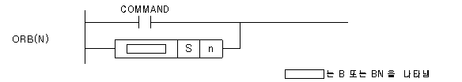

# ORB

Manual section(s): 4.38.3. Original Korean notes below may cover the other variants on the same page; apply the widths and execution form of `ORB`.

## Editing route

Use `insert_ladder_comparison` after calling `describe_operation` for its current schema.
The writer mnemonic is `B`; the catalog records opcode `1065` and `2` operands in order.
OR placement requires an inspected supported parallel branch. The insertion tool does not construct the branch automatically; use `edit_ladder_branch` only where its guarded shape supports the requested circuit.
Inspect the CPU/project and target cells first. Use the inspected revision and positions, preserve expected values, dry-run when useful, then save and inspect the result. See the [editing skill](../../SKILL.md) and [ladder workflow](../ladder.md).

## Operands

| Order | Operand | Description (Korean manual) | Reviewed types | Device areas | Constant |
| --- | --- | --- | --- | --- | --- |
| 1 | S | 데이터 또는 디바이스 번호 | WORD | PMK, L, T, C, Z, U, N, D, R | Not allowed |
| 2 | n | Not unambiguously specified in this topic | WORD | PMK, F, L, T, C, Z, U, N, D, R | Allowed |

These are the current library's reviewed operand rules. A shared type union is not a per-variant type choice; use the manual behavior to select the required width. Missing permissions stay unknown.

## CPU and acceptance

No separately reviewed CPU-model restriction is available in the current catalog; this means unknown, not universal compatibility.
Check the applicable model, firmware, modules and memory spans stated in the manual notes. Local parsing, writer validation and IL conversion do not prove native compilation or PLC behavior. Native acceptance requires XG5000 Open → Check Program → Save As → comparison.

## Manual behavior notes (Korean)

- ORB
- 이 명령은 워드 데이터(S)의 n번째 비트를 현재의 연산결과와 OR합니다.
- n값의 하위 4비트만을 취해서 비트 위치를 결정합니다. 따라서 n값이 워드크기를 벗어날 경우 에러가 발생하지 않습니다.
- ORBN
- 이 명령은 워드 데이터(S)의 n번째 비트를 반전한 값과 현재의 연산결과와 OR합니다.

## Manual applicability and restrictions

- 적용 기종 : XGK, XGB

## Manual flag and step matrix

The shared usage table marks affected flags with `O`, and `-` where it lists no effect. Native steps are the manual's instruction size, not the number of operand arguments. Conditions for setting/clearing flags are in the behavior notes.

| Manual instruction group | Native steps | 에러 (F110) | 제로 (F111) | 캐리 (F112) |
| --- | --- | --- | --- | --- |
| ORB ORBN | 2 | - | - | - |

## Referenced manual figures

These figures belong to the shared source topic. Read the source corrections above before using variant-specific layouts or example values.

## Provenance

Source: `XGK(B)InstructionHelp_Kr_V3.5.chm`, SHA-256 `b866d589d800addcb039f9f09b182592464d6367faa55abf6dde9ac34a1580e0`.

- `4383orborbn1.htm` — §4.38.3; source SHA-256 `0e564c6c3f844162ad641e09ec46a514bae7fed3f67149068ae54b0b4e746594`.
- Additional behavior/operand evidence: `4381loadbloadbn.htm`.
