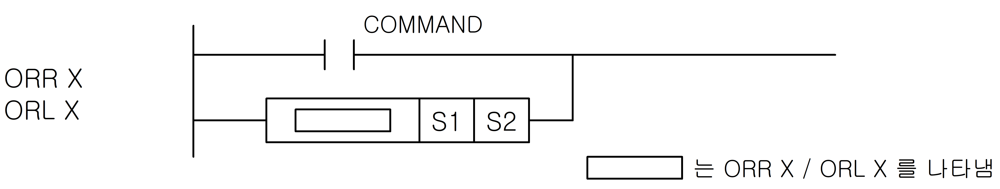

# ORL<>

Combine the current circuit result with an OR comparison: ORL<>.

Manual section(s): 4.15.6. Original Korean notes below may cover the other variants on the same page; apply the widths and execution form of `ORL<>`.

## Editing route

Use `insert_ladder_comparison` after calling `describe_operation` for its current schema.
The writer mnemonic is `L<>`; the catalog records opcode `1301` and `2` operands in order.
OR placement requires an inspected supported parallel branch. The insertion tool does not construct the branch automatically; use `edit_ladder_branch` only where its guarded shape supports the requested circuit.
Inspect the CPU/project and target cells first. Use the inspected revision and positions, preserve expected values, dry-run when useful, then save and inspect the result. See the [editing skill](../../SKILL.md) and [ladder workflow](../ladder.md).

## Behavior

- Compare S1 <> S2 as 64-bit LREAL floating-point; the comparison is On when the relation holds and Off otherwise.
- Combine the comparison result with the current bit result (BR) using OR.

## Instruction constraints

- Exact equality of floating-point values requires care because representational precision can change the values.

## Operands

| Order | Operand | Description (Korean manual) | Reviewed types | Device areas | Constant |
| --- | --- | --- | --- | --- | --- |
| 1 | S1 | 비교하고자 하는 실수 데이터 혹은 실수 데이터를 지정하는 디바이스 번호 | LREAL | Unknown | Unknown |
| 2 | S2 | 비교하고자 하는 실수 데이터 혹은 실수 데이터를 지정하는 디바이스 번호 | LREAL | Unknown | Unknown |

These are the current library's reviewed operand rules. A shared type union is not a per-variant type choice; use the manual behavior to select the required width. Missing permissions stay unknown.

## CPU and acceptance

No separately reviewed CPU-model restriction is available in the current catalog; this means unknown, not universal compatibility.
Check the applicable model, firmware, modules and memory spans stated in the manual notes. Local parsing, writer validation and IL conversion do not prove native compilation or PLC behavior. Native acceptance requires XG5000 Open → Check Program → Save As → comparison.

## Manual behavior notes (Korean)

- ORR X (R=, R>, R<, R>=, R<=, R<>)
- S1 과 S2를 비교하여 X조건과 일치하면 On, 불일치하면 Off하여 이 결과와 현재의 연산결과를 OR하여 새로운 연산결과로 취합니다.
- S1 과 S2 는 단장형 부동소수점 실수로서 X 조건에 따라 비교연산을 합니다.
- ORL X (L=, L>, L<, L>=, L<=, L<>)
- S1 과 S2 는 배장형 부동소수점 실수로서 X 조건에 따라 비교연산을 합니다.

| X조건 | 조건 | 연산결과 |
| --- | --- | --- |
| = | S1 = S2 | On |
| <= | S1 ￡ S2 | On |
| >= | S1 ³ S2 | On |
| < > | S1 ¹ S2 | On |
| < | S1 < S2 | On |
| > | S1 > S2 | On |

## Manual applicability and restrictions

- 적용 기종 : XGK, XGB

## Manual flag and step matrix

The shared usage table marks affected flags with `O`, and `-` where it lists no effect. Native steps are the manual's instruction size, not the number of operand arguments. Conditions for setting/clearing flags are in the behavior notes.

| Manual instruction group | Native steps | 에러 (F110) | 제로 (F111) | 캐리 (F112) |
| --- | --- | --- | --- | --- |
| ORR X ORL X | 2~5 | - | - | - |

## Referenced manual figures

These figures belong to the shared source topic. Read the source corrections above before using variant-specific layouts or example values.

## Provenance

Source: `XGK(B)InstructionHelp_Kr_V3.5.chm`, SHA-256 `b866d589d800addcb039f9f09b182592464d6367faa55abf6dde9ac34a1580e0`.

- `4156orrxorlx.htm` — §4.15.6; source SHA-256 `032d5e3ff4fd2e790a3d6671572436962d82ab13c4f0aeff4550edf56557e8de`.
- Additional behavior/operand evidence: `344.htm`, `4154loadrxloadlx.htm`.
