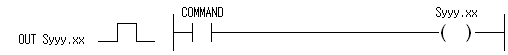

# OUT Syyy.xx

Select a latched step relay using the last enabled instruction in program order.

Manual section(s): 4.6.2. Original Korean notes below may cover the other variants on the same page; apply the widths and execution form of `OUT Syyy.xx`.

## Editing route

No matching public writer route is exposed for this exact instruction form. Use this file to interpret existing code; preserve its records when editing other parts of a project. Manual documentation alone does not enable insertion.

This manual form targets a specialized step-sequence S record, not the generic SET/OUT device coil.
No matching specialized public XGK ladder writer route is exposed; do not substitute edit_ladder_cell or an SFC XML operation.

## Behavior

- An input On activates its step without requiring the immediately preceding step.
- If several steps in the same group are enabled, only one remains On and the later programmed instruction wins.
- The selected step latches after input Off; enabling Syyy.00 clears the group.

## Instruction constraints

- yyy is the group number 0..127 and xx the step number 0..99. The operand is a BIT step-relay contact.

## Source corrections

- This is the S-device last-input-priority instruction; do not equate its mnemonic template with arbitrary SFC graph-step insertion.

## Operands

| 오퍼랜드 | 설 명 | 데이터 타입 |
| --- | --- | --- |
| Syyy.xx | S디바이스 접점으로, yyy는 조 번호를, xx는 스텝 번호를 나타냅니다. 조 번호는 0~127까지, 스텝 번호는 0~99까지 사용 가능합니다. | BIT |

This source table is not a separately reviewed writer rule. Retain shared variant distinctions and let the current writer reject unsupported operands.

## CPU and acceptance

No separately reviewed CPU-model restriction is available in the current catalog; this means unknown, not universal compatibility.
Check the applicable model, firmware, modules and memory spans stated in the manual notes. Local parsing, writer validation and IL conversion do not prove native compilation or PLC behavior. Native acceptance requires XG5000 Open → Check Program → Save As → comparison.

## Manual behavior notes (Korean)

- 셋(SET) Syyy.xx와는 달리, 스텝 순서에 관계없이 입력조건 접점이 On되면 해당 스텝이 기동합니다.
- 동일 조내에서 입력조건 접점이 다수가 On하여도 한 개의 스텝 번호만 On합니다. 이때, 나중에 프로그램된 것이 우선으로 출력됩니다.
- 현재 스텝번호가 On되면 자기 유지되어 입력 조건이 Off되어도 On되어진 상태를 유지합니다.
- OUT Syyy.xx 명령은 Syyy.00의 입력 접점을 On시킴으로써 클리어됩니다.

## Manual applicability and restrictions

- 적용 기종 : XGK, XGB

## Manual flag and step matrix

The shared usage table marks affected flags with `O`, and `-` where it lists no effect. Native steps are the manual's instruction size, not the number of operand arguments. Conditions for setting/clearing flags are in the behavior notes.

| Manual instruction group | Native steps | 에러 (F110) | 제로 (F111) | 캐리 (F112) |
| --- | --- | --- | --- | --- |
| OUT | 1 | - | - | - |

## Referenced manual figures

These figures belong to the shared source topic. Read the source corrections above before using variant-specific layouts or example values.

## Provenance

Source: `XGK(B)InstructionHelp_Kr_V3.5.chm`, SHA-256 `b866d589d800addcb039f9f09b182592464d6367faa55abf6dde9ac34a1580e0`.

- `462outsyyyxx.htm` — §4.6.2; source SHA-256 `c61dc6b934b119855c7befe47d77b3bd0f1e124a157a7521eafbe02214aca4ed`.
