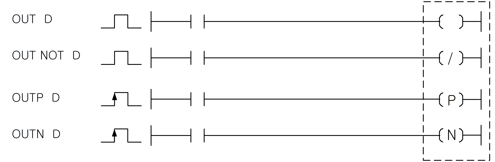

# OUT

Manual section(s): 4.5.1. Original Korean notes below may cover the other variants on the same page; apply the widths and execution form of `OUT`.

## Editing route

Use `edit_ladder_cell` after calling `describe_operation` for its current schema.
Set the replacement element kind to `Output`. `OUT` describes `output_column` placement; it is represented by a physical cell rather than an application opcode.
Inspect the CPU/project and target cells first. Use the inspected revision and positions, preserve expected values, dry-run when useful, then save and inspect the result. See the [editing skill](../../SKILL.md) and [ladder workflow](../ladder.md).

## Operands

| 오퍼랜드 | 설명 | 데이터 타입 |
| --- | --- | --- |
| D | On/Off하게 될 접점/워드 디바이스의 비트 접점 | BIT |

This source table is not a separately reviewed writer rule. Retain shared variant distinctions and let the current writer reject unsupported operands.

## CPU and acceptance

No separately reviewed CPU-model restriction is available in the current catalog; this means unknown, not universal compatibility.
Check the applicable model, firmware, modules and memory spans stated in the manual notes. Local parsing, writer validation and IL conversion do not prove native compilation or PLC behavior. Native acceptance requires XG5000 Open → Check Program → Save As → comparison.

## Manual behavior notes (Korean)

- OUT, OUT NOT
- OUT명령은 OUT명령까지의 연산 결과를 지정된 디바이스로 그대로 출력합니다.
- OUT NOT은 OUT NOT명령까지의 연산 결과를 반전해서 지정된 디바이스에 출력합니다.
- OUT Sxx.yy에 대한 설명은 4.6 순차후입 우선 명령을 참조하시기 바랍니다.
- OUTP, OUTN
- OUTP는 OUTP 명령까지의 연산 결과가 Off → On 으로 될 때 지정 접점을 1스캔 동안만 On하고그 이외에는 Off됩니다.
- 지정 접점이 워드 디바이스의 비트 접점이면 해당 비트는 1스캔동안만1이 되고 그 외에는 0이 됩니다.
- OUTN는 OUTN명령까지의 연산 결과가 On a Off로 될 때 지정 접점을 1스캔 동안만 On하고 그외에는 Off됩니다.
- 지정 접점이 워드 디바이스의 비트 접점이면 해당 비트는 1스캔동안만 1이되고 그 외에는 0이 됩니다.
- Master-K의 D, D NOT명령이 변경된 명령어 입니다.

## Manual applicability and restrictions

- 적용 기종 : XGK, XGB

## Manual flag and step matrix

The shared usage table marks affected flags with `O`, and `-` where it lists no effect. Native steps are the manual's instruction size, not the number of operand arguments. Conditions for setting/clearing flags are in the behavior notes.

| Manual instruction group | Native steps | 에러 (F110) | 제로 (F111) | 캐리 (F112) |
| --- | --- | --- | --- | --- |
| OUT OUT NOT | 1~2 | - | - | - |
| OUTP OUTN | 2 | - | - | - |

## Additional source notes after examples

The manual places some execution restrictions and timing conditions after its example heading. Retain those checks below. Example addresses and circuit assumptions describe the source example and are not defaults for a new program.

- OUTP, OUTN명령은 입력 조건 성립 시, 1스캔동안만 On하므로 P영역으로 출력은 주의를 요합니다.

## Referenced manual figures

These figures belong to the shared source topic. Read the source corrections above before using variant-specific layouts or example values.

## Provenance

Source: `XGK(B)InstructionHelp_Kr_V3.5.chm`, SHA-256 `b866d589d800addcb039f9f09b182592464d6367faa55abf6dde9ac34a1580e0`.

- `451outoutnotoutpoutn1.htm` — §4.5.1; source SHA-256 `7f4d92d42acfc843a1a11bec505471decf27daec66c57eebb561f405ad478478`.
