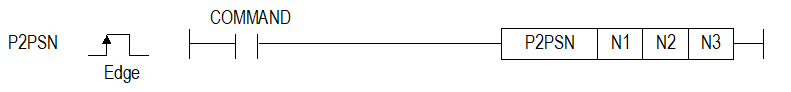
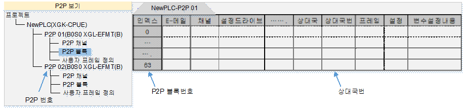

# P2PSN

Change the remote station number of a configured P2P block.

Manual section(s): 4.40.1. Original Korean notes below may cover the other variants on the same page; apply the widths and execution form of `P2PSN`.

## Editing route

Use `insert_ladder_instruction` after calling `describe_operation` for its current schema.
The writer mnemonic is `P2PSN`; the catalog records opcode `1039` and `3` operands in order.
Inspect the CPU/project and target cells first. Use the inspected revision and positions, preserve expected values, dry-run when useful, then save and inspect the result. See the [editing skill](../../SKILL.md) and [ladder workflow](../ladder.md).

## Behavior

- N1 selects P2P 1..8, N2 its block 0..63, and N3 remote station 0..63. Only the remote station changes.

## Instruction constraints

- The P2P block remote-station checkbox must be unchecked for this change. Applies to FDEnet/Cnet. Out-of-range operands set F110.

## Operands

| Order | Operand | Description (Korean manual) | Reviewed types | Device areas | Constant |
| --- | --- | --- | --- | --- | --- |
| 1 | N1 | P2P 번호 ( 1 ~ 8 ) | WORD | PMK, F, L, T, C, Z, U, N, D, R | Allowed |
| 2 | N2 | 블록 번호( 0 ~ 63 ) | WORD | PMK, F, L, T, C, Z, U, N, D, R | Allowed |
| 3 | N3 | 국번 ( 0 ~ 63 ) | WORD | PMK, F, L, T, C, Z, U, N, D, R | Allowed |

These are the current library's reviewed operand rules. A shared type union is not a per-variant type choice; use the manual behavior to select the required width. Missing permissions stay unknown.

## CPU and acceptance

Reviewed XGK model table: XGK-CPUU, XGK-CPUH, XGK-CPUA, XGK-CPUS, XGK-CPUE, XGK-CPUUN, XGK-CPUHN, XGK-CPUSN (`4401p2psn.htm`).
Check the applicable model, firmware, modules and memory spans stated in the manual notes. Local parsing, writer validation and IL conversion do not prove native compilation or PLC behavior. Native acceptance requires XG5000 Open → Check Program → Save As → comparison.

## Manual behavior notes (Korean)

- 이 명령은 P2P서비스에서 통신할 상대국번을 변경하는 명령입니다.
- 해당 P2P블록 설정화면에서 '상대국'에 체크가 되어있는 경우 변경할 수 없음. 반드시 체크 해제 필요
- N1번으로 지정된 P2P번호의 N2번째 블록의 상대 국번을 N3의 값으로 변경합니다. P2P통신 중 송수신할 데이터등은 변경하지 않고 상대국번만 변경하여 통신할 경우 사용합니다.
- 적용 제품: FDEnet, Cnet

## Manual flags

| 플래그 | 내 용 | 디바이스 번호 |
| --- | --- | --- |
| 에러 | N1, N2, N3의 값이 해당 범위를 벗어날 경우 | F110 |

## Manual applicability and restrictions

- N1(1~8), N2(0~63), N3(0~63)의 값이 설정 가능한 범위를 벗어날 경우 에러 플래그(F110)를 셋(Set)합니다.

| 지원 기종 | XGK | XGK | XGK | XGK | XGK | XGK-N | XGK-N | XGK-N | XBC-U | XBC-U | XBC-U | XBC-U | XBM | XBM |
| --- | --- | --- | --- | --- | --- | --- | --- | --- | --- | --- | --- | --- | --- | --- |
| 지원 기종 | U | H | A | S | E | UN | HN | SN | U | H | SU | E | S | H(P) |
| 지원 기종 | O | O | O | O | O | O | O | O | O | X | X | X | X | O |

## Manual flag and step matrix

The shared usage table marks affected flags with `O`, and `-` where it lists no effect. Native steps are the manual's instruction size, not the number of operand arguments. Conditions for setting/clearing flags are in the behavior notes.

| Manual instruction group | Native steps | 에러 (F110) | 제로 (F111) | 캐리 (F112) |
| --- | --- | --- | --- | --- |
| P2PSN | 4~6 | O | - | - |

## Referenced manual figures

These figures belong to the shared source topic. Read the source corrections above before using variant-specific layouts or example values.

## Provenance

Source: `XGK(B)InstructionHelp_Kr_V3.5.chm`, SHA-256 `b866d589d800addcb039f9f09b182592464d6367faa55abf6dde9ac34a1580e0`.

- `4401p2psn.htm` — §4.40.1; source SHA-256 `4cfee00329f8c1f7521f3c22db176384612a639edc5f09aff2f6e8fb320b8a53`.
- Additional behavior/operand evidence: `4401p2psn.htm`.
