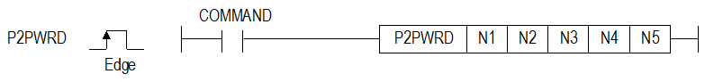
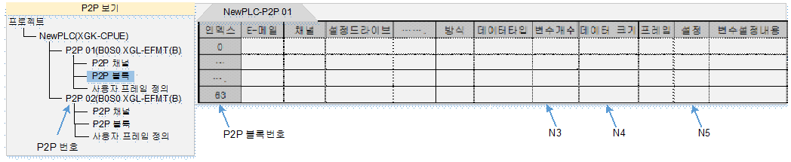

# P2PWRD

Change WORD address/count settings of a P2P READ block.

Manual section(s): 4.40.2. Original Korean notes below may cover the other variants on the same page; apply the widths and execution form of `P2PWRD`.

## Editing route

Use `get_ir` → `apply_patch` for this instruction edit. `insert_ladder_instruction` is the internal writer route, not a separate MCP tool. Preserve the exported revision and native constraints.
The writer mnemonic is `P2PWRD`; the catalog records opcode `1041` and `5` operands in order.
Inspect the CPU/project and target cells first. Use the inspected revision and positions, preserve expected values, dry-run when useful, then save and inspect the result. See the [editing skill](../../SKILL.md) and [ladder workflow](../ladder.md).

## Behavior

- N1 selects P2P 1..8; N2 block 0..63; N3 individual variable 1..4; N4 count 1..1,400; N5 the starting device address.
- Individual mode changes the selected variable address and ignores N4. Continuous mode uses N3=1 and updates both N4 and N5.

## Instruction constraints

- Applies to FEnet/FDEnet/Cnet; Cnet/FEnet support described here requires XGT dedicated communication. Out-of-range N1..N4 sets F110.
- Address interpretation depends on the configured data type; check the original address diagram.

## Operands

| Order | Operand | Description (Korean manual) | Reviewed types | Device areas | Constant |
| --- | --- | --- | --- | --- | --- |
| 1 | N1 | P2P 번호 ( 1 ~ 8 ) | WORD | PMK, F, L, T, C, Z, U, N, D, R | Allowed |
| 2 | N2 | 블록 번호 ( 0 ~ 63 ) | WORD | PMK, F, L, T, C, Z, U, N, D, R | Allowed |
| 3 | N3 | 개별읽기/쓰기 시 설정된 변수 번호( 1 ~ 4 ) | WORD | PMK, F, L, T, C, Z, U, N, D, R | Allowed |
| 4 | N4 | 데이터 크기 ( 1 ~ 1400 ) | WORD | PMK, F, L, T, C, Z, U, N, D, R | Allowed |
| 5 | N5 | 읽을 영역 시작 주소 | WORD | PMK, F, L, T, C, Z, U, N, D, R | Not allowed |

These are the current library's reviewed operand rules. A shared type union is not a per-variant type choice; use the manual behavior to select the required width. Missing permissions stay unknown.

## CPU and acceptance

Reviewed XGK model table: XGK-CPUU, XGK-CPUH, XGK-CPUA, XGK-CPUS, XGK-CPUE, XGK-CPUUN, XGK-CPUHN, XGK-CPUSN (`4402p2pwrd.htm`).
Check the applicable model, firmware, modules and memory spans stated in the manual notes. Local parsing, writer validation and IL conversion do not prove native compilation or PLC behavior. Native acceptance requires XG5000 Open → Check Program → Save As → comparison.

## Manual behavior notes (Korean)

- 이 명령은 P2P READ 블록의 데이터 크기와 읽을 영역 시작주소를 변경하는 명령입니다.
- N1번으로 지정된 P2P의 N2번째 블록 설정을 변경합니다.
- 방식이 “1.개별” 인 경우 N3번째 변수의 읽을 영역 시작 주소를 N5로 변경합니다.
- N4 데이터 크기는 무시되고 변경되지 않습니다.
- 방식이 “2.연속” 인 경우 N4와 N5를 각각 데이터 크기와 읽을 영역 시작 주소로 변경합니다.
- 적용 제품: FEnet, FDEnet, Cnet(Cnet, FEnet XGT전용통신만 해당)

## Manual flags

| 플래그 | 내 용 | 디바이스 번호 |
| --- | --- | --- |
| 에러 | N1, N2, N3, N4의 값이 해당 범위를 벗어날 경우 | F110 |

## Manual applicability and restrictions

- N1(1~8), N2(0~63), N3(1~4), N4(1~1400)의 값이 설정 가능한 범위를 벗어날 경우 에러 플래그(F110)를 셋(Set)합니다.

| 지원 기종 | XGK | XGK | XGK | XGK | XGK | XGK-N | XGK-N | XGK-N | XBC-U | XBC-U | XBC-U | XBC-U | XBM | XBM |
| --- | --- | --- | --- | --- | --- | --- | --- | --- | --- | --- | --- | --- | --- | --- |
| 지원 기종 | U | H | A | S | E | UN | HN | SN | U | H | SU | E | S | H(P) |
| 지원 기종 | O | O | O | O | O | O | O | O | O | X | X | X | X | O |

## Manual flag and step matrix

The shared usage table marks affected flags with `O`, and `-` where it lists no effect. Native steps are the manual's instruction size, not the number of operand arguments. Conditions for setting/clearing flags are in the behavior notes.

| Manual instruction group | Native steps | 에러 (F110) | 제로 (F111) | 캐리 (F112) |
| --- | --- | --- | --- | --- |
| P2PWRD | 4~6 | O | - | - |

## Additional source notes after examples

The manual places some execution restrictions and timing conditions after its example heading. Retain those checks below. Example addresses and circuit assumptions describe the source example and are not defaults for a new program.

- 개별 명령일 경우 변수 번호(N3)는 1~4의 값을 사용하고 변수 크기(N4)는 적용되지 않습니다.
- 연속 명령일 경우 변수 번호(N3)는 항상 1을 사용하고 변수 크기(N4)가 적용됩니다.
- 데이터 타입에 따라 읽을 영역 시작주소가 다르게 적용됩니다.
- EX. 읽을 영역을 D1004로 변경 시

## Referenced manual figures

These figures belong to the shared source topic. Read the source corrections above before using variant-specific layouts or example values.

## Provenance

Source: `XGK(B)InstructionHelp_Kr_V3.5.chm`, SHA-256 `b866d589d800addcb039f9f09b182592464d6367faa55abf6dde9ac34a1580e0`.

- `4402p2pwrd.htm` — §4.40.2; source SHA-256 `b6582c3ee779fdd14daa6b08554867aae95129c542c84c83cbbb9a269ec77d39`.
- Additional behavior/operand evidence: `4402p2pwrd.htm`.
