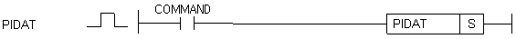

# PIDAT

Run XGB PID autotuning for a selected loop.

Manual section(s): 4.28.9. Original Korean notes below may cover the other variants on the same page; apply the widths and execution form of `PIDAT`.

## Editing route

Use `insert_ladder_instruction` after calling `describe_operation` for its current schema.
The writer mnemonic is `PIDAT`; the catalog records opcode `1058` and `1` operands in order.
Inspect the CPU/project and target cells first. Use the inspected revision and positions, preserve expected values, dry-run when useful, then save and inspect the result. See the [editing skill](../../SKILL.md) and [ladder workflow](../ladder.md).

## Behavior

- S is a constant loop number in 0..15. Autotuning uses the XGB K1856-based parameter area and produces Kp, Ti and Td.

## Instruction constraints

- The page applies to XGB, not XGK. Preserve status, error, and reserved entries and configure SV, Ts and output settings for the actual process.

## Operands

| Order | Operand | Description (Korean manual) | Reviewed types | Device areas | Constant |
| --- | --- | --- | --- | --- | --- |
| 1 | S | AT 연산을 수행할 루프 번호 (0~15) | WORD | None | Allowed |

These are the current library's reviewed operand rules. A shared type union is not a per-variant type choice; use the manual behavior to select the required width. Missing permissions stay unknown.

## CPU and acceptance

No separately reviewed CPU-model restriction is available in the current catalog; this means unknown, not universal compatibility.
Check the applicable model, firmware, modules and memory spans stated in the manual notes. Local parsing, writer validation and IL conversion do not prove native compilation or PLC behavior. Native acceptance requires XG5000 Open → Check Program → Save As → comparison.

## Manual behavior notes (Korean)

- PIDAT (PID AutoTune)
- 사용자가 AT형식에 맞추어 저장한 파라미터 또는 K영역(워드로 K1856 ~ K2176)의 PID루프 (S:루프 번호) 자동동조를 가동합니다.
- K 디바이스 AT 파라미터 영역: K디바이스 내의 AT 파라미터위치 할당은 다음의 표와 같습니다.
- AT Common 영역은 모든 루프들의 간략한 설정 및 상태를 나타내며 워드내의 비트 위치가 곧 루프 번호를 의미합니다.
- AT 루프 개별 파라미터에는 사용자가 입력할 수 있는 사용자 입력값과 사용자가 가져다 사용할 수 있는 AT 출력값이 함께 들어있습니다.
- 사용자 세팅값 : SV, Ts, MV_max, MV_min, PWM, Hys_Val
- PID 출력값 : PV, MV, STATUS, ERR_Code, K_p, T_i, T_d
- Quick Start
- 간단하게 사용할 경우 PV, MV를 각각 제어기의 입력, 출력으로 사용하며, 사용자가 입력해야할 값은 SV, Ts 입니다.
- PV : 제어기의 입력 (제어 대상의 센서출력), 주로 AD 모듈을 사용합니다.
- MV : 제어기의 출력 (제어 대상의 입력신호), 주로 DA 모듈을 사용합니다.
- SV : 제어 목표값. 제어를 통해 도달하고자하는 센서의 출력값을 입력합니다.

## Manual applicability and restrictions

- 적용 기종 : XGB

## Manual flag and step matrix

The shared usage table marks affected flags with `O`, and `-` where it lists no effect. Native steps are the manual's instruction size, not the number of operand arguments. Conditions for setting/clearing flags are in the behavior notes.

| Manual instruction group | Native steps | 에러 (F110) | 제로 (F111) | 캐리 (F112) |
| --- | --- | --- | --- | --- |
| PIDAT | 2 | - | - | - |

## Referenced manual figures

These figures belong to the shared source topic. Read the source corrections above before using variant-specific layouts or example values.

## Provenance

Source: `XGK(B)InstructionHelp_Kr_V3.5.chm`, SHA-256 `b866d589d800addcb039f9f09b182592464d6367faa55abf6dde9ac34a1580e0`.

- `4289pidat.htm` — §4.28.9; source SHA-256 `9817bdbce546840c53f679ebf4762fa5a691a10013d0a2f00f71bb5ea39fd77d`.
- Additional behavior/operand evidence: `4289pidat.htm`.
