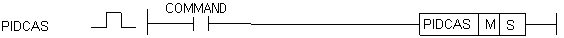
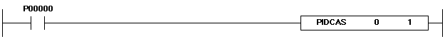

# PIDCAS

Connect two PID loops in cascade.

Manual section(s): 4.28.11. Original Korean notes below may cover the other variants on the same page; apply the widths and execution form of `PIDCAS`.

## Editing route

Use `insert_ladder_instruction` after calling `describe_operation` for its current schema.
The writer mnemonic is `PIDCAS`; the catalog records opcode `1059` and `2` operands in order.
Inspect the CPU/project and target cells first. Use the inspected revision and positions, preserve expected values, dry-run when useful, then save and inspect the result. See the [editing skill](../../SKILL.md) and [ladder workflow](../ladder.md).

## Behavior

- XGK M is the master and S the slave; both are constant loop numbers 0..31 and must differ.
- XGB M is the outer loop and S the inner loop; both are constant loop numbers 0..15.

## Instruction constraints

- A pair used in PIDCAS must not be reused by another PIDCAS or PIDRUN. Use the matching CPU-specific K parameter layout.

## Operands

| Order | Operand | Description (Korean manual) | Reviewed types | Device areas | Constant |
| --- | --- | --- | --- | --- | --- |
| 1 | M | PID 캐스케이드 마스터 루프 번호 (0~31) | WORD | None | Allowed |
| 2 | S | PID 캐스케이드 슬레이브 루프 번호 (0~31) | WORD | None | Allowed |

These are the current library's reviewed operand rules. A shared type union is not a per-variant type choice; use the manual behavior to select the required width. Missing permissions stay unknown.

## CPU and acceptance

No separately reviewed CPU-model restriction is available in the current catalog; this means unknown, not universal compatibility.
Check the applicable model, firmware, modules and memory spans stated in the manual notes. Local parsing, writer validation and IL conversion do not prove native compilation or PLC behavior. Native acceptance requires XG5000 Open → Check Program → Save As → comparison.

## Manual behavior notes (Korean)

- PIDCAS (PID Cascade) - XGK
- 접점이 On되면 캐스케이드 연산을 시작합니다.
- 오퍼랜드 M은 마스터 루프의 번호이고 오퍼랜드 S는 슬레이브 루프의 번호입니다.
- 오퍼랜드 M과 S는 각각 0 ~ 31의 상수만 입력이 가능하고 서로 같을 수 없습니다.
- 한 번PIDCAS에 사용된 두 루프는 다른 PIDCAS나 PIDRUN 사용될 수 없습니다.
- 마스터와 슬레이브 루프의 설정은 PIDRUN에 소개된 각각의 K 디바이스 상에서 설정합니다.
- 프로그램 예시 - XGK
- 영역 설정 - XGB
- PIDCAS (PID Cascade) - XGB
- 사용자가 PID형식에 맞추어 저장한 외부루프, 내부루프 파라미터 또는 K영역(워드로 K1200 ~ K1850)의 PID루프를 연결하여 Cascade 운전을 가동합니다.
- K 디바이스 PID 파라미터 영역 각 루프의 K디바이스 내의 파라미터위치 할당은 PIDRUN명령을 참조하시기 바랍니다.
- Quick Start - XGB
- PIDCAS 명령을 사용할 때는 외부루프와 내부루프를 올바르게 지정해주시기 바랍니다.
- PIDCAS 명령으로 사용된 루프를 PIDRUN등 다른 명령에서 사용하는 경우, 제어동작이 이상동작할 수 있으므로 주의하시기 바랍니다.
- 프로그램 예시 - XGB

| LD |  |
| --- | --- |

## Manual applicability and restrictions

- 적용 기종 : XGK, XGB

## Manual flag and step matrix

The shared usage table marks affected flags with `O`, and `-` where it lists no effect. Native steps are the manual's instruction size, not the number of operand arguments. Conditions for setting/clearing flags are in the behavior notes.

| Manual instruction group | Native steps | 에러 (F110) | 제로 (F111) | 캐리 (F112) |
| --- | --- | --- | --- | --- |
| PIDCAS | 2 | - | - | - |

## Referenced manual figures

These figures belong to the shared source topic. Read the source corrections above before using variant-specific layouts or example values.

## Provenance

Source: `XGK(B)InstructionHelp_Kr_V3.5.chm`, SHA-256 `b866d589d800addcb039f9f09b182592464d6367faa55abf6dde9ac34a1580e0`.

- `42811pidcas.htm` — §4.28.11; source SHA-256 `04f5d5da6d2ebc68d7f125f230d5fa8626c5ccf7210c13cd77e781c13daeaaf0`.
- Additional behavior/operand evidence: `42811pidcas.htm`.
