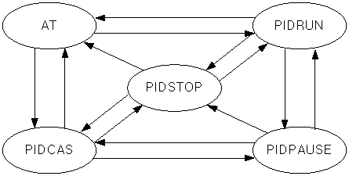

# PIDPAUSE

Pause a running PID loop while preserving its state.

Manual section(s): 4.28.7. Original Korean notes below may cover the other variants on the same page; apply the widths and execution form of `PIDPAUSE`.

## Editing route

Use `get_ir` → `apply_patch` for this instruction edit. `insert_ladder_instruction` is the internal writer route, not a separate MCP tool. Preserve the exported revision and native constraints.
The writer mnemonic is `PIDPAUSE`; the catalog records opcode `1052` and `1` operands in order.
Inspect the CPU/project and target cells first. Use the inspected revision and positions, preserve expected values, dry-run when useful, then save and inspect the result. See the [editing skill](../../SKILL.md) and [ladder workflow](../ladder.md).

## Behavior

- Input On sets the selected loop PAUSE bit. The output keeps its last value and integral state is retained for later RUN.
- PAUSE only operates from RUN, not STOP.

## Instruction constraints

- Avoid direct competing writes to the same _PIDn_PAUSE bit. The manual cautions that long pauses or unstable/noisy systems can destabilize control.

## Operands

| Order | Operand | Description (Korean manual) | Reviewed types | Device areas | Constant |
| --- | --- | --- | --- | --- | --- |
| 1 | S | PID 연산을 PAUSE(일시정지) 상태로 전환할 루프번호 (0~31) | WORD | None | Allowed |

These are the current library's reviewed operand rules. A shared type union is not a per-variant type choice; use the manual behavior to select the required width. Missing permissions stay unknown.

## CPU and acceptance

No separately reviewed CPU-model restriction is available in the current catalog; this means unknown, not universal compatibility.
Check the applicable model, firmware, modules and memory spans stated in the manual notes. Local parsing, writer validation and IL conversion do not prove native compilation or PLC behavior. Native acceptance requires XG5000 Open → Check Program → Save As → comparison.

## Manual behavior notes (Korean)

- PIDPAUSE
- 접점이 On인 경우 오퍼랜드 S에 해당하는 PID루프의 _PIDn_PAUSE 비트를 ON 시켜서 해당 루프가 PAUSE 상태가 되도록 합니다.
- 일시정지시 PID루프의 출력값은 일시정지전의 최종값을 그대로 유지하며, 적분정보 또한 유지되므로, 다시 RUN 상태로 되돌아갈 경우 이전의 상태가 초기화되지 않고 계속적인 동작을 합니다.
- PAUSE는 RUN상태에서만 가능하며, STOP 상태에서는 수행되지 않습니다.
- _PIDn_PAUSE 비트를 직접 엑세스 하는 경우 래더 프로그램 상에서 본 명령어와 충돌하여 오동작 할 수 있습니다.
- PID루프가 안정화 되기전이나 외란이나 노이즈가 많이 발생하는 시스템, 또는 쉽게 불안정해지는 시스템에서는 PIDPAUSE로 인하여, 시스템이 발산하는 경우가 있습니다.
- 꼭 필요한 경우가 아니라면 사용하지 않을 것을 권장합니다.
- PAUSE시에 사용자는 언제든지 시스템을 비상 정지 시킬 수 있도록 시스템을 모니터링 해 주시고, 장시간 PAUSE상태로 두지 마십시오.
- PID 루프의 상태
- PID루프는 아래의 그림과 같이 5가지 운전 상태를 가지고 화살표시대로만 동작상태의 전환이 가능합니다.

## Manual applicability and restrictions

- 적용 기종 : XGK, XGB(XBC-U, XBM-H/H2/HP)

## Manual flag and step matrix

The shared usage table marks affected flags with `O`, and `-` where it lists no effect. Native steps are the manual's instruction size, not the number of operand arguments. Conditions for setting/clearing flags are in the behavior notes.

| Manual instruction group | Native steps | 에러 (F110) | 제로 (F111) | 캐리 (F112) |
| --- | --- | --- | --- | --- |
| PIDPAUSE | 2 | - | - | - |

## Referenced manual figures

These figures belong to the shared source topic. Read the source corrections above before using variant-specific layouts or example values.

## Provenance

Source: `XGK(B)InstructionHelp_Kr_V3.5.chm`, SHA-256 `b866d589d800addcb039f9f09b182592464d6367faa55abf6dde9ac34a1580e0`.

- `4287pidpause.htm` — §4.28.7; source SHA-256 `e3726924343b1c1bde0319ae679eeb44d475aaeee5440171969ebe0c41687e2a`.
- Additional behavior/operand evidence: `4287pidpause.htm`.
