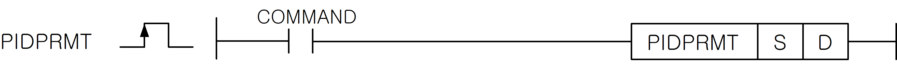

# PIDPRMT

Load the main PID parameters from a contiguous source block.

Manual section(s): 4.28.6. Original Korean notes below may cover the other variants on the same page; apply the widths and execution form of `PIDPRMT`.

## Editing route

Use `get_ir` → `apply_patch` for this instruction edit. `insert_ladder_instruction` is the internal writer route, not a separate MCP tool. Preserve the exported revision and native constraints.
The writer mnemonic is `PIDPRMT`; the catalog records opcode `1054` and `2` operands in order.
Inspect the CPU/project and target cells first. Use the inspected revision and positions, preserve expected values, dry-run when useful, then save and inspect the result. See the [editing skill](../../SKILL.md) and [ladder workflow](../ladder.md).

## Behavior

- On the input rising edge, update SV, Ts, Kp, Ti and Td irrespective of RUN/STOP/PAUSE state.
- S+0 holds SV (WORD), S+1 Ts (WORD, 0.1 ms), S+2 Kp (REAL), S+4 Ti (REAL), and S+6 Td (REAL). D is the constant loop number.

## Instruction constraints

- The page documents D in 0..31; check the selected CPU family rather than extending XGB beyond its supported loop range.

## Operands

| Order | Operand | Description (Korean manual) | Reviewed types | Device areas | Constant |
| --- | --- | --- | --- | --- | --- |
| 1 | S | 변경할 PID 연산 정보가 있는 디바이스 번호 | INT | PMK, L, Z, U, N, D, R | Not allowed |
| 2 | D | PID 연산 정보를 바꿀 루프 번호 (0~31) | WORD | None | Allowed |

These are the current library's reviewed operand rules. A shared type union is not a per-variant type choice; use the manual behavior to select the required width. Missing permissions stay unknown.

## CPU and acceptance

No separately reviewed CPU-model restriction is available in the current catalog; this means unknown, not universal compatibility.
Check the applicable model, firmware, modules and memory spans stated in the manual notes. Local parsing, writer validation and IL conversion do not prove native compilation or PLC behavior. Native acceptance requires XG5000 Open → Check Program → Save As → comparison.

## Manual behavior notes (Korean)

- PIDPRMT (PID 파라미터)
- 접점이 On되는 순간에 주요 PID 파라미터를 변경합니다.
- 오퍼랜드 S 는 변경할 파라미터가 저장된 곳의 첫 번째 워드 번지를 나타내고, 오퍼랜드 D 는 상수 ( 0 ~31 ) 이며 루프 번호를 의미합니다.
- PID루프의 RUN/STOP/PAUSE 상태에 관계없이 동작합니다.
- PIDPRMT를 이용해서 바꿀수 있는 파라미터는 SV, Ts, Kp, Ti, Td입니다.
- 오퍼랜드 S를 시작으로 대입되는 데이터형은 아래의 표와 같습니다.

## Manual applicability and restrictions

- 적용 기종 : XGK, XGB(XBC-U, XBM-H/H2/HP)

## Manual flag and step matrix

The shared usage table marks affected flags with `O`, and `-` where it lists no effect. Native steps are the manual's instruction size, not the number of operand arguments. Conditions for setting/clearing flags are in the behavior notes.

| Manual instruction group | Native steps | 에러 (F110) | 제로 (F111) | 캐리 (F112) |
| --- | --- | --- | --- | --- |
| PIDPRMT | 2 | - | - | - |

## Referenced manual figures

These figures belong to the shared source topic. Read the source corrections above before using variant-specific layouts or example values.

## Provenance

Source: `XGK(B)InstructionHelp_Kr_V3.5.chm`, SHA-256 `b866d589d800addcb039f9f09b182592464d6367faa55abf6dde9ac34a1580e0`.

- `4286pidprmt.htm` — §4.28.6; source SHA-256 `722dcac3fee2123759b21dbf80c5e79874f6c3d394c4039be201b5c503b059d8`.
- Additional behavior/operand evidence: `4286pidprmt.htm`.
