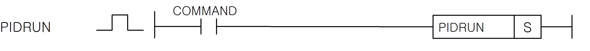

# PIDRUN

Run a PID loop using its configured K-device parameter area.

Manual section(s): 4.28.5. Original Korean notes below may cover the other variants on the same page; apply the widths and execution form of `PIDRUN`.

## Editing route

Use `insert_ladder_instruction` after calling `describe_operation` for its current schema.
The writer mnemonic is `PIDRUN`; the catalog records opcode `1051` and `1` operands in order.
Inspect the CPU/project and target cells first. Use the inspected revision and positions, preserve expected values, dry-run when useful, then save and inspect the result. See the [editing skill](../../SKILL.md) and [ladder workflow](../ladder.md).

## Behavior

- S selects loop 0..31 on XGK or 0..15 on XGB. Configure PV, SV, gains, output limits and MV routing for the correct CPU family.
- Ti is an integral time denominator: reducing it strengthens integral action.

## Instruction constraints

- XGK and XGB use different K-device layouts. Preserve user-read-only/reserved parameter entries.
- When deleting PIDRUN through a RUN-time edit, first turn its enable contact Off; otherwise the previous output may remain and a later insertion can resume the loop.

## Source corrections

- The second PID parameter table is labelled XGK but contains XGB K1200-based data; distinguish it from the XGK K1000-based layout.

## Operands

| Order | Operand | Description (Korean manual) | Reviewed types | Device areas | Constant |
| --- | --- | --- | --- | --- | --- |
| 1 | S | PID 연산을 수행할 루프 번호 (XGK : 0~31, XGB : 0 ~ 15) | WORD | None | Allowed |

These are the current library's reviewed operand rules. A shared type union is not a per-variant type choice; use the manual behavior to select the required width. Missing permissions stay unknown.

## CPU and acceptance

No separately reviewed CPU-model restriction is available in the current catalog; this means unknown, not universal compatibility.
Check the applicable model, firmware, modules and memory spans stated in the manual notes. Local parsing, writer validation and IL conversion do not prove native compilation or PLC behavior. Native acceptance requires XG5000 Open → Check Program → Save As → comparison.

## Manual behavior notes (Korean)

- PIDRUN
- 사용자가 PID형식에 맞추어 저장한 K영역(워드로 XGK는K1000 ~ K2047, XGB는 K1200~K1850)의 PID루프 (S:루프 번호)를 가동합니다.
- K 디바이스 PID 파라미터 영역K디바이스 내의 PID 파라미터위치 할당은 다음의 표와 같습니다.
- PID Common 영역은 모든 루프들의 간략한 설정 및 상태를 나타내며 XGK는 더블 워드내의 비트 위치, XGB는 워드내의 비트 위치가 곧 루프 번호를 의미합니다.
- 자세한 내용은 아래의 XGK PID 파라미터 일람을 참고 하시기 바랍니다.
- PID 루프 개별 파라미터에는 사용자가 입력할 수 있는 사용자 입력값과 사용자가 가져다 사용할 수 있는 PID 출력값이 함께 들어있습니다.
- Quick Start
- 간단하게 사용할 경우 PV, MV를 각각 제어기의 입력, 출력으로 사용하며, 사용자가 입력해야할 값은 SV, MV_man, Kp, Ti, Td 입니다.
- PV : 제어기의 입력 (제어 대상의 센서출력), 주로 AD 모듈을 사용합니다.
- MV : 제어기의 출력 (제어 대상의 입력신호), 주로 DA 모듈을 사용합니다.
- SV : 제어 목표값. 제어를 통해 도달하고자하는 센서의 출력값을 입력합니다.
- MV_max : 최대 제어출력값. 제어 출력의 최대 범위를 입력합니다. 보통 XGK는10000, XGB는 4000을 입력하며, 값이 0일 경우 0 이상의 출력이 나가지 않습니다. Kp, Ti, Td : 비례, 적분, 미분 계수를 각각 입력하고 튜닝합니다.
- Ti 값은 적분항의 분모입니다. 따라서 적분 효과를 증대 시키려면 Ti를 줄여주고, 반대로 적분 효과를 감소시키려면 Ti를 크게 설정합니다.
- 런 중 수정으로 PIDRUN 블록을 지워야 할 경우 접점이 꺼진 상태에서 지워 주십시오.
- 접점을 켠 상태로 런중 수정하게 될 경우 출력값이 그대로 남아서, 나중에 같은 루프를 항시 On접점으로 추가할 경우 제어가 이어서 되는 문제가 발생할 수 있습니다.
- 상세 기능을 이용할 경우 별도의 XGK/XGB CPU사용설명서의 내장 PID편을 참고하시기 바랍니다.
- PIDRUN, PIDPRMT, PIDPAUSE, PIDINIT명령어를 모두 숙지하여, 오동작에 의한 사고를 방지해 주십시오.

## Manual applicability and restrictions

- 적용 기종 : XGK, XGB

## Manual flag and step matrix

The shared usage table marks affected flags with `O`, and `-` where it lists no effect. Native steps are the manual's instruction size, not the number of operand arguments. Conditions for setting/clearing flags are in the behavior notes.

| Manual instruction group | Native steps | 에러 (F110) | 제로 (F111) | 캐리 (F112) |
| --- | --- | --- | --- | --- |
| PIDRUN | 2 | - | - | - |

## Additional source notes after examples

The manual places some execution restrictions and timing conditions after its example heading. Retain those checks below. Example addresses and circuit assumptions describe the source example and are not defaults for a new program.

- XGK PID 파라미터 일람
- n: PID 의 루프 번호 10진수 표현
- m: PID 의 루프 번호 16진수 표현
- PID 관련 명령을 사용하지 않을 경우 일반 K 디바이스와 동일하게 사용할 수 있습니다.
- PV는 제어 입력으로, MOV등의 명령을 이용해서 제어 대상의 센서출력에 연결해 줍니다.
- MV는 제어 출력으로, MOV등의 명령을 이용해서 제어 대상의 구동기에 연결해 줍니다.
- PV, MV 및 모니터하기를 원하는 값은 모두 XG5000의 트랜드 모니터 또는 데이터 트레이스를 통해 제어시스템이 동작하는 모습을 그래프, 테이블 형태로 한 눈에 확인할 수 있습니다.

## Referenced manual figures

These figures belong to the shared source topic. Read the source corrections above before using variant-specific layouts or example values.

## Provenance

Source: `XGK(B)InstructionHelp_Kr_V3.5.chm`, SHA-256 `b866d589d800addcb039f9f09b182592464d6367faa55abf6dde9ac34a1580e0`.

- `4285pidrun.htm` — §4.28.5; source SHA-256 `616a8b85a055c0266f58fd867ea7018cbfe08ed019c2ec120d823d46519a5853`.
- Additional behavior/operand evidence: `4285pidrun.htm`.
