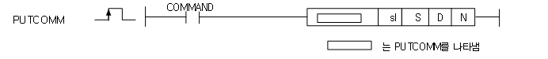

# PUTCOMM

Write one CANopen SDO object sub-index asynchronously.

Manual section(s): 4.40.17. Original Korean notes below may cover the other variants on the same page; apply the widths and execution form of `PUTCOMM`.

## Editing route

Use `insert_ladder_instruction` after calling `describe_operation` for its current schema.
The writer mnemonic is `PUTCOMM`; the catalog records opcode `1050` and `4` operands in order.
Inspect the CPU/project and target cells first. Use the inspected revision and positions, preserve expected values, dry-run when useful, then save and inspect the result. See the [editing skill](../../SKILL.md) and [ladder workflow](../ladder.md).

## Behavior

- sl identifies the communication module. S begins a command buffer containing the remote station, index/sub-index and data; N is the total byte length, eight command bytes plus payload.
- D begins an eight-byte/four-WORD result block. Response completion may arrive after multiple scans; inspect D bit15 (NDR) and bit14 (ERR), along with module flag WORDs F0023/F0015.

## Instruction constraints

- Reserve and correctly format the command and result blocks. Source/result range overflow sets F110 and F115.
- The body says XGB N-device memory is flash/read-only and therefore cannot be used as an output operand; distinguish that memory region from the N byte-length operand.

## Source corrections

- The initial device/support matrix says GETCOMM, copied from the read page. PUTCOMM body and operand table specify writing.

## Operands

| Order | Operand | Description (Korean manual) | Reviewed types | Device areas | Constant |
| --- | --- | --- | --- | --- | --- |
| 1 | sl | 통신 모듈이 장착된 슬롯번호(16진수로 설정) | WORD | None | Allowed |
| 2 | S | 데이터 쓰기를 할 슬레이브 국번, SDO 인덱스/서브인덱스, 데이터 | WORD | PMK, L, U, N, D, R | Not allowed |
| 3 | D | 명령어 처리 결과 저장 | WORD | Unknown | Unknown |
| 4 | N | 데이터 쓰기를 할 최대 바이트 길이, 실제 데이터는 N(전체크기)는 8 + 실제 데이터 크기 | WORD | PMK, L, U, N, D, R | Allowed |

These are the current library's reviewed operand rules. A shared type union is not a per-variant type choice; use the manual behavior to select the required width. Missing permissions stay unknown.

## CPU and acceptance

Reviewed XGK model table: no XGK model is allowed (`44017putcomm.htm`).
Check the applicable model, firmware, modules and memory spans stated in the manual notes. Local parsing, writer validation and IL conversion do not prove native compilation or PLC behavior. Native acceptance requires XG5000 Open → Check Program → Save As → comparison.

## Manual behavior notes (Korean)

- 통신 모듈을 통해 상대방 기기에 데이터를 Write하고자 하는 경우 사용되는 명령어 입니다
- sl(통신 모듈의 슬롯번호)로 지정된 통신 모듈에 S로 지정된 내부 디바이스 영역부터 N바이트의 명령어 데이터를 통신 모듈에 전송하고 통신모듈로부터의 결과값을 D로 지정된 내부 디바이스 영역으로 저장합니다.
- sl(통신 모듈의 슬롯번호)로 지정된 위치에 통신 모듈이 없거나, PUTCOMM 명령을 정상적으로 수행하지 못 했을 경우 F0015(WORD)의 해당 위치 비트가 셋(Set)됩니다.
- 이 명령은 스캔 동기 방식으로 처리되지 않습니다. 즉, 요청 후 여러 스캔이 지난 다음 상대방기기로부터 응답이 올 수 있으므로 명령어 처리시 바로 결과를 알 수 없습니다.
- 처리 결과 체크는 플래그로 확인 가능합니다.
- sl(통신 모듈의 슬롯번호)의 설정방식은 16진수 2자리로 설정하고 아래의 프로그램과 같이 h0002인 경우, 0002는 슬롯번호를 의미합니다
- (S + N) Byte또는 (D + 8)Byte가 영역을 초과한 경우 F110, F115 비트 셋(set)됩니다.
- XGB에서는 N영역이 플래시 영역이므로 읽기만 가능합니다. 따라서 XGB에서는 오퍼랜드로 N영역을 지원하지 않습니다.

## Manual flags

| 플래그 | 내 용 | 디바이스 번호 |
| --- | --- | --- |
| PUTCOMM/GETCOMM 에러 | 지정한 슬롯에 통신 모듈이 없을 경우 해당 비트가 ON됨 PUTCOMM/GETCOMM 명령을 제대로 수행하지 못 했을 경우 해당 비트가 On됨 | F0015 D의 Bit14 |
| PUTCOMM /GETCOMM 완료 | 상대방 통신 모듈로부터 정상 응답이 온 경우 해당 비트가 On됨 | F0023 D의 Bit15 |

## Manual applicability and restrictions

| 지원 기종 | XGK | XGK | XGK | XGK | XGK | XGK-N | XGK-N | XGK-N | XBC-U | XBC-U | XBC-U | XBC-U | XBM | XBM |
| --- | --- | --- | --- | --- | --- | --- | --- | --- | --- | --- | --- | --- | --- | --- |
| 지원 기종 | U | H | A | S | E | UN | HN | SN | U | H | SU | E | S | H(P) |
| 지원 기종 | X | X | X | X | X | X | X | X | O | O | O | X | O | O |

## Referenced manual figures

These figures belong to the shared source topic. Read the source corrections above before using variant-specific layouts or example values.

## Provenance

Source: `XGK(B)InstructionHelp_Kr_V3.5.chm`, SHA-256 `b866d589d800addcb039f9f09b182592464d6367faa55abf6dde9ac34a1580e0`.

- `44017putcomm.htm` — §4.40.17; source SHA-256 `6a3418de9ac792897d3f398f313ed2de86ec4cb56e7395a5b205f84379ea3784`.
- Additional behavior/operand evidence: `44017putcomm.htm`.
