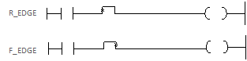

# R_EDGE

Manual section(s): 4.1.5. Original Korean notes below may cover the other variants on the same page; apply the widths and execution form of `R_EDGE`.

## Editing route

Use `edit_ladder_cell` after calling `describe_operation` for its current schema.
Set the replacement element kind to `RisingPulse`. `R_EDGE` describes `logic_cell` placement; it is represented by a physical cell rather than an application opcode.
Inspect the CPU/project and target cells first. Use the inspected revision and positions, preserve expected values, dry-run when useful, then save and inspect the result. See the [editing skill](../../SKILL.md) and [ladder workflow](../ladder.md).

## Operands

| 오퍼랜드 | 설명 | 데이터 타입 |
| --- | --- | --- |
| S | 비트 디바이스의 접점 / 워드 디바이스의 비트 접점 | BIT |

This source table is not a separately reviewed writer rule. Retain shared variant distinctions and let the current writer reject unsupported operands.

## CPU and acceptance

No separately reviewed CPU-model restriction is available in the current catalog; this means unknown, not universal compatibility.
Check the applicable model, firmware, modules and memory spans stated in the manual notes. Local parsing, writer validation and IL conversion do not prove native compilation or PLC behavior. Native acceptance requires XG5000 Open → Check Program → Save As → comparison.

## Manual behavior notes (Korean)

- R_EDGE
- R_EDGE 양변환 검출 기능을 합니다.
- R_EDGE 이전까지의 연산 결과가 전 스캔에서 Off였던 것이 현재 스캔에서 On으로 되고, 왼쪽 연결선 상태가 On 되어 있는 경우에 한해서 오른쪽의 연결선 상태는 현재 스캔 동안에 On이 됩니다.
- F_EDGE
- F_EDGE 음변환 검출 기능을 합니다.
- F_EDGE 이전까지의 연산결과가 전 스캔에서 On이였던 것이 현재 스캔에서 Off 되고 왼쪽 연결선 상태가 Off 되어 있는 경우에 한해서 오른쪽의 연결선 상태는 현재 스캔 동안에 On이 됩니다.

## Manual applicability and restrictions

- 적용 기종 : XGK-N(V1.60)

## Manual flag and step matrix

The shared usage table marks affected flags with `O`, and `-` where it lists no effect. Native steps are the manual's instruction size, not the number of operand arguments. Conditions for setting/clearing flags are in the behavior notes.

| Manual instruction group | Native steps | 에러 (F110) | 제로 (F111) | 캐리 (F112) |
| --- | --- | --- | --- | --- |
| R_EDGE | 1.5 | - | - | - |
| F_EDGE | 1.5 | - | - | - |

## Referenced manual figures

These figures belong to the shared source topic. Read the source corrections above before using variant-specific layouts or example values.

## Provenance

Source: `XGK(B)InstructionHelp_Kr_V3.5.chm`, SHA-256 `b866d589d800addcb039f9f09b182592464d6367faa55abf6dde9ac34a1580e0`.

- `415r_edgef_edge.htm` — §4.1.5; source SHA-256 `3477c06e987d5634bdb8a1bbaf527d3a3e25c2bef911697704ab96bb48739c6f`.
