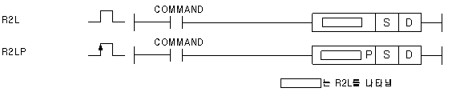
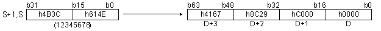

# R2LP

Manual section(s): 4.13.5. Original Korean notes below may cover the other variants on the same page; apply the widths and execution form of `R2LP`.

Execution form: the source explicitly pairs this command as `(P)`; `R2LP` is the pulse-type P form. Manual §2.4.2 defines `P` as pulse-type notation. Select the paired forms deliberately and retain the instruction's actual execution conditions; unrelated mnemonics ending in P are not classified by suffix alone.

## Editing route

Use `insert_ladder_instruction` after calling `describe_operation` for its current schema.
The writer mnemonic is `R2LP`; the catalog records opcode `839` and `2` operands in order.
Inspect the CPU/project and target cells first. Use the inspected revision and positions, preserve expected values, dry-run when useful, then save and inspect the result. See the [editing skill](../../SKILL.md) and [ladder workflow](../ladder.md).

## Operands

| Order | Operand | Description (Korean manual) | Reviewed types | Device areas | Constant |
| --- | --- | --- | --- | --- | --- |
| 1 | S | 단장 실수형 데이터가 저장되어진 영역번호 또는 배장 실수형 데이터 | REAL | PMK, F, L, T, C, U, N, D, R | Allowed |
| 2 | D | 배장 실수형 데이터가 저장되어진 영역번호 또는 배장 실수형 데이터 | LREAL | PMK, L, T, C, U, N, D, R | Not allowed |

These are the current library's reviewed operand rules. A shared type union is not a per-variant type choice; use the manual behavior to select the required width. Missing permissions stay unknown.

## CPU and acceptance

No separately reviewed CPU-model restriction is available in the current catalog; this means unknown, not universal compatibility.
Check the applicable model, firmware, modules and memory spans stated in the manual notes. Local parsing, writer validation and IL conversion do not prove native compilation or PLC behavior. Native acceptance requires XG5000 Open → Check Program → Save As → comparison.

## Manual behavior notes (Korean)

- R2L은 S+1, S로 지정된 단장형 실수(32비트)를 배장형 실수(64비트) 데이터로 변환하여 D+3, D+2, D+1, D에 저장합니다.

## Manual flags

| 플래그 | 내 용 | 디바이스 번호 |
| --- | --- | --- |
| 에러 | FPU연산 에러 플래그인 F0057E, F0057C, F0057B, F0057A가 셋(Set)될 경우, 셋(Set)됩니다. | F110 |

## Manual applicability and restrictions

- 적용 기종 : XGK, XGB
- 입력된 데이터가 실수값이 아닌경우를 제외하고 연산에러가 발생하지 않습니다.

## Manual flag and step matrix

The shared usage table marks affected flags with `O`, and `-` where it lists no effect. Native steps are the manual's instruction size, not the number of operand arguments. Conditions for setting/clearing flags are in the behavior notes.

| Manual instruction group | Native steps | 에러 (F110) | 제로 (F111) | 캐리 (F112) |
| --- | --- | --- | --- | --- |
| R2L(P) | 2~4 | - | - | - |

## Referenced manual figures

These figures belong to the shared source topic. Read the source corrections above before using variant-specific layouts or example values.

## Provenance

Source: `XGK(B)InstructionHelp_Kr_V3.5.chm`, SHA-256 `b866d589d800addcb039f9f09b182592464d6367faa55abf6dde9ac34a1580e0`.

- `4135r2lr2lp.htm` — §4.13.5; source SHA-256 `26affe8e3a8ba05ff0c5eb64bc8209268e42ba70a4f881133669c07300a687b0`.
- Additional behavior/operand evidence: `4135r2lr2lp.htm`, `245.htm`.
