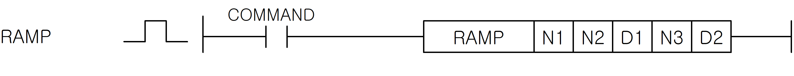
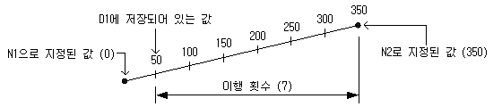

# RAMP

Manual section(s): 4.24.17. Original Korean notes below may cover the other variants on the same page; apply the widths and execution form of `RAMP`.

## Editing route

Use `insert_ladder_instruction` after calling `describe_operation` for its current schema.
The writer mnemonic is `RAMP`; the catalog records opcode `941` and `5` operands in order.
Inspect the CPU/project and target cells first. Use the inspected revision and positions, preserve expected values, dry-run when useful, then save and inspect the result. See the [editing skill](../../SKILL.md) and [ladder workflow](../ladder.md).

## Operands

| Order | Operand | Description (Korean manual) | Reviewed types | Device areas | Constant |
| --- | --- | --- | --- | --- | --- |
| 1 | N1 | 초기값 | WORD | PMK, F, L, T, C, Z, U, N, D, R | Allowed |
| 2 | N2 | 최종값 | WORD | PMK, F, L, T, C, Z, U, N, D, R | Allowed |
| 3 | D1 | 현재값 | WORD | PMK, L, N, D, R | Not allowed |
| 4 | N3 | 이행 횟수 (스캔 수) | WORD | PMK, F, L, T, C, Z, U, N, D, R | Allowed |
| 5 | D2 | 수행완료 주소( 1: 완료, 0: 진행중 또는 Off 상태 ) | WORD | PMK, L, N, D, R | Not allowed |

These are the current library's reviewed operand rules. A shared type union is not a per-variant type choice; use the manual behavior to select the required width. Missing permissions stay unknown.

## CPU and acceptance

No separately reviewed CPU-model restriction is available in the current catalog; this means unknown, not universal compatibility.
Check the applicable model, firmware, modules and memory spans stated in the manual notes. Local parsing, writer validation and IL conversion do not prove native compilation or PLC behavior. Native acceptance requires XG5000 Open → Check Program → Save As → comparison.

## Manual behavior notes (Korean)

- DETECT
- N3로 지정된 스캔 횟수동안, 초기값에서 최종값까지 직선으로 변화되는 값을 D1에 저장하고, D1+1에는 현재 수행된 횟수가 저장됩니다.
- 수행이 완료되면 D2의 값을 1로 만듭니다.( D2의 0번 비트 셋(Set) )
- N3로 지정된 이행 횟수로, N1으로 지정된 값부터 N2로 지정된 값까지의 직선으로 변화되는 값을 D1에 저장합니다. D1에 저장시킨 값은 매 스캔, 다음 식으로 산출합니다.
- 0부터 350까지의 구간을 7스캔 동안 변화시키는 경우는 다음 그림과 같이 됩니다.
- 1회의 변화값을 계산했을 때, 정수로 나누어 지지 않을 경우는 N3로 지정된 이행 횟수에서 N2로 지정된 값이 되도록 보정합니다. 이 때문에 직선 경사가 되지 않는 경우가 있습니다.
- N3에는 N1에서 N2로 이행할 때까지의 스캔 횟수를 지정합니다. N3가 0인 경우는 무처리됩니다.
- D1+1은 시스템이 사용하며, 본 명령의 실행 횟수를 저장합니다. 따라서 사용자가 임의로 변경하였을 경우 원치 않는 결과가 발생이 될 수 있습니다.
- 최종값까지의 이행이 완료되면 D2로 지정된 완료 디바이스가 1이 됩니다.
- 본 명령의 실행 도중에 지령이 OFF했을 경우, D1 (현재 값)의 내용은 변화하지 않습니다.
- RAMP 명령을 중간에 취소하고 싶은 경우 완료 디바이스에 1을 셋(Set) 하면 명령은 실행을 하지 않습니다.
- 완료된 RAMP 명령을 초기화 후 다시 실행시키고자 할 경우, 지령을 OFF a ON 하면 RAMP 명령을 다시 수행합니다.
- D2로 지정된 완료 디바이스가 ON하기 전에 N1과 N2로 지정된 값을 변경하지 마십시오. 매 스캔, 동일한 계산식으로 D1+1에 저장하는 값을 산출하기 때문에, N1 또는N2를 변경하면 급격히 변화하는 경우가 있습니다.

## Manual applicability and restrictions

- 적용 기종 : XGK, XGB

## Manual flag and step matrix

The shared usage table marks affected flags with `O`, and `-` where it lists no effect. Native steps are the manual's instruction size, not the number of operand arguments. Conditions for setting/clearing flags are in the behavior notes.

| Manual instruction group | Native steps | 에러 (F110) | 제로 (F111) | 캐리 (F112) |
| --- | --- | --- | --- | --- |
| RAMP | 4~7 | - | - | - |

## Additional source notes after examples

The manual places some execution restrictions and timing conditions after its example heading. Retain those checks below. Example addresses and circuit assumptions describe the source example and are not defaults for a new program.

- RAMP 명령은 접점이 ON되지 않아도 내부적으로 처리되는 부분이 있으므로, 간접지정(#)이나 인덱스([Z]) 사용시 주의하시기 바랍니다.
- RAMP명령의 오퍼랜드 중 하나에 M100[Z10]을 사용하고 Z10의 값이 M영역의 범위를 벗어날 수 있는 1947을 초과한 값이면 접점이 ON되지 않았어도 에러가 발생하게 됩니다.

## Referenced manual figures

These figures belong to the shared source topic. Read the source corrections above before using variant-specific layouts or example values.

## Provenance

Source: `XGK(B)InstructionHelp_Kr_V3.5.chm`, SHA-256 `b866d589d800addcb039f9f09b182592464d6367faa55abf6dde9ac34a1580e0`.

- `42417ramp.htm` — §4.24.17; source SHA-256 `943538b2e386588daf6b590371a99f493ce8263be9a1aa2240a066be77821bb7`.
- Additional behavior/operand evidence: `42417ramp.htm`.
