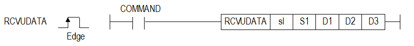

# RCVUDATA

Receive user-defined data through a configured Cnet/FEnet channel.

Manual section(s): 4.40.7. Original Korean notes below may cover the other variants on the same page; apply the widths and execution form of `RCVUDATA`.

## Editing route

Use `insert_ladder_instruction` after calling `describe_operation` for its current schema.
The writer mnemonic is `RCVUDATA`; the catalog records opcode `1082` and `5` operands in order.
Inspect the CPU/project and target cells first. Use the inspected revision and positions, preserve expected values, dry-run when useful, then save and inspect the result. See the [editing skill](../../SKILL.md) and [ladder workflow](../ladder.md).

## Behavior

- sl selects h00xy; S1 is Cnet channel 1/2 or a user-defined FEnet P2P channel. D1 is the destination and D2 reports the received byte count.
- D3..D3+3 is the four-WORD internal/status workspace. Data exceeding 1,024 bytes raises status 08 and only 1,024 bytes are stored.

## Instruction constraints

- Initialize the workspace to zero; do not reuse or manually alter it. Reserve enough destination devices and require user-defined parameters/link enable.
- The manual lists Cnet V3.2/CPU V4.2 and FEnet V8.0/CPU V4.7 minimums. The page says prior-command status 09 is XGB-only.

## Operands

| Order | Operand | Description (Korean manual) | Reviewed types | Device areas | Constant |
| --- | --- | --- | --- | --- | --- |
| 1 | sl | 통신모듈(Cnet, FEnet)이 장착된 베이스(x) 및 슬롯(y) 번호: h00xy | WORD | None | Allowed |
| 2 | S1 | 채널 정보 | WORD | PMK, L, Z, U, N, D, R | Allowed |
| 3 | D1 | 수신된 DATA를 저장할 시작 디바이스 번호 | WORD | PMK, L, Z, U, N, D, R | Not allowed |
| 4 | D2 | 수신된 DATA의 사이즈(최대 1024 Byte) | WORD | PMK, L, Z, U, N, D, R | Not allowed |
| 5 | D3 | 명령어 내부에서 사용될 임시 디바이스 번호 | WORD | PMK, L, Z, U, N, D, R | Not allowed |

These are the current library's reviewed operand rules. A shared type union is not a per-variant type choice; use the manual behavior to select the required width. Missing permissions stay unknown.

## CPU and acceptance

Reviewed XGK model table: XGK-CPUU, XGK-CPUH, XGK-CPUA, XGK-CPUS, XGK-CPUE, XGK-CPUUN, XGK-CPUHN, XGK-CPUSN (`4407rcvudata.htm`).
Check the applicable model, firmware, modules and memory spans stated in the manual notes. Local parsing, writer validation and IL conversion do not prove native compilation or PLC behavior. Native acceptance requires XG5000 Open → Check Program → Save As → comparison.

## Manual behavior notes (Korean)

- 이 명령은 사용자 정의 데이터(이하:UDATA)를 수신(Recieve)하는 명령 입니다.
- sl은 현재 통신모듈(Cnet, FEnet)이 장착된 베이스와 슬롯 번호를 입력하면 됩니다
- S1는 채널 번호를 의미하고 Cnet인 경우 1 또는 2만 설정해야 하며, FEnet은 사용자 정의로 설정된P2P 채널을 입력해야 합니다.
- D1는 수신된 UDATA를 저장할 시작 영역 주소를 나타냅니다.
- D2은 수신된 UDATA의 사이즈를 나타내며, 단위는 Byte 입니다.
- D3는 명령어 정보를 저장하는 임시 영역으로 사용되는 디바이스 영역이며, 크기는 4 워드(D3 ~ D3+3)입니다.
- FEnet 모듈의 경우 상위 1Byte는 Ethernet 연결 상태를 표시하며, 하위 1Byte는 명령어의 상태 정보를 시합니다. Cnet 모듈인 경우에는 ‘00’으로 표시합니다.
- 초기값은 모두 0이며 사용자가 임의로 데이터 값을 조작할 경우 명령어가 오동작 할 수 있습니다.

| CPU영역 | 데이터 크기 | 상태종류 |
| --- | --- | --- |
| D3 | WORD | 상태 코드 |
| D3+1 | WORD | 예약영역(사용금지) |
| D3+2 | WORD | 예약영역(사용금지) |
| D3+3 | WORD | 예약영역(사용금지) |

## Manual flags

| 플래그 | 내 용 | 디바이스 번호 |
| --- | --- | --- |
| 에러 | sl값이 통신모듈(Cnet, FEnet)이 장착된 베이스 및 슬롯번호와 일치하지 않을 경우 | F110 |

## Manual applicability and restrictions

- 적용제품 : Cnet, FEnet
- sl값이 통신모듈(Cnet, FEnet)이 장착된 베이스 및 슬롯번호와 일치하지 않을 경우 에러 플래그(F110)를 셋(Set)합니다.
- 상태 정보
- 상위 Byte
- 하위 Byte
- * 상태코드 9번은 XGB만 해당

| 지원 기종 | XGK | XGK | XGK | XGK | XGK | XGK-N | XGK-N | XGK-N | XBC-U | XBC-U | XBC-U | XBC-U | XBM | XBM |
| --- | --- | --- | --- | --- | --- | --- | --- | --- | --- | --- | --- | --- | --- | --- |
| 지원 기종 | U | H | A | S | E | UN | HN | SN | U | H | SU | E | S | H(P) |
| 지원 기종 | O | O | O | O | O | O | O | O | O | O | O | X | O | O |

| 상태코드 | 상태 정보 | 의미 |
| --- | --- | --- |
| 00 | 초기상태 | 명령어 수행 전 또는 Cnet 모듈이 장착되어 있는 경우 |
| 01 | 연결해제 | 이더넷 연결이 안된 경우 |
| 02 | 연결 | 이더넷 연결이 완료된 상태 |
| 03 | 연결 대기 중 | 이더넷 연결을 위해 응답 대기 중 |
| 04 | 연결 중 | 이더넷 연결 중 |
| 05 | 연결 해제 중 | 이더넷 연결 해제 중 |

| 상태코드 | 상태 정보 | 의미 |
| --- | --- | --- |
| 00 | 초기상태 | 명령어 수행 전 |
| 01 | 완료 | 명령어가 정상적으로 수행된 경우 |
| 02 | 모듈설정 에러 | sl 값이 통신모듈(Cnet, FEnet)이 장착되지 않은 베이스 또는 슬롯으로 설정된 경우 |
| 03 | 채널설정 에러 | Cnet: S1 채널 정보값이 1 또는 2가 아닌 경우 FEnet: S1 채널 정보값의 P2P 채널설정이 사용자정의가 아닌 경우 |
| 04 | 수신 데이터 없음 | 수신된 데이터가 없는 경우 |
| 05 | 통신파라미터 설정에러 | 통신모듈(Cnet, FEnet)의 통신 파라미터를 사용자정의로 설정하지 않았을 경우 및 링크인에이블을 설정하지 않은 경우 |
| 06 | 타임아웃 에러 | 통신모듈(Cnet, FEnet)이상으로 명령어에 대한 응답이 없는 경우 |
| 07 | 버전 호환 오류 | Cnet: Cnet 버전이 V3.2 미만, CPU 버전이 V4.2 미만 인 경우 FEnet: FEnet 버전이 V8.0 미만, CPU 버전이 V4.7 미만 인 경우 |
| 08 | 수신 사이즈 초과 | 수신된 데이터의 크기가 1024 Byte를 초과한 경우 발생 (초과된 경우 1024 Byte의 데이터만 디바이스 메모리에 저장) |
| 09 | 이전 명령 수행 중 | 같은 슬롯에 대해서 이전 명령의 수행이 완료되기 전에 기동 조건을 만났을 때 |

## Manual flag and step matrix

The shared usage table marks affected flags with `O`, and `-` where it lists no effect. Native steps are the manual's instruction size, not the number of operand arguments. Conditions for setting/clearing flags are in the behavior notes.

| Manual instruction group | Native steps | 에러 (F110) | 제로 (F111) | 캐리 (F112) |
| --- | --- | --- | --- | --- |
| RCVUDATA | 4~7 | O | - | - |

## Additional source notes after examples

The manual places some execution restrictions and timing conditions after its example heading. Retain those checks below. Example addresses and circuit assumptions describe the source example and are not defaults for a new program.

- D3에 지정한 디바이스 D3+1 ~ D3+3은 명령어에서 사용하는 각종 정보들이 저장되는 공간입니다.
- 사용자가 해당 영역의 값을 임의로 변경해서는 안됩니다. 해당 영역의 값을 임의로 변경할 경우 명령어가 정상적으로 동작 하지 않습니다.
- 수신된 데이터의 최대 사이즈는 1024Byte이므로, D1에 설정된 디바이스 주소 + D2로 설정된 수신 데이터 크기가 해당 CPU 모듈 디바이스의 끝영역을 초과하지 않도록 설정해야 합니다.

## Referenced manual figures

These figures belong to the shared source topic. Read the source corrections above before using variant-specific layouts or example values.

## Provenance

Source: `XGK(B)InstructionHelp_Kr_V3.5.chm`, SHA-256 `b866d589d800addcb039f9f09b182592464d6367faa55abf6dde9ac34a1580e0`.

- `4407rcvudata.htm` — §4.40.7; source SHA-256 `5f181c9095e330c19c4d3795c1af0d0953c9badd9b878e774eb16b0279811b9f`.
- Additional behavior/operand evidence: `4407rcvudata.htm`.
