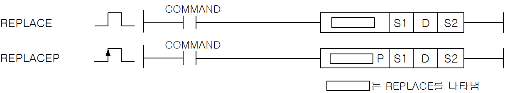
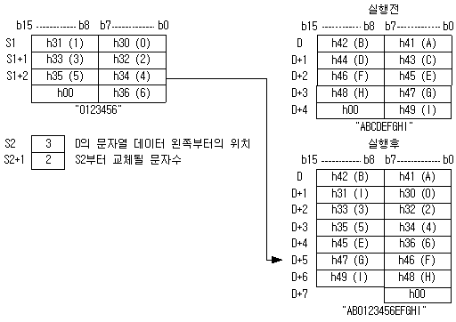

# REPLACEP

Manual section(s): 4.26.16. Original Korean notes below may cover the other variants on the same page; apply the widths and execution form of `REPLACEP`.

Execution form: the source explicitly pairs this command as `(P)`; `REPLACEP` is the pulse-type P form. Manual §2.4.2 defines `P` as pulse-type notation. Select the paired forms deliberately and retain the instruction's actual execution conditions; unrelated mnemonics ending in P are not classified by suffix alone.

## Editing route

Use `get_ir` → `apply_patch` for this instruction edit. `insert_ladder_instruction` is the internal writer route, not a separate MCP tool. Preserve the exported revision and native constraints.
The writer mnemonic is `REPLACEP`; the catalog records opcode `724` and `3` operands in order.
Inspect the CPU/project and target cells first. Use the inspected revision and positions, preserve expected values, dry-run when useful, then save and inspect the result. See the [editing skill](../../SKILL.md) and [ladder workflow](../ladder.md).

## Operands

| Order | Operand | Description (Korean manual) | Reviewed types | Device areas | Constant |
| --- | --- | --- | --- | --- | --- |
| 1 | S1 | 대체할 문자열 시작 주소 | STRING | PMK, L, Z, U, N, D, R | Not allowed |
| 2 | D | 문자열 시작 주소 | STRING | PMK, L, Z, U, N, D, R | Not allowed |
| 3 | S2 | D에서 교체될 선두 문자의 위치(S2+0)와 교체될 크기(S2+1) | WORD | PMK, L, Z, U, N, D, R | Not allowed |

These are the current library's reviewed operand rules. A shared type union is not a per-variant type choice; use the manual behavior to select the required width. Missing permissions stay unknown.

## CPU and acceptance

No separately reviewed CPU-model restriction is available in the current catalog; this means unknown, not universal compatibility.
Check the applicable model, firmware, modules and memory spans stated in the manual notes. Local parsing, writer validation and IL conversion do not prove native compilation or PLC behavior. Native acceptance requires XG5000 Open → Check Program → Save As → comparison.

## Manual flags

- REPLACE
- D로 지정된 디바이스 번호 이후에 저장되어 있는 문자열 데이터의 왼쪽부터 S2로 지정된 문자분의 데이터부터 S2+1 로 지정된 문자분의 데이터 까지를 S1으로 지정된 문자열로 대체하여 저장합니다.
- S2+1 이 0이면 D 로 지정된 문자열로부터 S2 로 지정된 위치에 S1을 삽입합니다.
- S1 문자열의 길이가 S2+1로 지정된 교체 문자열 크기와 다르면 D 의 문자열이 계속해서 증가 또는 감소할 위험이 있으므로 사용상 주의를 요합니다.

| 플래그 | 내 용 | 디바이스 번호 |
| --- | --- | --- |
| 에러 | 1.S2+1의 값이 D의 문자열의 길이를 초과했을 경우 2.S2의 값이 D의 문자열의 길이를 초과했을 경우 | F110 |

## Manual applicability and restrictions

- 적용 기종 : XGK, XGB

## Manual flag and step matrix

The shared usage table marks affected flags with `O`, and `-` where it lists no effect. Native steps are the manual's instruction size, not the number of operand arguments. Conditions for setting/clearing flags are in the behavior notes.

| Manual instruction group | Native steps | 에러 (F110) | 제로 (F111) | 캐리 (F112) |
| --- | --- | --- | --- | --- |
| REPLACE(P) | 4~6 | O | - | - |

## Referenced manual figures

These figures belong to the shared source topic. Read the source corrections above before using variant-specific layouts or example values.

## Provenance

Source: `XGK(B)InstructionHelp_Kr_V3.5.chm`, SHA-256 `b866d589d800addcb039f9f09b182592464d6367faa55abf6dde9ac34a1580e0`.

- `42616replacereplacep.htm` — §4.26.16; source SHA-256 `4472818802aba3635bbf280add4ed4c474c3d5050d6b9e5fbddcf6ebab6edbab`.
- Additional behavior/operand evidence: `42616replacereplacep.htm`, `245.htm`.
