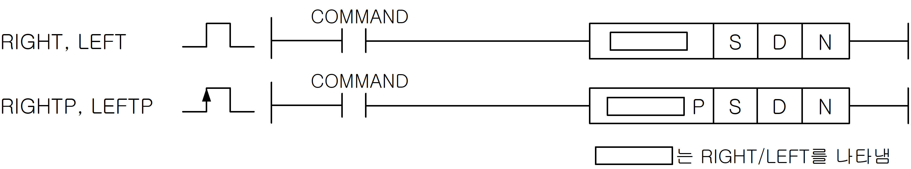
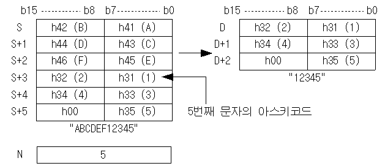
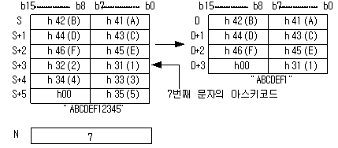

# RIGHT

Manual section(s): 4.26.14. Original Korean notes below may cover the other variants on the same page; apply the widths and execution form of `RIGHT`.

Execution form: the source explicitly pairs this command as `(P)`; `RIGHT` is the non-P partner. Manual §2.4.2 defines `P` as pulse-type notation. Select the paired forms deliberately and retain the instruction's actual execution conditions; unrelated mnemonics ending in P are not classified by suffix alone.

## Editing route

Use `get_ir` → `apply_patch` for this instruction edit. `insert_ladder_instruction` is the internal writer route, not a separate MCP tool. Preserve the exported revision and native constraints.
The writer mnemonic is `RIGHT`; the catalog records opcode `310` and `3` operands in order.
Inspect the CPU/project and target cells first. Use the inspected revision and positions, preserve expected values, dry-run when useful, then save and inspect the result. See the [editing skill](../../SKILL.md) and [ladder workflow](../ladder.md).

## Operands

| Order | Operand | Description (Korean manual) | Reviewed types | Device areas | Constant |
| --- | --- | --- | --- | --- | --- |
| 1 | S | 문자열 | STRING | PMK, L, Z, U, N, D, R | Not allowed |
| 2 | D | 추출된 문자열을 저장할 위치 | STRING | PMK, L, Z, U, N, D, R | Not allowed |
| 3 | N | 추출할 문자수 | WORD | PMK, F, L, T, C, Z, U, N, D, R | Allowed |

These are the current library's reviewed operand rules. A shared type union is not a per-variant type choice; use the manual behavior to select the required width. Missing permissions stay unknown.

## CPU and acceptance

No separately reviewed CPU-model restriction is available in the current catalog; this means unknown, not universal compatibility.
Check the applicable model, firmware, modules and memory spans stated in the manual notes. Local parsing, writer validation and IL conversion do not prove native compilation or PLC behavior. Native acceptance requires XG5000 Open → Check Program → Save As → comparison.

## Manual flags

- RIGHT
- S로 지정된 디바이스 번호 이후에 저장되어 있는 문자열 데이터의 오른쪽(문자열의 최종)부터 N문자분의 데이터를 D로 지정된 디바이스 번호 이후에 저장합니다.
- N으로 지정한 문자수가 0일 경우에는 D 에 NULL 코드(h00)가 저장됩니다.
- 지정된 N 값이 S에 지정된 문자열의 크기보다 클 경우 S 문자열 전체를 D로 복사합니다. 이때 에러는 발생되지 않습니다.
- LEFT
- S로 지정된 디바이스 번호 이후에 저장되어 있는 문자열 데이터의 왼쪽(문자열의 시작)부터 N문자분의 데이터를 D로 지정된 디바이스 번호 이후에 저장합니다.

| 플래그 | 내 용 | 디바이스 번호 |
| --- | --- | --- |
| 에러 | N이 최대 문자열 크기를 넘을 때 | F110 |

## Manual applicability and restrictions

- 적용 기종 : XGK, XGB

## Manual flag and step matrix

The shared usage table marks affected flags with `O`, and `-` where it lists no effect. Native steps are the manual's instruction size, not the number of operand arguments. Conditions for setting/clearing flags are in the behavior notes.

| Manual instruction group | Native steps | 에러 (F110) | 제로 (F111) | 캐리 (F112) |
| --- | --- | --- | --- | --- |
| RIGHT(P) LEFT(P) | 4~6 | O | - | - |

## Referenced manual figures

These figures belong to the shared source topic. Read the source corrections above before using variant-specific layouts or example values.

## Provenance

Source: `XGK(B)InstructionHelp_Kr_V3.5.chm`, SHA-256 `b866d589d800addcb039f9f09b182592464d6367faa55abf6dde9ac34a1580e0`.

- `42614rightrightpleftleftp1.htm` — §4.26.14; source SHA-256 `9174e636b1f910d525f3de545fa6578f2b660ef4316ddaafcbb6dd1ab5d4efd6`.
- Additional behavior/operand evidence: `42614rightrightpleftleftp1.htm`, `245.htm`.
