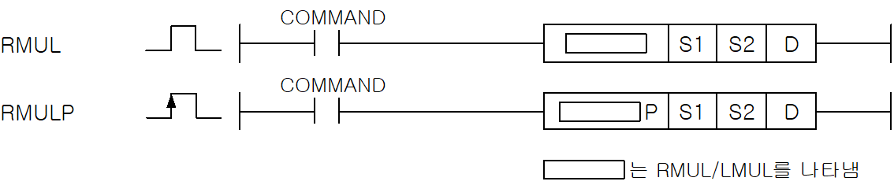
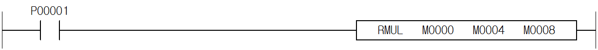
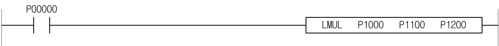

# RMUL

Manual section(s): 4.20.11. Original Korean notes below may cover the other variants on the same page; apply the widths and execution form of `RMUL`.

Execution form: the source explicitly pairs this command as `(P)`; `RMUL` is the non-P partner. Manual §2.4.2 defines `P` as pulse-type notation. Select the paired forms deliberately and retain the instruction's actual execution conditions; unrelated mnemonics ending in P are not classified by suffix alone.

## Editing route

Use `insert_ladder_instruction` after calling `describe_operation` for its current schema.
The writer mnemonic is `RMUL`; the catalog records opcode `232` and `3` operands in order.
Inspect the CPU/project and target cells first. Use the inspected revision and positions, preserve expected values, dry-run when useful, then save and inspect the result. See the [editing skill](../../SKILL.md) and [ladder workflow](../ladder.md).

## Operands

| Order | Operand | Description (Korean manual) | Reviewed types | Device areas | Constant |
| --- | --- | --- | --- | --- | --- |
| 1 | S1 | S2와 곱셈연산을 실행할 데이터 | REAL | PMK, F, L, T, C, Z, U, N, D, R | Allowed |
| 2 | S2 | S1과 곱셈연산을 실행할 데이터 | REAL | PMK, F, L, T, C, Z, U, N, D, R | Allowed |
| 3 | D | 연산결과를 저장할 주소 | REAL | PMK, L, T, C, Z, U, N, D, R | Not allowed |

These are the current library's reviewed operand rules. A shared type union is not a per-variant type choice; use the manual behavior to select the required width. Missing permissions stay unknown.

## CPU and acceptance

No separately reviewed CPU-model restriction is available in the current catalog; this means unknown, not universal compatibility.
Check the applicable model, firmware, modules and memory spans stated in the manual notes. Local parsing, writer validation and IL conversion do not prove native compilation or PLC behavior. Native acceptance requires XG5000 Open → Check Program → Save As → comparison.

## Manual flags

- RMUL (Real Multiply)
- S1으로 지정된 단장형 실수와 S2 로 지정된 단장형 실수를 승산하여, 그 결과를 D 영역에 단장형 실수로 저장한다. (단장형 실수는 2워드를 점유함)
- 오퍼랜드의 값의 범위는 다음과 같다.
- ± 2-126 ≤ | 오퍼랜드 | < ± 2128
- 오퍼랜드의 값의 결과가 범위를 초과하였을 경우 연산에러가 발생하나, 연산의 연속성을 위해 특정 값이 할당될 수 있습니다.
- LMUL (Long Real Multiply)
- S1으로 지정된 배장형 실수에서 S2 로 지정된 배장형 실수를 승산하여, 그 결과를 D 영역에 배장형 실수로 저장한다. (배장형 실수는 4워드를 점유함)
- ± 2-1022 ≤ | 오퍼랜드 | < ± 21024

| 플래그 | 내 용 | 디바이스 번호 |
| --- | --- | --- |
| 에러 | FPU연산 에러 플래그인 F0057E, F0057C, F0057B, F0057A가 셋(Set)될 경우, 셋(Set)됩니다(XGB는 지원안함) | F110 |

## Manual applicability and restrictions

- 적용 기종 : XGK, XGB

## Manual flag and step matrix

The shared usage table marks affected flags with `O`, and `-` where it lists no effect. Native steps are the manual's instruction size, not the number of operand arguments. Conditions for setting/clearing flags are in the behavior notes.

| Manual instruction group | Native steps | 에러 (F110) | 제로 (F111) | 캐리 (F112) |
| --- | --- | --- | --- | --- |
| RMUL(P) LMOV(P) | 4~8 | O | - | - |

## Referenced manual figures

These figures belong to the shared source topic. Read the source corrections above before using variant-specific layouts or example values.

## Provenance

Source: `XGK(B)InstructionHelp_Kr_V3.5.chm`, SHA-256 `b866d589d800addcb039f9f09b182592464d6367faa55abf6dde9ac34a1580e0`.

- `42011rmulrmulplmullmulp.htm` — §4.20.11; source SHA-256 `c28a071a2c71deaae18cc99d70ba797d0ae496987e935b3b7230e2fd515cb110`.
- Additional behavior/operand evidence: `42011rmulrmulplmullmulp.htm`, `245.htm`.
