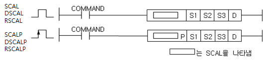
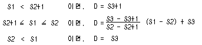
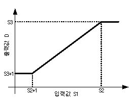

# RSCALP

Manual section(s): 4.28.12. Original Korean notes below may cover the other variants on the same page; apply the widths and execution form of `RSCALP`.

Execution form: the source explicitly pairs this command as `(P)`; `RSCALP` is the pulse-type P form. Manual §2.4.2 defines `P` as pulse-type notation. Select the paired forms deliberately and retain the instruction's actual execution conditions; unrelated mnemonics ending in P are not classified by suffix alone.

## Editing route

Use `get_ir` → `apply_patch` for this instruction edit. `insert_ladder_instruction` is the internal writer route, not a separate MCP tool. Preserve the exported revision and native constraints.
The writer mnemonic is `RSCALP`; the catalog records opcode `895` and `4` operands in order.
Inspect the CPU/project and target cells first. Use the inspected revision and positions, preserve expected values, dry-run when useful, then save and inspect the result. See the [editing skill](../../SKILL.md) and [ladder workflow](../ladder.md).

## Operands

| Order | Operand | Description (Korean manual) | Reviewed types | Device areas | Constant |
| --- | --- | --- | --- | --- | --- |
| 1 | S1 | 변환하고자 하는 입력 데이터의 디바이스 번호 | REAL | PMK, L, T, C, Z, U, N, D, R | Allowed |
| 2 | S2 | 입력 데이터의 스케일 상한 | REAL | PMK, L, Z, U, N, D, R | Not allowed |
| 3 | S3 | 출력 데이터의 스케일 상한 | REAL | PMK, L, Z, U, N, D, R | Not allowed |
| 4 | D | 출력 데이터를 저장 할 디바이스 번호 | REAL | PMK, L, Z, U, N, D, R | Not allowed |

These are the current library's reviewed operand rules. A shared type union is not a per-variant type choice; use the manual behavior to select the required width. Missing permissions stay unknown.

## CPU and acceptance

No separately reviewed CPU-model restriction is available in the current catalog; this means unknown, not universal compatibility.
Check the applicable model, firmware, modules and memory spans stated in the manual notes. Local parsing, writer validation and IL conversion do not prove native compilation or PLC behavior. Native acceptance requires XG5000 Open → Check Program → Save As → comparison.

## Manual flags

- SCL, DSCAL, RSCAL
- S2+1≤S1≤S2 범위의 입력 값 S1을 S3+1≤D≤S3 범위의 출력 값 D로 스케일링 변환합니다.
- S1이 [S2+1 ~ S2] 범위를 벗어난 경우 각각 S2+1, S2로 대체합니다.
- S3 < S3+1 인 경우 음의 스케일링 변환이 가능합니다.
- 입력 데이터의 스케일 상하한이 뒤바뀌어 설정 된 경우 에러 플래그가 On되며, 출력은 0으로 바뀝니다.
- 입력 데이터의 스케일 상하한이 동일할 경우 아래의 출력조건에서 일부 분모항이 0되므로 에러 플래그가 On되며, 출력은 0으로 바뀝니다.
- 출력 조건:
- INT/DINT형 연산 결과는 소수점 아래 첫째자리에서 반올림하여 표시됩니다.
- INT/DINT형 연산 결과가 표현 가능한 최대/최소값을 벗어날 경우 최대/최소값으로 표시됩니다.
- REAL형 연산 과정에서 표현 가능한 최대/최소값을 벗어날 경우 ±1.INF00000e+000으로 표시되므로 ±1.000e+010 이상의 큰 값을 분자에 사용하거나 ±1.000e-010이하의 작은 값을 분모에 사용할 때에는 주의하시기 바랍니다.
- DINT 형 연산 시 설정값이 1000만 이상이면 연산 오차가 발생할 수 있습니다.

| 플래그 | 내 용 | 디바이스 번호 |
| --- | --- | --- |
| 에러 | 입력 데이터의 스케일 하한값이 상한값 이상인 경우 | F110 |
| 에러 | 입력 데이터의 스케일 상한값이 하한값과 동일한 경우 | F110 |

## Manual applicability and restrictions

- 적용 기종 : XGK, XGB

## Manual flag and step matrix

The shared usage table marks affected flags with `O`, and `-` where it lists no effect. Native steps are the manual's instruction size, not the number of operand arguments. Conditions for setting/clearing flags are in the behavior notes.

| Manual instruction group | Native steps | 에러 (F110) | 제로 (F111) | 캐리 (F112) |
| --- | --- | --- | --- | --- |
| SCAL(P) / DSCAL(P) / RSCAL(P) | 4~7 | O | - | - |

## Referenced manual figures

These figures belong to the shared source topic. Read the source corrections above before using variant-specific layouts or example values.

## Provenance

Source: `XGK(B)InstructionHelp_Kr_V3.5.chm`, SHA-256 `b866d589d800addcb039f9f09b182592464d6367faa55abf6dde9ac34a1580e0`.

- `42812scalscalpdscaldscalprscalrs.htm` — §4.28.12; source SHA-256 `52f02805ec477ea2f42fc10fa21232f3fdd548b78fd7e92fc057ee55b4afb5e5`.
- Additional behavior/operand evidence: `42812scalscalpdscaldscalprscalrs.htm`, `245.htm`.
