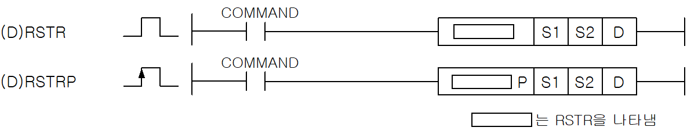
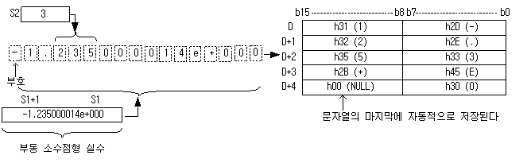
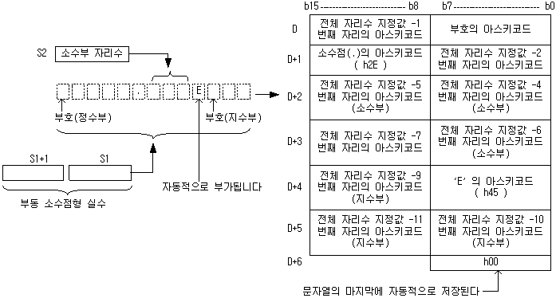

# RSTRP

Manual section(s): 4.26.10. Original Korean notes below may cover the other variants on the same page; apply the widths and execution form of `RSTRP`.

Execution form: the source explicitly pairs this command as `(P)`; `RSTRP` is the pulse-type P form. Manual §2.4.2 defines `P` as pulse-type notation. Select the paired forms deliberately and retain the instruction's actual execution conditions; unrelated mnemonics ending in P are not classified by suffix alone.

## Editing route

Use `insert_ladder_instruction` after calling `describe_operation` for its current schema.
The writer mnemonic is `RSTRP`; the catalog records opcode `706` and `3` operands in order.
Inspect the CPU/project and target cells first. Use the inspected revision and positions, preserve expected values, dry-run when useful, then save and inspect the result. See the [editing skill](../../SKILL.md) and [ladder workflow](../ladder.md).

## Operands

| Order | Operand | Description (Korean manual) | Reviewed types | Device areas | Constant |
| --- | --- | --- | --- | --- | --- |
| 1 | S1 | 변환할 부동 소수점 데이터 | REAL | PMK, L, Z, U, N, D, R | Allowed |
| 2 | S2 | 유효 소수점 자리수(0~25) | WORD | PMK, L, Z, U, N, D, R | Not allowed |
| 3 | D | 변환한 문자열을 저장할 주소 | STRING | PMK, L, Z, U, N, D, R | Not allowed |

These are the current library's reviewed operand rules. A shared type union is not a per-variant type choice; use the manual behavior to select the required width. Missing permissions stay unknown.

## CPU and acceptance

No separately reviewed CPU-model restriction is available in the current catalog; this means unknown, not universal compatibility.
Check the applicable model, firmware, modules and memory spans stated in the manual notes. Local parsing, writer validation and IL conversion do not prove native compilation or PLC behavior. Native acceptance requires XG5000 Open → Check Program → Save As → comparison.

## Manual flags

- RSTR (Real to String)
- 부동소수점형 실수 데이터S1을 S2에 지정한 소수점 자리수에 맞추어 지수 형식의 ASCII문자열로 변환하여 D부터 각 워드당 2개씩 차례로 저장합니다.
- RSTR의 연산 범위는 -3.402823466e+038 ~ -1.175494351e-038 또는 0 또는 1.175494351e-038 ~ 3.402823466e+038 까지 입니다. S2의 범위는 0 ~ 25 까지입니다.
- LSTR (Long Real to String)
- 부동소수점형 실수 데이터S1을 S2에 저장된 형식에 따라 ASCII문자열로 변환하여 D부터 각 워드당 2개씩 차례로 저장합니다.
- LSTR의 연산 범위는 -1.7976931348623157e+308 ~ -2.2250738585072014e-308 또는 0또는 2.2250738585072014e-308 ~ 1.7976931348623157e+308 까지 입니다. 주의)연산 범위를 넘은 값을 입력할 경우 1.#INF000e+0 또는 -1.#QNAN0E+0 또는 0 이 나올 수 있으며 에러를 출력하지 않습니다.
- S2에 지정된 유효 소수점 자리수의 범위는 0~25 까지 입니다.

| 플래그 | 내 용 | 디바이스 번호 |
| --- | --- | --- |
| 에러 | 변환된 값이 D로 지정된 영역을 초과할 경우 S2지정값이 0~25 범위를 벗어날 때 | F110 |

## Manual applicability and restrictions

- 적용 기종 : XGK, XGB(XBC-U, XBM-H/H2/HP)

## Manual flag and step matrix

The shared usage table marks affected flags with `O`, and `-` where it lists no effect. Native steps are the manual's instruction size, not the number of operand arguments. Conditions for setting/clearing flags are in the behavior notes.

| Manual instruction group | Native steps | 에러 (F110) | 제로 (F111) | 캐리 (F112) |
| --- | --- | --- | --- | --- |
| RSTR(P) LSTR(P) | 4~6 | O | - | - |

## Referenced manual figures

These figures belong to the shared source topic. Read the source corrections above before using variant-specific layouts or example values.

## Provenance

Source: `XGK(B)InstructionHelp_Kr_V3.5.chm`, SHA-256 `b866d589d800addcb039f9f09b182592464d6367faa55abf6dde9ac34a1580e0`.

- `42610rstrrstrplstrlstrp.htm` — §4.26.10; source SHA-256 `21a14bc93252787783c2dcfd9197e36470caa3e0bad6bbc09840879c6d90e0ce`.
- Additional behavior/operand evidence: `42610rstrrstrplstrlstrp.htm`, `245.htm`.
