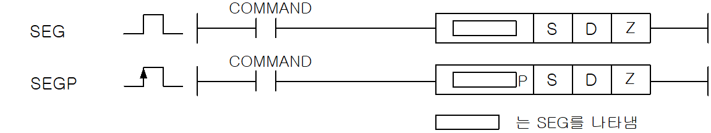
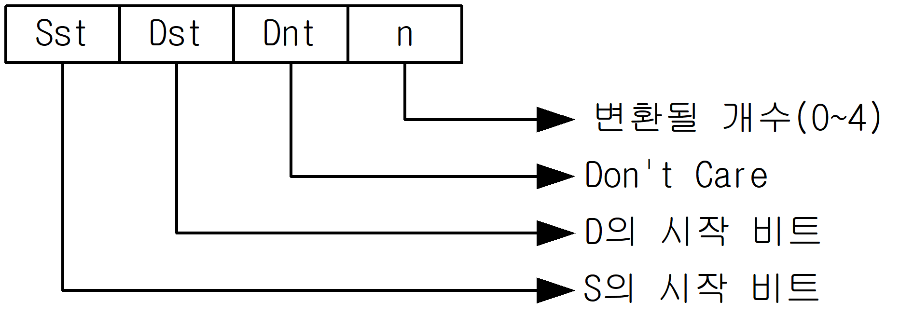
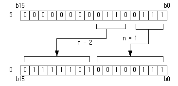
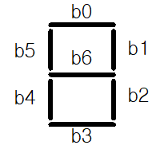

# SEG

Manual section(s): 4.23.1. Original Korean notes below may cover the other variants on the same page; apply the widths and execution form of `SEG`.

Execution form: the source explicitly pairs this command as `(P)`; `SEG` is the non-P partner. Manual §2.4.2 defines `P` as pulse-type notation. Select the paired forms deliberately and retain the instruction's actual execution conditions; unrelated mnemonics ending in P are not classified by suffix alone.

## Editing route

Use `get_ir` → `apply_patch` for this instruction edit. `insert_ladder_instruction` is the internal writer route, not a separate MCP tool. Preserve the exported revision and native constraints.
The writer mnemonic is `SEG`; the catalog records opcode `281` and `3` operands in order.
Inspect the CPU/project and target cells first. Use the inspected revision and positions, preserve expected values, dry-run when useful, then save and inspect the result. See the [editing skill](../../SKILL.md) and [ladder workflow](../ladder.md).

## Operands

| Order | Operand | Description (Korean manual) | Reviewed types | Device areas | Constant |
| --- | --- | --- | --- | --- | --- |
| 1 | S | 7세그먼트로 디코드할 데이터가 저장되어있는 주소 | DWORD | PMK, F, T, C, Z, U, N, D, R | Allowed |
| 2 | D | Decode한 데이터를 저장할 주소 | DWORD | Unknown | Unknown |
| 3 | Z | 표시할 포맷 | WORD | PMK, Z, U, N, D, R | Allowed |

These are the current library's reviewed operand rules. A shared type union is not a per-variant type choice; use the manual behavior to select the required width. Missing permissions stay unknown.

## CPU and acceptance

No separately reviewed CPU-model restriction is available in the current catalog; this means unknown, not universal compatibility.
Check the applicable model, firmware, modules and memory spans stated in the manual notes. Local parsing, writer validation and IL conversion do not prove native compilation or PLC behavior. Native acceptance requires XG5000 Open → Check Program → Save As → comparison.

## Manual flags

- SEG (7 Segment)
- Z에 설정된 포맷에 의해 S로부터 n개 숫자를 7세그먼트로 Decode하여 D에 저장합니다.
- Z의 포맷(16진수 형식)
- 여기서 n은 변환될 숫자의 개수를 의미하며 4비트 단위입니다.
- n 이 0이면 변환하지 않습니다.
- Segment의 구성

| 플래그 | 내 용 | 디바이스 번호 |
| --- | --- | --- |
| 에러 | Z의 포맷 규정이 틀린경우 셋(Set)합니다 | F110 |

| S1 | S1 | 7Segment의 구성 |  |  |  |  |  |  |  |  | 표시 데이터 |
| --- | --- | --- | --- | --- | --- | --- | --- | --- | --- | --- | --- |
| 16진수 | 비트 | 7Segment의 구성 | b7 | b6 | b5 | b4 | b3 | b2 | b1 | b0 | 표시 데이터 |
| 0 | 0000 |  | 0 | 0 | 1 | 1 | 1 | 1 | 1 | 1 | 0 |
| 1 | 0001 |  | 0 | 0 | 0 | 0 | 0 | 1 | 1 | 0 | 1 |
| 2 | 0010 |  | 0 | 1 | 0 | 1 | 1 | 0 | 1 | 1 | 2 |
| 3 | 0011 |  | 0 | 1 | 0 | 0 | 1 | 1 | 1 | 1 | 3 |
| 4 | 0100 |  | 0 | 1 | 1 | 0 | 0 | 1 | 1 | 0 | 4 |
| 5 | 0101 |  | 0 | 1 | 1 | 0 | 1 | 1 | 0 | 1 | 5 |
| 6 | 0110 |  | 0 | 1 | 1 | 1 | 1 | 1 | 0 | 1 | 6 |
| 7 | 0111 |  | 0 | 0 | 1 | 0 | 0 | 1 | 1 | 1 | 7 |
| 8 | 1000 |  | 0 | 1 | 1 | 1 | 1 | 1 | 1 | 1 | 8 |
| 9 | 1001 |  | 0 | 1 | 1 | 0 | 1 | 1 | 1 | 1 | 9 |
| A | 1010 |  | 0 | 1 | 1 | 1 | 0 | 1 | 1 | 1 | A |
| B | 1011 |  | 0 | 1 | 1 | 1 | 1 | 1 | 0 | 0 | B |
| C | 1100 |  | 0 | 0 | 1 | 1 | 1 | 0 | 0 | 1 | C |
| D | 1101 |  | 0 | 1 | 0 | 1 | 1 | 1 | 1 | 0 | D |
| E | 1110 |  | 0 | 1 | 1 | 1 | 1 | 0 | 0 | 1 | E |
| F | 1111 |  | 0 | 1 | 1 | 1 | 0 | 0 | 0 | 1 | F |

## Manual applicability and restrictions

- 적용 기종 : XGK, XGB

## Manual flag and step matrix

The shared usage table marks affected flags with `O`, and `-` where it lists no effect. Native steps are the manual's instruction size, not the number of operand arguments. Conditions for setting/clearing flags are in the behavior notes.

| Manual instruction group | Native steps | 에러 (F110) | 제로 (F111) | 캐리 (F112) |
| --- | --- | --- | --- | --- |
| SEG(P) | 4 | O | - | - |

## Referenced manual figures

These figures belong to the shared source topic. Read the source corrections above before using variant-specific layouts or example values.

## Provenance

Source: `XGK(B)InstructionHelp_Kr_V3.5.chm`, SHA-256 `b866d589d800addcb039f9f09b182592464d6367faa55abf6dde9ac34a1580e0`.

- `4231segsegp.htm` — §4.23.1; source SHA-256 `a49e7417842171630ffd4813834828e8a195e452251202dd938310f940a394d5`.
- Additional behavior/operand evidence: `4231segsegp.htm`, `245.htm`.
