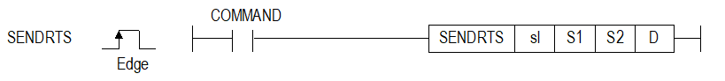
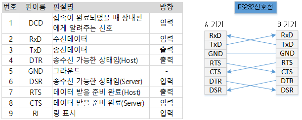

# SENDRTS

Manual section(s): 4.40.9. Original Korean notes below may cover the other variants on the same page; apply the widths and execution form of `SENDRTS`.

## Editing route

Use `get_ir` → `apply_patch` for this instruction edit. `insert_ladder_instruction` is the internal writer route, not a separate MCP tool. Preserve the exported revision and native constraints.
The writer mnemonic is `SENDRTS`; the catalog records opcode `1086` and `4` operands in order.
Inspect the CPU/project and target cells first. Use the inspected revision and positions, preserve expected values, dry-run when useful, then save and inspect the result. See the [editing skill](../../SKILL.md) and [ladder workflow](../ladder.md).

## Operands

| Order | Operand | Description (Korean manual) | Reviewed types | Device areas | Constant |
| --- | --- | --- | --- | --- | --- |
| 1 | sl | CNET모듈이 장착된 베이스(x) 및 슬롯(y) 번호 : h00xy | WORD | None | Allowed |
| 2 | S1 | 채널 정보 (1 ~ 2) | WORD | PMK, L, Z, U, N, D, R | Allowed |
| 3 | S2 | RTS 설정 값 (0 : Off또는 1: On(송신 요구)) | WORD | PMK, L, Z, U, N, D, R | Allowed |
| 4 | D | 명령어 내부에서 사용될 임시 디바이스 번호 | WORD | PMK, L, Z, U, N, D, R | Not allowed |

These are the current library's reviewed operand rules. A shared type union is not a per-variant type choice; use the manual behavior to select the required width. Missing permissions stay unknown.

## CPU and acceptance

Reviewed XGK model table: XGK-CPUU, XGK-CPUH, XGK-CPUA, XGK-CPUS, XGK-CPUE, XGK-CPUUN, XGK-CPUHN, XGK-CPUSN (`4409sendrts.htm`).
Check the applicable model, firmware, modules and memory spans stated in the manual notes. Local parsing, writer validation and IL conversion do not prove native compilation or PLC behavior. Native acceptance requires XG5000 Open → Check Program → Save As → comparison.

## Manual behavior notes (Korean)

- 자신의 수신버퍼 상태를 알려주는 신호인 RTS(Request To Send)를 내보내는 명령입니다.
- sl은 현재 CNET모듈이 장착된 베이스와 슬롯 번호를 입력하면 됩니다
- S1는 채널 번호를 의미하고 1 또는 2만 설정해야 합니다.
- S2는 RTS값으로 모뎀으로부터 데이터를 수신받기 위해 1로 설정해야하며 설정가능한 값은 0 또는 1로 설정해야 합니다.
- RS232 신호선으로 RTS(Request To Send)는 해당장비의 수신버퍼 상태를 알려주어 상대기기로 송신을 요구하는 신호입니다.
- D는 명령어 정보를 저장하는 임시 영역으로 사용되는 디바이스 영역이며, 크기는 4 워드(D ~ D+3)입니다. 초기값은 모두 0이며 사용자가 임의로 데이터 값을 조작할 경우 명령어가 오동작 할 수 있습니다.

| CPU영역 | 데이터 크기 | 상태종류 |
| --- | --- | --- |
| D | WORD | 상태 코드 |
| D+1 | WORD | 예약영역(사용금지) |
| D+2 | WORD | 예약영역(사용금지) |
| D+3 | WORD | 예약영역(사용금지) |

## Manual flags

| 플래그 | 내 용 | 디바이스 번호 |
| --- | --- | --- |
| 에러 | sl값이 Cnet 모듈이 장착된 베이스 및 슬롯번호와 일치하지 않을 경우 | F110 |

## Manual applicability and restrictions

- 적용제품 : Cnet
- sl값이 Cnet 모듈이 장착된 베이스 및 슬롯번호와 일치하지 않을 경우 에러 플래그(F110)를 셋(Set)합니다.
- 상태 정보
- * 상태코드 9번은 XGB만 해당

| 지원 기종 | XGK | XGK | XGK | XGK | XGK | XGK-N | XGK-N | XGK-N | XBC-U | XBC-U | XBC-U | XBC-U | XBM | XBM |
| --- | --- | --- | --- | --- | --- | --- | --- | --- | --- | --- | --- | --- | --- | --- |
| 지원 기종 | U | H | A | S | E | UN | HN | SN | U | H | SU | E | S | H(P) |
| 지원 기종 | O | O | O | O | O | O | O | O | O | O | O | X | O | O |

| 상태코드 | 상태 정보 | 의미 |
| --- | --- | --- |
| 00 | 초기상태 | 명령어 수행 전 |
| 01 | 완료 | 명령어가 정상적으로 수행된 경우 |
| 02 | 모듈설정 에러 | sl 값이 Cnet 모듈이 장착되지 않은 베이스 또는 슬롯으로 설정된 경우 |
| 03 | 채널설정 에러 | S1 채널 정보 값이 1 또는 2가 아닌 경우 |
| 04 | DTR 레벨 설정 오류 | S2 DTR설정 값이 0,1이 아닌 경우 |
| 05 | 통신파라미터 설정에러 | Cnet의 통신 파라미터를 사용자정의로 설정하지 않았을 경우 및 크인에이블을 설정하지 않은 경우 |
| 06 | 타임아웃 에러 | Cnet 모듈 이상으로 명령어에 대한 응답이 없는 경우 |
| 07 | 버전 호환 오류 | Cnet 버전이 V3.2 미만으로 해당 명령어를 지원하지 않는 경우 (CPU 버전이 V4.2 미만 인경우는 프로그램 다운로드가 되지 않습니다.) |
| 09 | 이전 명령 수행 중 | 같은 슬롯에 대해서 이전 명령의 수행이 완료되기 전에 기동 조건을 만났을 때 |

## Manual flag and step matrix

The shared usage table marks affected flags with `O`, and `-` where it lists no effect. Native steps are the manual's instruction size, not the number of operand arguments. Conditions for setting/clearing flags are in the behavior notes.

| Manual instruction group | Native steps | 에러 (F110) | 제로 (F111) | 캐리 (F112) |
| --- | --- | --- | --- | --- |
| SENDRTS | 4~7 | O | - | - |

## Additional source notes after examples

The manual places some execution restrictions and timing conditions after its example heading. Retain those checks below. Example addresses and circuit assumptions describe the source example and are not defaults for a new program.

- D에 지정한 디바이스D+1 ~ D+3은 명령어에서 사용하는 각종 정보들이 저장되는 공간입니다.
- 사용자가 해당 영역의 값을 임의로 변경해서는 안됩니다.
- 해당 영역의 값을 임의로 변경할 경우 명령어가 정상적으로 동작 하지 않습니다.

## Referenced manual figures

These figures belong to the shared source topic. Read the source corrections above before using variant-specific layouts or example values.

## Provenance

Source: `XGK(B)InstructionHelp_Kr_V3.5.chm`, SHA-256 `b866d589d800addcb039f9f09b182592464d6367faa55abf6dde9ac34a1580e0`.

- `4409sendrts.htm` — §4.40.9; source SHA-256 `de774870d644e8d78e09b7935a7e69a7357919e69beace71ce8987c6df9538e6`.
- Additional behavior/operand evidence: `4409sendrts.htm`.
