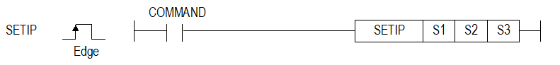
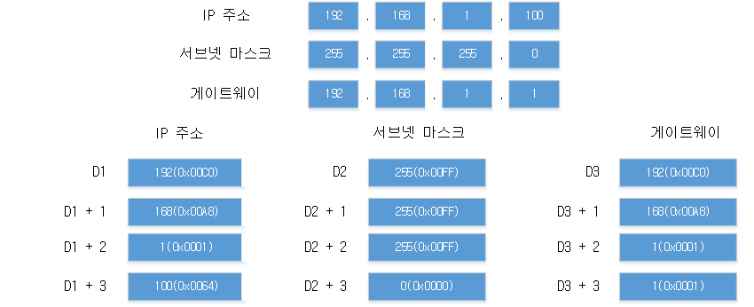

# SETIP

Set CPU local-Ethernet IP, mask and gateway together.

Manual section(s): 4.40.11. Original Korean notes below may cover the other variants on the same page; apply the widths and execution form of `SETIP`.

## Editing route

Use `get_ir` → `apply_patch` for this instruction edit. `insert_ladder_instruction` is the internal writer route, not a separate MCP tool. Preserve the exported revision and native constraints.
The writer mnemonic is `SETIP`; the catalog records opcode `1558` and `3` operands in order.
Inspect the CPU/project and target cells first. Use the inspected revision and positions, preserve expected values, dry-run when useful, then save and inspect the result. See the [editing skill](../../SKILL.md) and [ladder workflow](../ladder.md).

## Behavior

- S1, S2 and S3 point to four WORDs each, with one decimal IPv4 octet per WORD. To change only IP, first read the existing mask/gateway with GETIP.

## Instruction constraints

- Only CPUs with local Ethernet support this instruction. Invalid addresses/parameters or specified DHCP configurations set F110.

## Operands

| Order | Operand | Description (Korean manual) | Reviewed types | Device areas | Constant |
| --- | --- | --- | --- | --- | --- |
| 1 | S1 | 설정할 IP 주소가 저장된 디바이스 번호 | WORD | PMK, L, Z, U, N, D, R | Not allowed |
| 2 | S2 | 설정할 서브넷 마스크가 저장된 디바이스 번호 | WORD | PMK, L, Z, U, N, D, R | Not allowed |
| 3 | S3 | 설정할 게이트웨이가 저장된 디바이스 번호 | WORD | Unknown | Unknown |

These are the current library's reviewed operand rules. A shared type union is not a per-variant type choice; use the manual behavior to select the required width. Missing permissions stay unknown.

## CPU and acceptance

Reviewed XGK model table: XGK-CPUUN, XGK-CPUHN, XGK-CPUSN (`44011setip.htm`).
Check the applicable model, firmware, modules and memory spans stated in the manual notes. Local parsing, writer validation and IL conversion do not prove native compilation or PLC behavior. Native acceptance requires XG5000 Open → Check Program → Save As → comparison.

## Manual behavior notes (Korean)

- 로컬이더넷 정보를 설정할 수 있는 명령어입니다.
- S1, S2, S3에 설정한 값을 로컬이더의 IP주소, 서브넷마스크, 게이트웨이로 변경합니다. (로컬이더넷이 없는 기종에서는 사용할 수 없습니다)
- IP주소, 서브넷마스크, 게이트 웨이를 동시에 설정할 수 있습니다. IP주소만 변경하기 위해서는 GETIP명령어를 사용하여 현재 설정 된 서브넷 마스크와 게이트웨이 설정값을 가져와서 사용해야 합니다.
- IP주소를 설정하는 경우에 아래와 같이 주소 설정에 유의해야 합니다.
- EX. 192.168.1.100으로 IP주소를 설정하는 경우 디바이스에 설정값을 입력하기 위해서는 아래와 같이S1에 192(0x00C0), S1+1에 168(0X00A8), S1+2에 1(0x0001), S1+3에 100(0x0064)을 입력해야 합니다.

## Manual flags

| 플래그 | 내 용 | 디바이스 번호 |
| --- | --- | --- |
| 에러 | 1. 로컬이더넷 파라미터 설정이 이상한 경우 2. IP주소, 서브넷마스크, 게이트웨이 설정값이 유효하지 않은 경우 3. DHCP가 설정되어 있는 경우( XBCU-DN32U/UA/UP, XBMH-DN32H/HP) | F110 |

## Manual applicability and restrictions

- 적용 기종 : XG5000 V4.51, XGK V1.50

| 지원 기종 | XGK | XGK | XGK | XGK | XGK | XGK-N | XGK-N | XGK-N | XBC-U | XBC-U | XBC-U | XBC-U | XBM | XBM |
| --- | --- | --- | --- | --- | --- | --- | --- | --- | --- | --- | --- | --- | --- | --- |
| 지원 기종 | U | H | A | S | E | UN | HN | SN | U | H | SU | E | S | H(P) |
| 지원 기종 | X | X | X | X | X | O | O | O | O | X | X | X | X | O |

## Manual flag and step matrix

The shared usage table marks affected flags with `O`, and `-` where it lists no effect. Native steps are the manual's instruction size, not the number of operand arguments. Conditions for setting/clearing flags are in the behavior notes.

| Manual instruction group | Native steps | 에러 (F110) | 제로 (F111) | 캐리 (F112) |
| --- | --- | --- | --- | --- |
| SETIP | 4~7 | O | - | - |

## Referenced manual figures

These figures belong to the shared source topic. Read the source corrections above before using variant-specific layouts or example values.

## Provenance

Source: `XGK(B)InstructionHelp_Kr_V3.5.chm`, SHA-256 `b866d589d800addcb039f9f09b182592464d6367faa55abf6dde9ac34a1580e0`.

- `44011setip.htm` — §4.40.11; source SHA-256 `ca82885ebbb29cff192eb7e91b5d40f0d1949b9f237d3c0c174b40807510c35c`.
- Additional behavior/operand evidence: `44011setip.htm`.
