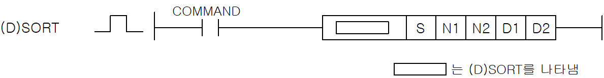
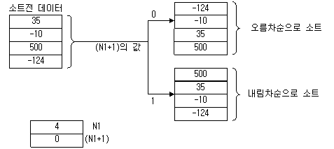

# SORT

Manual section(s): 4.24.18. Original Korean notes below may cover the other variants on the same page; apply the widths and execution form of `SORT`.

## Editing route

Use `get_ir` → `apply_patch` for this instruction edit. `insert_ladder_instruction` is the internal writer route, not a separate MCP tool. Preserve the exported revision and native constraints.
The writer mnemonic is `SORT`; the catalog records opcode `942` and `5` operands in order.
Inspect the CPU/project and target cells first. Use the inspected revision and positions, preserve expected values, dry-run when useful, then save and inspect the result. See the [editing skill](../../SKILL.md) and [ladder workflow](../ladder.md).

## Operands

| Order | Operand | Description (Korean manual) | Reviewed types | Device areas | Constant |
| --- | --- | --- | --- | --- | --- |
| 1 | S | 정렬할 데이터 시작 위치 | WORD/DWORD | PMK, L, T, C, Z, U, N, D, R | Not allowed |
| 2 | N1 | 정렬 범위와 정렬 순서(오름차순/내림차순) | WORD | PMK, L, T, C, Z, U, N, D, R | Not allowed |
| 3 | N2 | 1회 실행범위 ( < 정렬 범위 ) | WORD | PMK, F, L, T, C, Z, U, N, D, R | Allowed |
| 4 | D1 | 수행 완료 주소( 1: 완료, 0: 진행중 또는 Off 상태 ) | WORD | PMK, L, Z, U, N, D, R | Not allowed |
| 5 | D2 | 보조영역 | WORD | PMK, L, Z, N, D, R | Not allowed |

These are the current library's reviewed operand rules. A shared type union is not a per-variant type choice; use the manual behavior to select the required width. Missing permissions stay unknown.

## CPU and acceptance

No separately reviewed CPU-model restriction is available in the current catalog; this means unknown, not universal compatibility.
Check the applicable model, firmware, modules and memory spans stated in the manual notes. Local parsing, writer validation and IL conversion do not prove native compilation or PLC behavior. Native acceptance requires XG5000 Open → Check Program → Save As → comparison.

## Manual flags

- SORT
- S부터 N1개의 BIN 16비트 데이터를 N1+1의 값에 따라 오름차순(0)/내림차순(1)로 소트(정렬)합니다.
- SORT 명령에 의한 소트는 몇 스캔이 필요합니다.
- 실행 완료까지의 스캔 횟수는 소트 실행 완료까지의 최대 실행 횟수를 N2로 지정된 1회의 실행에서 비교하는 데이터 수로 나눈 값이 됩니다. (소수점 이하는 내림이 됩니다.)
- N2의 값을 크게 하면 소트 완료까지의 스캔 횟수는 적어지지만, 스캔 타임은 연장됩니다.
- N2 가 0이면 명령을 실행하지 않습니다.
- 소트의 실행 완료까지의 최대 실행 횟수는 다음 식으로 산출합니다.
- 실행 완료까지의 최대 실행 횟수 = (N1) * (N1-1) ÷ 2 ÷ N2 [회] 예를 들면 N1=10, N2=1의 경우에는 10 * (10-1) ÷ 2 ÷ 1=45(회) 걸립니다. N2=2로 하면 소트 완료까지에 45 ÷ 2 = 22.5 → 23 [스캔]이 걸립니다.
- D1으로 지정된 디바이스(완료 디바이스)는 SORT 명령 실행을 완료하면 1을 저장합니다. 소트 완료 후, 입력 접점(지령)을 OFF하면 D1으로 지정된 디바이스의 값은 0으로 됩니다.
- D2로 지정된 디바이스에서 4워드는 실행시에 시스템이 사용합니다. D2로 지정된 디바이스에서 4워드는 사용자가 변경하지 마십시오.
- 소트 실행 중에 N1을 변경했을 경우에는 변경 후의 소트 데이터로 소트를 합니다.

| 플래그 | 내 용 | 디바이스 번호 |
| --- | --- | --- |
| 에러 | N1의 값이 해당 영역을 벗어날 경우 N1+1 에 지정한 정렬 순서가 0 또는 1이 아닐 때 | F110 |

## Manual applicability and restrictions

- 적용 기종 : XGK, XGB

## Manual flag and step matrix

The shared usage table marks affected flags with `O`, and `-` where it lists no effect. Native steps are the manual's instruction size, not the number of operand arguments. Conditions for setting/clearing flags are in the behavior notes.

| Manual instruction group | Native steps | 에러 (F110) | 제로 (F111) | 캐리 (F112) |
| --- | --- | --- | --- | --- |
| (D)SORT | 4~7 | O | - | - |

## Additional source notes after examples

The manual places some execution restrictions and timing conditions after its example heading. Retain those checks below. Example addresses and circuit assumptions describe the source example and are not defaults for a new program.

- SORT/DSORT 명령은 접점이 ON되지 않아도 내부적으로 처리되는 부분이 있으므로, 간접지정(#)이나 인덱스([Z]) 사용시 주의하시기 바랍니다.
- SORT명령의 오퍼랜드 중 하나에 M100[Z10]을 사용하고 Z10의 값이 M영역의 범위를 벗어날 수 있는 1947을 초과한 값이면 접점이 ON되지 않았어도 에러가 발생하게 됩니다.

## Referenced manual figures

These figures belong to the shared source topic. Read the source corrections above before using variant-specific layouts or example values.

## Provenance

Source: `XGK(B)InstructionHelp_Kr_V3.5.chm`, SHA-256 `b866d589d800addcb039f9f09b182592464d6367faa55abf6dde9ac34a1580e0`.

- `42418sortdsort1.htm` — §4.24.18; source SHA-256 `f4191748def20c818ca31f4203b7cb0accf088bae4aaec94afb91b6d1bf8bb83`.
- Additional behavior/operand evidence: `42418sortdsort1.htm`.
