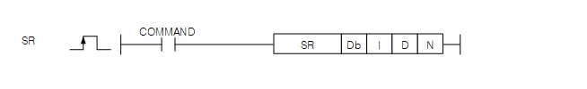
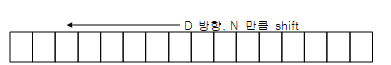

# SR

Manual section(s): 4.18.8. Original Korean notes below may cover the other variants on the same page; apply the widths and execution form of `SR`.

## Editing route

Use `get_ir` → `apply_patch` for this instruction edit. `insert_ladder_instruction` is the internal writer route, not a separate MCP tool. Preserve the exported revision and native constraints.
The writer mnemonic is `SR`; the catalog records opcode `939` and `4` operands in order.
Inspect the CPU/project and target cells first. Use the inspected revision and positions, preserve expected values, dry-run when useful, then save and inspect the result. See the [editing skill](../../SKILL.md) and [ladder workflow](../ladder.md).

## Operands

| Order | Operand | Description (Korean manual) | Reviewed types | Device areas | Constant |
| --- | --- | --- | --- | --- | --- |
| 1 | Db | 비트 단위로 shift할 영역의 시작비트 | BIT | PMK, L, D.x, R.x, U | Not allowed |
| 2 | I | 비트 단위로 shift할 입력 데이터 | BIT | PMK, F, L, T, C, D.x, R.x, U | Not allowed |
| 3 | D | 비트 단위로 shift할 이동 방향 | BIT | PMK, F, L, T, C, D.x, R.x, U | Not allowed |
| 4 | N | 비트 shift할 개수 | WORD | PMK, F, L, T, C, Z, U, N, D, R | Allowed |

These are the current library's reviewed operand rules. A shared type union is not a per-variant type choice; use the manual behavior to select the required width. Missing permissions stay unknown.

## CPU and acceptance

No separately reviewed CPU-model restriction is available in the current catalog; this means unknown, not universal compatibility.
Check the applicable model, firmware, modules and memory spans stated in the manual notes. Local parsing, writer validation and IL conversion do not prove native compilation or PLC behavior. Native acceptance requires XG5000 Open → Check Program → Save As → comparison.

## Manual flags

- SR
- SR명령의 실행조건인 입력신호가 Off-> On될 때마다 shift시작비트 Db로부터 N개 만큼의 데이터를 shift합니다.
- D에 설정된 입력방향 설정비트가 On이면 Right shift, 입력방향 비트가 Off이면 Left shift합니다.
- 데이터 shift에 의해 비워진 비트는 I로 설정된 입력데이터 비트의 값으로 채워집니다.

| 플래그 | 내 용 | 디바이스 번호 |
| --- | --- | --- |
| 에러 | N으로 설정한 값으로 SR명령실행중 ‘Db’로 설정된 디바이스 최대 영역를 벗어나는 경우 에러 플래그가 셋(Set)됩니다. | F110 |

## Manual applicability and restrictions

- 적용 기종 : XGK, XGB

## Manual flag and step matrix

The shared usage table marks affected flags with `O`, and `-` where it lists no effect. Native steps are the manual's instruction size, not the number of operand arguments. Conditions for setting/clearing flags are in the behavior notes.

| Manual instruction group | Native steps | 에러 (F110) | 제로 (F111) | 캐리 (F112) |
| --- | --- | --- | --- | --- |
| SR | 3 | O | - | - |

## Referenced manual figures

These figures belong to the shared source topic. Read the source corrections above before using variant-specific layouts or example values.

## Provenance

Source: `XGK(B)InstructionHelp_Kr_V3.5.chm`, SHA-256 `b866d589d800addcb039f9f09b182592464d6367faa55abf6dde9ac34a1580e0`.

- `4188sr.htm` — §4.18.8; source SHA-256 `2e9dbcfd72c6b0b2f81bafc4772d673611df13df3f64e4ff98e1bfad4cad27d6`.
- Additional behavior/operand evidence: `4188sr.htm`.
