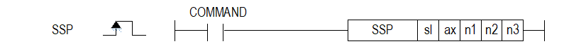
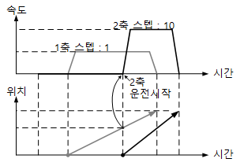

# SSP

Manual section(s): 4.41.12. Original Korean notes below may cover the other variants on the same page; apply the widths and execution form of `SSP`.

## Editing route

Use `insert_ladder_instruction` after calling `describe_operation` for its current schema.
The writer mnemonic is `SSP`; the catalog records opcode `970` and `5` operands in order.
Inspect the CPU/project and target cells first. Use the inspected revision and positions, preserve expected values, dry-run when useful, then save and inspect the result. See the [editing skill](../../SKILL.md) and [ladder workflow](../ladder.md).

## Operands

| Order | Operand | Description (Korean manual) | Reviewed types | Device areas | Constant |
| --- | --- | --- | --- | --- | --- |
| 1 | sl | 위치 모듈이 장착된 베이스(x)와 슬롯(y) 번호:h00xy | WORD | Unknown | Unknown |
| 2 | ax | 지령을 내릴 축 (0:X 축, 1:Y 축, 2:Z 축) | WORD | PMK, L, Z, N, D, R | Allowed |
| 3 | n1 | 위치동기를 실행할 주축의 위치값 | DINT | PMK, L, Z, N, D, R | Allowed |
| 4 | n2 | 위치동기 기동시 운전할 지령축의 스텝번호 ※ XGB 위치:내장(0~80), XGB 증설(0~150) | WORD | PMK, L, Z, N, D, R | Allowed |
| 5 | n3 | 위치동기 주축 설정 | WORD | PMK, L, Z, N, D, R | Allowed |

These are the current library's reviewed operand rules. A shared type union is not a per-variant type choice; use the manual behavior to select the required width. Missing permissions stay unknown.

## CPU and acceptance

No separately reviewed CPU-model restriction is available in the current catalog; this means unknown, not universal compatibility.
Check the applicable model, firmware, modules and memory spans stated in the manual notes. Local parsing, writer validation and IL conversion do not prove native compilation or PLC behavior. Native acceptance requires XG5000 Open → Check Program → Save As → comparison.

## Manual behavior notes (Korean)

- ※ 오퍼랜드 설정 범위는 XGF-PxxA를 기준으로 합니다. 축에 대한 오퍼랜드(ax)의 설정 범위는 제품에서 지원하는 제어 축 수에 따라 다르니, 제품 사용설명서를 참조하여 주십시오.
- 이 명령은 위치결정 모듈에 위치동기 지령을 내리는 명령입니다.
- sl(위치결정 모듈의 슬롯번호)로 지정된 위치결정 모듈의 ax로 지정된 축에 주축인 n3축이 n1의 위치가 되었을 때 지령축 ax의 n2스텝을 기동 하도록 위치동기를 명령합니다.
- 위치 동기 명령은 주축이 원점 결정 상태에서만 실행할 수 있습니다.
- 위치 동기 명령은 주축의 현재 위치에 따라서 종축이 동기 되어 기동합니다.
- 위치 동기는 종축에서 위치 동기 명령을 실행시켜야 합니다.
- 위치 동기 명령을 실행하면 운전 중 상태로 되고 운전은 주축의 현재 위치가 위치 동기의 설정 위치와 일치하는 시점에서 종축이 운전을 시작합니다.
- 종축에서 위치 동기 명령을 실행시킨 후에 취소하고자 하는 경우에는 정지 명령을 실행하면 위치 동기명령이 해제됩니다.
- n3에 설정할 수 있는 값은 아래와 같습니다.

| 설정값 | 축 | 축 |
| --- | --- | --- |
| 설정값 | XGK | XGB |
| 0 | X축 | X축 |
| 1 | Y축 | Y축 |
| 2 | Z축 | 지원안함 |
| 3 | Encoder | 지원안함 |

## Manual flags

| 플래그 | 내 용 | 디바이스 번호 |
| --- | --- | --- |
| 에러 | ax 값이 범위를 벗어날 경우 | F110 |

## Manual applicability and restrictions

- 적용 기종 : XGK, XBC, XBM, XBF
- ax의 설정값이 제품에서 지원하는 설정 범위와 다른 값을 입력하면 에러가 발생(F110이 Set)됩니다.

## Manual flag and step matrix

The shared usage table marks affected flags with `O`, and `-` where it lists no effect. Native steps are the manual's instruction size, not the number of operand arguments. Conditions for setting/clearing flags are in the behavior notes.

| Manual instruction group | Native steps | 에러 (F110) | 제로 (F111) | 캐리 (F112) |
| --- | --- | --- | --- | --- |
| SSP | 4~7 | O | - | - |

## Additional source notes after examples

The manual places some execution restrictions and timing conditions after its example heading. Retain those checks below. Example addresses and circuit assumptions describe the source example and are not defaults for a new program.

- 다음의 경우는 에러가 되어 위치 동기 제어를 실행할 수 없습니다.
- M코드 신호가 On된 상태에서 위치 동기 명령을 실행한 경우 에러가 발생합니다.
- M코드 해제(MOF) 명령으로 M 코드를 “Off”로 만든 후 사용하시기 바랍니다.
- 주축으로 설정한 축이 현재 사용중인 모듈의 설정 가능한 축이 아니거나, 주축 설정을 명령축과 같게 설정한 경우 에러가 발생합니다.
- 현재 사용중인 모듈의 설정 가능한 축들 중에서 주축을 설정하십시오.

## Referenced manual figures

These figures belong to the shared source topic. Read the source corrections above before using variant-specific layouts or example values.

## Provenance

Source: `XGK(B)InstructionHelp_Kr_V3.5.chm`, SHA-256 `b866d589d800addcb039f9f09b182592464d6367faa55abf6dde9ac34a1580e0`.

- `44112ssp.htm` — §4.41.12; source SHA-256 `aee99afda0e03ae056d15fbfaa81fe6c2e6b290169e9ef4621a27299c5b9f305`.
- Additional behavior/operand evidence: `44112ssp.htm`.
