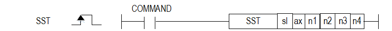

# SST

Start configured APM positioning steps on multiple axes simultaneously.

Manual section(s): 4.41.7. Original Korean notes below may cover the other variants on the same page; apply the widths and execution form of `SST`.

## Editing route

Use `get_ir` → `apply_patch` for this instruction edit. `insert_ladder_instruction` is the internal writer route, not a separate MCP tool. Preserve the exported revision and native constraints.
The writer mnemonic is `SST`; the catalog records opcode `960` and `6` operands in order.
Inspect the CPU/project and target cells first. Use the inspected revision and positions, preserve expected values, dry-run when useful, then save and inspect the result. See the [editing skill](../../SKILL.md) and [ladder workflow](../ladder.md).

## Behavior

- Use n1/n2/n3 for X/Y/Z step numbers and n4 as the axis-selection bitmask. Two or more valid axes must participate.

## Instruction constraints

- The page ax convention is 0=X,1=Y,2=Z for XGF-PxxA; verify the actual module axis count. XGB has no Z operand use, fixes n4 to 3, and has its own step limits.
- Invalid participating axis data can prevent all selected axes from starting.

## Source corrections

- The n4 table only labels bits 0..2, but its h000B example selects four-axis data. Use the actual module manual when fourth-axis behavior matters.

## Operands

| Order | Operand | Description (Korean manual) | Reviewed types | Device areas | Constant |
| --- | --- | --- | --- | --- | --- |
| 1 | sl | 위치 모듈이 장착된 베이스(x)와 슬롯(y) 번호:h00xy | WORD | Unknown | Unknown |
| 2 | ax | 지령을 내릴 축 (0:X 축, 1:Y 축, 2:Z 축) | WORD | PMK, L, Z, N, D, R | Allowed |
| 3 | n1 | 동시기동을 실행할 X축 스텝번호 ※ XGB 위치:내장(0~80), XGB 증설(0~150) | WORD | PMK, L, Z, N, D, R | Allowed |
| 4 | n2 | 동시기동을 실행할 Y축 스텝번호 ※ XGB 위치:내장(0~80), XGB 증설(0~150) | WORD | PMK, L, Z, N, D, R | Allowed |
| 5 | n3 | 동시기동을 실행할 Z축 스텝번호 ※ XGB 위치:사용 안 함 | WORD | PMK, L, Z, N, D, R | Allowed |
| 6 | n4 | 동시기동을 실행할 축 설정 ※ XGB 위치:3으로 고정 | WORD | PMK, L, Z, N, D, R | Allowed |

These are the current library's reviewed operand rules. A shared type union is not a per-variant type choice; use the manual behavior to select the required width. Missing permissions stay unknown.

## CPU and acceptance

No separately reviewed CPU-model restriction is available in the current catalog; this means unknown, not universal compatibility.
Check the applicable model, firmware, modules and memory spans stated in the manual notes. Local parsing, writer validation and IL conversion do not prove native compilation or PLC behavior. Native acceptance requires XG5000 Open → Check Program → Save As → comparison.

## Manual behavior notes (Korean)

- ※ 오퍼랜드 설정 범위는 XGF-PxxA를 기준으로 합니다. 축에 대한 오퍼랜드(ax)의 설정 범위는 제품에서 지원하는 제어 축 수에 따라 다르니, 제품 사용설명서를 참조하여 주십시오.
- 이 명령은 위치결정 모듈에 동시기동 지령을 내리는 명령입니다.
- sl(위치결정 모듈의 슬롯번호)로 지정된 위치결정 모듈의 ax로 지정된 축에 X축은 n1스텝, Y축은 n2스텝, Z축은 n3스텝(XGB는 미사용)을 동시기동 하라는 명령을 합니다..
- n4에 동시기동을 실행할 축을 설정할 때는 아래와 같이 각 Bit별로 할당된 축의 Bit를 셋(Set)하여 설정합니다.
- ※ 예시) h000B로 설정하면 동시기동을 실행할 축으로 4축,2축,1축이 설정됩니다.

| 15 ~ 3 | 2 | 1 | 0 |
| --- | --- | --- | --- |
| 미사용 | Z축(XGB는 미사용) | Y축 | X축 |

## Manual flags

| 플래그 | 내 용 | 디바이스 번호 |
| --- | --- | --- |
| 에러 | ax 값이 범위를 벗어날 경우 | F110 |

## Manual applicability and restrictions

- 적용 기종 : XGK, XBC, XBM, XBF
- ax의 설정값이 제품에서 지원하는 설정 범위와 다른 값을 입력하면 에러가 발생(F110이 Set)됩니다.

## Manual flag and step matrix

The shared usage table marks affected flags with `O`, and `-` where it lists no effect. Native steps are the manual's instruction size, not the number of operand arguments. Conditions for setting/clearing flags are in the behavior notes.

| Manual instruction group | Native steps | 에러 (F110) | 제로 (F111) | 캐리 (F112) |
| --- | --- | --- | --- | --- |
| SST | 4~7 | O | - | - |

## Additional source notes after examples

The manual places some execution restrictions and timing conditions after its example heading. Retain those checks below. Example addresses and circuit assumptions describe the source example and are not defaults for a new program.

- 다음과 같은 경우에 에러가 되어 동시 기동에 설정된 모든 축의 운전을 실행할 수 없습니다.
- 동시 기동 설정 축들 중 한 축이라도 운전 데이터에서 에러가 발생한 경우 (해당 축에 에러코드 출력)
- 동시 기동 명령 축 설정이 잘못된 경우
- (1) 명령 축만 설정한 경우 (반드시 2축 이상 설정해야 합니다.)
- (2) 설정 축들 중 현재 사용중인 모듈의 설정 가능한 축 번호를 초과한 경우

## Referenced manual figures

These figures belong to the shared source topic. Read the source corrections above before using variant-specific layouts or example values.

## Provenance

Source: `XGK(B)InstructionHelp_Kr_V3.5.chm`, SHA-256 `b866d589d800addcb039f9f09b182592464d6367faa55abf6dde9ac34a1580e0`.

- `4417sst.htm` — §4.41.7; source SHA-256 `bb5c331bdd263ede0d98e935cccd93279e252d9002adefa1dbf5dbb7c7e7f8a0`.
- Additional behavior/operand evidence: `4417sst.htm`.
