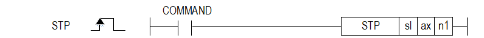

# STP

Manual section(s): 4.41.10. Original Korean notes below may cover the other variants on the same page; apply the widths and execution form of `STP`.

## Editing route

Use `get_ir` → `apply_patch` for this instruction edit. `insert_ladder_instruction` is the internal writer route, not a separate MCP tool. Preserve the exported revision and native constraints.
The writer mnemonic is `STP`; the catalog records opcode `966` and `3` operands in order.
Inspect the CPU/project and target cells first. Use the inspected revision and positions, preserve expected values, dry-run when useful, then save and inspect the result. See the [editing skill](../../SKILL.md) and [ladder workflow](../ladder.md).

## Operands

| Order | Operand | Description (Korean manual) | Reviewed types | Device areas | Constant |
| --- | --- | --- | --- | --- | --- |
| 1 | sl | 위치 모듈이 장착된 베이스(x)와 슬롯(y) 번호:h00xy | WORD | Unknown | Unknown |
| 2 | ax | 지령을 내릴 축 (0:X 축, 1:Y 축, 2:Z 축) | WORD | PMK, L, Z, N, D, R | Allowed |
| 3 | n1 | 감속 시간(0 ~ 2,147,483,647 ms) | DWORD | PMK, L, Z, N, D, R | Allowed |

These are the current library's reviewed operand rules. A shared type union is not a per-variant type choice; use the manual behavior to select the required width. Missing permissions stay unknown.

## CPU and acceptance

No separately reviewed CPU-model restriction is available in the current catalog; this means unknown, not universal compatibility.
Check the applicable model, firmware, modules and memory spans stated in the manual notes. Local parsing, writer validation and IL conversion do not prove native compilation or PLC behavior. Native acceptance requires XG5000 Open → Check Program → Save As → comparison.

## Manual behavior notes (Korean)

- ※ 오퍼랜드 설정 범위는 XGF-PxxA를 기준으로 합니다. 축에 대한 오퍼랜드(ax)의 설정 범위는 제품에서 지원하는 제어 축 수에 따라 다르니, 제품 사용설명서를 참조하여 주십시오.
- 이 명령은 위치결정 모듈에 감속정지 지령을 내리는 명령입니다.
- sl(위치결정 모듈의 슬롯번호)로 지정된 위치결정 모듈의 ax로 지정된 축에 감속정지를 합니다.
- 감속 정지 명령은 가속 구간, 정속 구간 및 감속 구간에서 처리하는 내용이 같습니다.
- 감속 시간은 감속 시작부터 정지까지의 시간을 뜻하며 0 ~ 2,147,483,647ms 까지 설정할 수 있습니다.
- 단, 0으로 설정했을 때는 운전을 시작할 때 설정된 감속 시간에 의해서 정지됩니다
- 감속 시간은 운전 축 기본 파라미터의 속도 제한치부터 정지까지 소요되는 시간을 뜻합니다.
- 감속 정지 명령으로 감속 정지하면 설정된 목표 위치로 위치결정 운전을 완료하지 않으므로 위치결정 완료 신호가 발생하지 않으며, M 코드모드 중 After 모드에서는 M 코드가 “On”되지 않습니다.
- 이후 정지 상태에서 간접 기동 명령(스텝 번호 = 현재 스텝 번호)이 발생하면
- (1) 절대좌표 방식 위치결정에서는 현재 운전 스텝의 출력되지 않은 위치 잔여량을 운전하고,
- (2) 상대좌표 방식 위치결정에서는 목표 위치에 설정된 이동량만큼 운전을 합니다.

## Manual flags

| 플래그 | 내 용 | 디바이스 번호 |
| --- | --- | --- |
| 에러 | ax 값이 범위를 벗어날 경우 | F110 |

## Manual applicability and restrictions

- 적용 기종 : XGK, XBC, XBM, XBF
- ax의 설정값이 제품에서 지원하는 설정 범위와 다른 값을 입력하면 에러가 발생(F110이 Set)됩니다.

## Manual flag and step matrix

The shared usage table marks affected flags with `O`, and `-` where it lists no effect. Native steps are the manual's instruction size, not the number of operand arguments. Conditions for setting/clearing flags are in the behavior notes.

| Manual instruction group | Native steps | 에러 (F110) | 제로 (F111) | 캐리 (F112) |
| --- | --- | --- | --- | --- |
| STP | 4~7 | O | - | - |

## Additional source notes after examples

The manual places some execution restrictions and timing conditions after its example heading. Retain those checks below. Example addresses and circuit assumptions describe the source example and are not defaults for a new program.

- 조그 운전의 실행 중 감속 정지 명령이 입력되면 에러가 발생됩니다.
- 조그 운전의 정지는 “조그 정지” 명령을 사용하십시오.
- 직선보간 또는 원호보간의 연속 운전 시에는 이동 방향을 따로 검사하지 않으므로 모터의 이동 방향이 바뀌어도 감속 정지 하지 않습니다.
- 운전 데이터에 이동방향의 반대로 목표 위치가 설정되어 있으면 연속 운전 제어 시 이동방향이 급격히 반대로 바뀌기 때문에 기계에 충격이 발생할 수 있습니다.
- 기계에 충격을 주지 않기 위해서는 운전방식을 「연속」으로 사용하지 말고, 「계속」으로 사용해 주십시오.
- 위치 결정 제어 운전 중 감속 정지 명령이 입력 되었을 때 감속 정지 시간에 의한 감속 거리가 목표 위치까지의 이동량 보다 크면 목표 위치에서 즉시 정지합니다.
- XGB 내장위치결정에서는 감속시간이 0인 경우 즉시 정지하고, 그 이외의 값인 경우는 해당 운전 스텝의 운전 데이터, 직접 기동인 경우는 DST 명령어에서 설정된 가감속 번호에 따라 정지합니다.

## Referenced manual figures

These figures belong to the shared source topic. Read the source corrections above before using variant-specific layouts or example values.

## Provenance

Source: `XGK(B)InstructionHelp_Kr_V3.5.chm`, SHA-256 `b866d589d800addcb039f9f09b182592464d6367faa55abf6dde9ac34a1580e0`.

- `44110stp.htm` — §4.41.10; source SHA-256 `2d2b39d624d30ca60732b957618479854a7d2db3bc732365fd99a83f1d1808aa`.
- Additional behavior/operand evidence: `44110stp.htm`.
