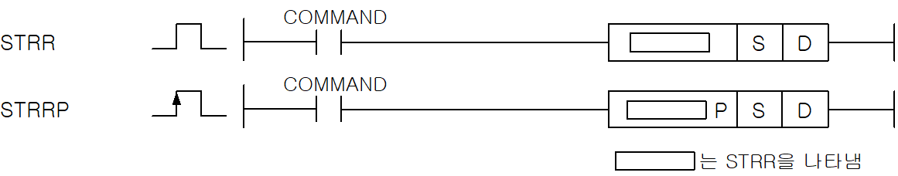
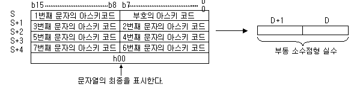
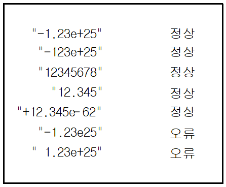
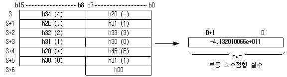

# STRLP

Manual section(s): 4.26.11. Original Korean notes below may cover the other variants on the same page; apply the widths and execution form of `STRLP`.

Execution form: the source explicitly pairs this command as `(P)`; `STRLP` is the pulse-type P form. Manual §2.4.2 defines `P` as pulse-type notation. Select the paired forms deliberately and retain the instruction's actual execution conditions; unrelated mnemonics ending in P are not classified by suffix alone.

## Editing route

Use `insert_ladder_instruction` after calling `describe_operation` for its current schema.
The writer mnemonic is `STRLP`; the catalog records opcode `712` and `2` operands in order.
Inspect the CPU/project and target cells first. Use the inspected revision and positions, preserve expected values, dry-run when useful, then save and inspect the result. See the [editing skill](../../SKILL.md) and [ladder workflow](../ladder.md).

## Operands

| Order | Operand | Description (Korean manual) | Reviewed types | Device areas | Constant |
| --- | --- | --- | --- | --- | --- |
| 1 | S | 변환할 문자열이 입력되어 있는 주소 | STRING | PMK, L, Z, U, N, D, R | Not allowed |
| 2 | D | 변환한 부동 소수점 데이터를 저장할 주소 | REAL/LREAL | PMK, L, Z, U, N, D, R | Not allowed |

These are the current library's reviewed operand rules. A shared type union is not a per-variant type choice; use the manual behavior to select the required width. Missing permissions stay unknown.

## CPU and acceptance

No separately reviewed CPU-model restriction is available in the current catalog; this means unknown, not universal compatibility.
Check the applicable model, firmware, modules and memory spans stated in the manual notes. Local parsing, writer validation and IL conversion do not prove native compilation or PLC behavior. Native acceptance requires XG5000 Open → Check Program → Save As → comparison.

## Manual flags

- STRR (String to Real)
- ASCII문자열 S를 단장형 실수데이터로 변환하여 D에 저장합니다.
- 지정된 문자열은 소수점형, 지수형으로 변환이 가능합니다.
- 문자열의 허용 예는 다음과 같습니다.
- 문자열에 ASCII값이 ‘0’~’9’, 부호, 소수점, ‘e’또는 ‘E’ 이외의 값이 있을 때 에러가 셋(Set)됩니다.
- STRR의 연산 범위는 -3.402823466e+038 ~ -1.175494351e-038 또는 0 또는 1.175494351e-038 ~ 3.402823466e+038 까지 입니다.
- STRR(P) 의 경우 연산 범위를 넘는 데이터가 입력되면 에러를 셋(Set) 하게 됩니다. 입력한 데이터의 유효 자리수가 17을 넘을 때 그 이후에 입력된 값은 무시됩니다.
- STRL (String to Long Real)
- ASCII문자열 S를 배장형 실수데이터로 변환하여 D에 저장합니다.
- STRL의 연산 범위는 -1.7976931348623157e+308 ~ -2.2250738585072014e-308 또는 0 또는 2.2250738585072014e-308 ~ 1.7976931348623157e+308 까지 입니다.
- 연산 범위를 넘은 값을 입력할 경우 1.#INF000e+0 또는 -1.#QNAN0E+0 또는 0 이 나올 수 있으며 에러를 출력하지 않습니다.
- STRL(P) 의 허용 문자열 포맷은 STRR(P)와 같습니다.
- 입력한 데이터의 유효 자리수가 17을 넘을 때 그 이후에 입력된 값은 무시됩니다.

| 플래그 | 내 용 | 디바이스 번호 |
| --- | --- | --- |
| 에러 | 1.문자열 끝에 NULL이 없거나, ASCII값이 ‘0’~’9’, 부호, 소수점, ‘e’또는 ‘E’ 이외의 값일 때 2.문자열의 길이가 최대 크기를 넘었을 때 3.입력 문자열이 부동 소수점을 나타내는 데이터 포맷이 아닐 때. 4.입력된 문자의 데이터가 연산 범위를 넘었을 때( STRR, STRRP ) | F110 |

## Manual applicability and restrictions

- 적용 기종 : XGK, XGB(XBC-U, XBM-H/H2/HP)

## Manual flag and step matrix

The shared usage table marks affected flags with `O`, and `-` where it lists no effect. Native steps are the manual's instruction size, not the number of operand arguments. Conditions for setting/clearing flags are in the behavior notes.

| Manual instruction group | Native steps | 에러 (F110) | 제로 (F111) | 캐리 (F112) |
| --- | --- | --- | --- | --- |
| STRR(P) STRL(P) | 2~4 | O | - | - |

## Referenced manual figures

These figures belong to the shared source topic. Read the source corrections above before using variant-specific layouts or example values.

## Provenance

Source: `XGK(B)InstructionHelp_Kr_V3.5.chm`, SHA-256 `b866d589d800addcb039f9f09b182592464d6367faa55abf6dde9ac34a1580e0`.

- `42611strrstrrpstrlstrlp.htm` — §4.26.11; source SHA-256 `178a2f15fe3124b0ab5f97f3c03db74b7a3f98db77fb4ae7b4555035f754305b`.
- Additional behavior/operand evidence: `42611strrstrrpstrlstrlp.htm`, `245.htm`.
