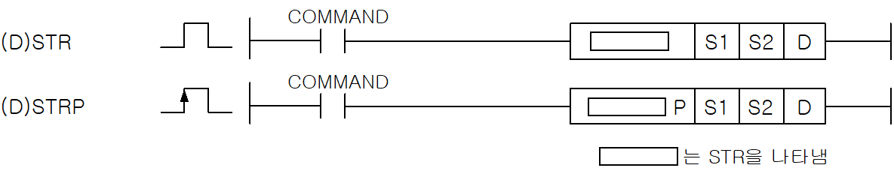
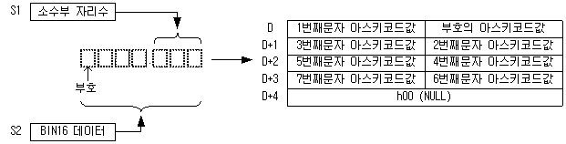
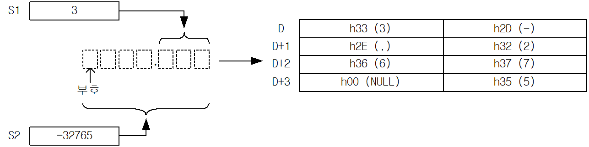
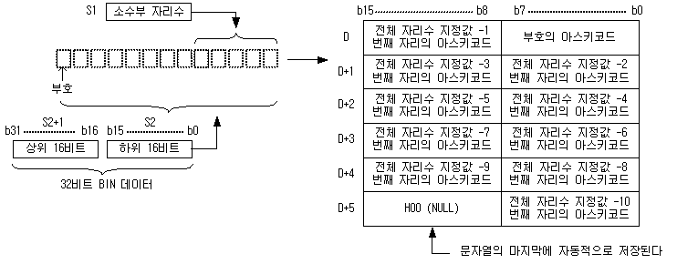
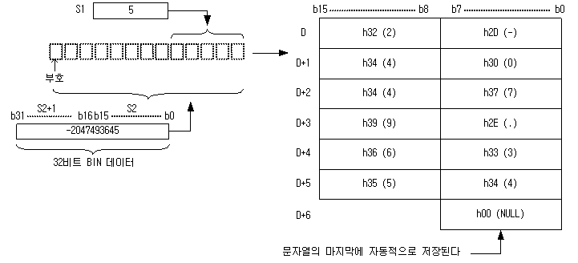

# STRP

Manual section(s): 4.26.8. Original Korean notes below may cover the other variants on the same page; apply the widths and execution form of `STRP`.

Execution form: the source explicitly pairs this command as `(P)`; `STRP` is the pulse-type P form. Manual §2.4.2 defines `P` as pulse-type notation. Select the paired forms deliberately and retain the instruction's actual execution conditions; unrelated mnemonics ending in P are not classified by suffix alone.

## Editing route

Use `get_ir` → `apply_patch` for this instruction edit. `insert_ladder_instruction` is the internal writer route, not a separate MCP tool. Preserve the exported revision and native constraints.
The writer mnemonic is `STRP`; the catalog records opcode `698` and `3` operands in order.
Inspect the CPU/project and target cells first. Use the inspected revision and positions, preserve expected values, dry-run when useful, then save and inspect the result. See the [editing skill](../../SKILL.md) and [ladder workflow](../ladder.md).

## Operands

| Order | Operand | Description (Korean manual) | Reviewed types | Device areas | Constant |
| --- | --- | --- | --- | --- | --- |
| 1 | S1 | S2의 소수부 자리수를 저장하고 있는 데이터 주소(0~28) | WORD | PMK, L, Z, U, N, D, R | Not allowed |
| 2 | S2 | 변환할 BIN데이터 | INT/DINT | PMK, L, T, C, Z, U, N, D, R | Allowed |
| 3 | D | 변환한 문자열을 저장할 주소 | STRING | PMK, L, Z, U, N, D, R | Not allowed |

These are the current library's reviewed operand rules. A shared type union is not a per-variant type choice; use the manual behavior to select the required width. Missing permissions stay unknown.

## CPU and acceptance

No separately reviewed CPU-model restriction is available in the current catalog; this means unknown, not universal compatibility.
Check the applicable model, firmware, modules and memory spans stated in the manual notes. Local parsing, writer validation and IL conversion do not prove native compilation or PLC behavior. Native acceptance requires XG5000 Open → Check Program → Save As → comparison.

## Manual flags

- STR (String)
- S2로 지정된 BIN16비트 데이터를 S1으로 지정된 위치에 소수점을 부가하여 문자열로 변환하여 D로 지정된 디바이스 번호 이후에 저장합니다.
- S1은 소수부 자리수를 나타냅니다.
- S1이 0~28이외의 범위일 때 에러 플래그를 셋(Set)합니다.
- BIN16 데이터 이상의 소수부 자리수를 지정할 경우 부족한 부분은 0을 추가합니다.
- 입력한 BIN16 데이터가 음수일 때 문자열 앞에 ‘-‘(h2D)를 붙입니다.
- DSTR (Double String)
- S2로 지정된 BIN 32비트 데이터를 S1으로 지정된 위치에 소수점을 부가하여 문자열로 변환하여 D로 지정된 디바이스 번호 이후에 저장합니다.
- S1은 소수부분 자리수를 나타냅니다.
- S1이 0~28 이외의 범위일 때 에러 플래그를 셋(Set)합니다.

| 플래그 | 내 용 | 디바이스 번호 |
| --- | --- | --- |
| 에러 | 소수부 자리수 지정이 0~28 이외의 값일 때 셋(Set) 합니다 | F110 |

## Manual applicability and restrictions

- 적용 기종 : XGK, XGB

## Manual flag and step matrix

The shared usage table marks affected flags with `O`, and `-` where it lists no effect. Native steps are the manual's instruction size, not the number of operand arguments. Conditions for setting/clearing flags are in the behavior notes.

| Manual instruction group | Native steps | 에러 (F110) | 제로 (F111) | 캐리 (F112) |
| --- | --- | --- | --- | --- |
| STR(P) DSTR(P) | 4~6 | O | - | - |

## Referenced manual figures

These figures belong to the shared source topic. Read the source corrections above before using variant-specific layouts or example values.

## Provenance

Source: `XGK(B)InstructionHelp_Kr_V3.5.chm`, SHA-256 `b866d589d800addcb039f9f09b182592464d6367faa55abf6dde9ac34a1580e0`.

- `4268strstrp.htm` — §4.26.8; source SHA-256 `9d013ed3ab8f8e708178f48dfdb2fc5081b3c5cb7f374d5c9c8f65a2d406a9ae`.
- Additional behavior/operand evidence: `4268strstrp.htm`, `245.htm`.
